# Лаба 1 — Свой Docker
## Часть 0 — Свой сервис
Был создан небольшой [service]() на Python c тремя эндпоинтами:
| Эндпоинт | Что делает |
|---|---|
| `/health` | Возвращает `ok` |
| `/eat?mb=N` | Выделяет N МиБ памяти и удерживает её; повторные запросы добавляют память |
| `/burn` | Запускает бесконечную нагрузку на одно ядро CPU |

## Часть 1 — Запуск напрямую
После запуска, сервис отдает `ok` при открытии в браузере:


PID процесса на хосте: 289524

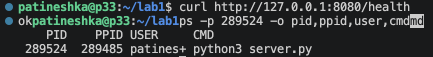

## Часть 2 — Namespaces
Процесс был помещен в отдельные namespaces с помощью команды unshare:
```
patineshka@p33:~/lab1/api$ unshare --user --map-root-user --pid --fork \
  --mount --mount-proc --net --uts --ipc \
  sh -c 'hostname lab1; ip link set lo up; exec python3 server.py'
```
Однако при первом запуске команды возникла ошибка: ```unshare: write failed /proc/self/uid_map: Operation not permitted```
Она возникла из-за того, что ```unshare``` является ```unprivileged_userns```:

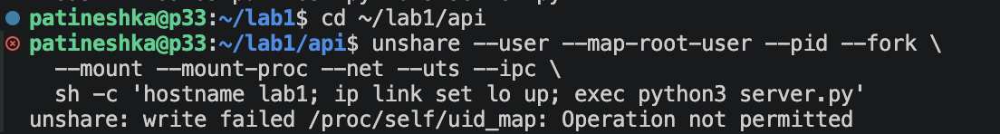
После выполнения лабораторной было временно разрешены непривилегированные user namespace и процесс заново был помещен в namespace:

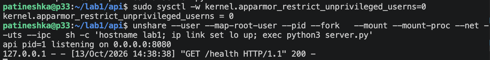

При запуске от обычного пользователя UID 0 внутри соответствует UID 1000 снаружи:
```text
Внутри: PID 1, UID 0
Снаружи: PID 290102, UID 1000
uid_map: 0 1000 1
```
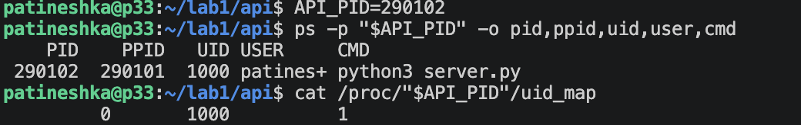

Для проверки был выполнен вход через `nsenter`. Внутри namespace:
- Сервис работает с PID 1, процессы основной Ubuntu не видны
- Имя хоста — `lab1`
- В сети есть только включённый интерфейс `lo`
- Пользователь — root, но снаружи процесс принадлежит обычному пользователю
- `/health` возвращает `ok`
- 
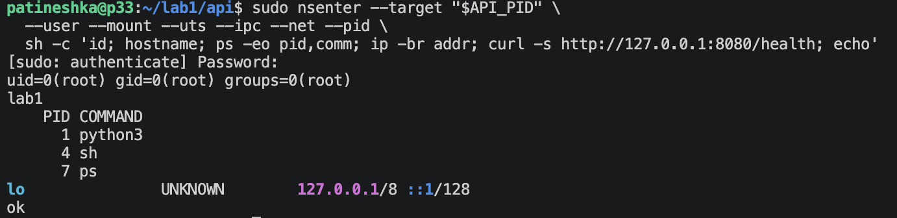

## Часть 3 — Cgroups
### 3.1 Память
Был создан `/sys/fs/cgroup/lab1`, в котором заданы:
- `memory.max = 134217728` — ограничение памяти 128 МиБ.
- `memory.swap.max = 0` — запрет использования swap.
- В `cgroup.procs` записан PID процесса.
- 
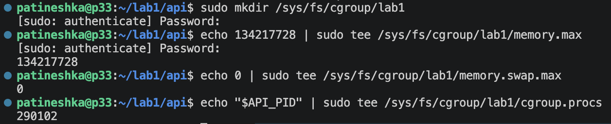

После запуска `http://127.0.0.1:8080/eat?mb=256` процесс был остановлен OOM_Kill:

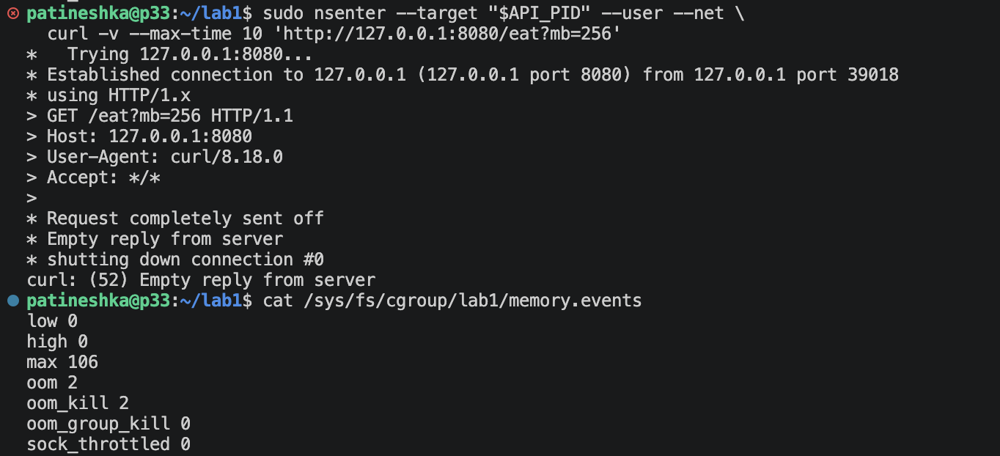

### 3.2 CPU
После повторного запуска API был задан cpu.max = 50000 100000. То есть использование примерно половины одного ядра (50 мс процессорного времени на период 100 мс)
Был запущен `http://127.0.0.1:8080/burn` и подтвержден throttling. 
```text
nr_throttled: 0 → 382
throttled_usec: 0 → 16161693
```
Процесс остался жив, но после исчерпания квоты ждал ее пополнения:

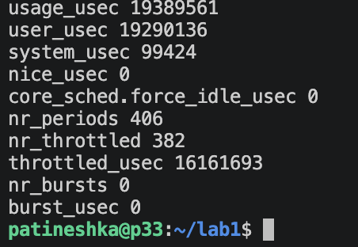

### 3.3 Память
Был задан pids.max = 16. Для проверки использовался `stress-ng`:
```bash
stress-ng --fork 1 --fork-max 64 --timeout 10s --metrics-brief
```
При первом запуске появилась ошибка `stress-ng: not found`. Установка пакета до этого не завершилась из-за временной ошибки разрешения имени `pt.archive.ubuntu.com`. Были проверены маршрут, доступ по IP и DNS. После восстановления разрешения имен установка была повторена.


Полученный результат:

```text
pids.max: 16
pids.events: max 59201 - дро отклонило создание новых задач из-за лимита
```

Уже существующие процессы из-за достижения `pids.max` не убивались:

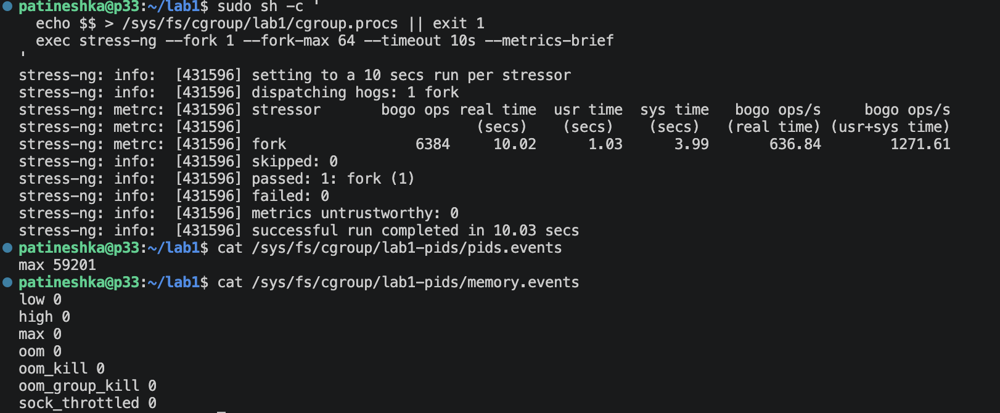

## Часть 4 — Права
### 4.1 Capabilities

В отдельном user и UTS namespace была проверена смена имени хоста. До удаления capabilities команда выполнялась:

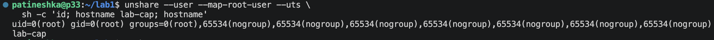

После `capsh --drop=all` был получен отказ. Для смены hostname требуется `CAP_SYS_ADMIN`. UID 0 без этой привилегии не позволил выполнить действие:

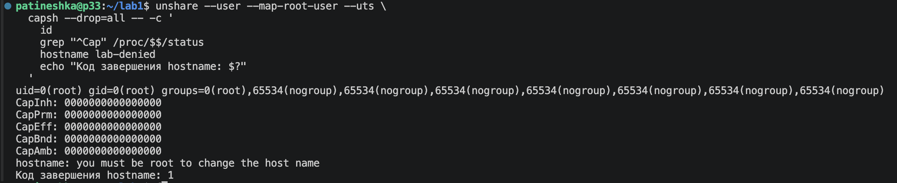

При этом UID оставался равен 0, а все маски capabilities стали нулевыми:

```text
CapInh: 0000000000000000
CapPrm: 0000000000000000
CapEff: 0000000000000000
CapBnd: 0000000000000000
CapAmb: 0000000000000000
```

Затем без capabilities был запущен сам API. Сервис продолжил отдавать `ok` на `/health`.

Имя хоста и сеть настраиваются до удаления прав: смена hostname требует `CAP_SYS_ADMIN`, а включение `lo` — `CAP_NET_ADMIN`.


### 4.2 Seccomp

Сначала был проверен запрет системного вызова `uname` через `systemd-run`. 
Обычная команда `uname -a` работает:

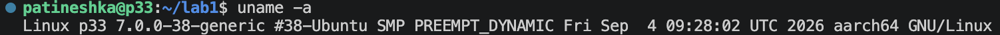

Под seccomp-фильтром завершается с ошибкой:

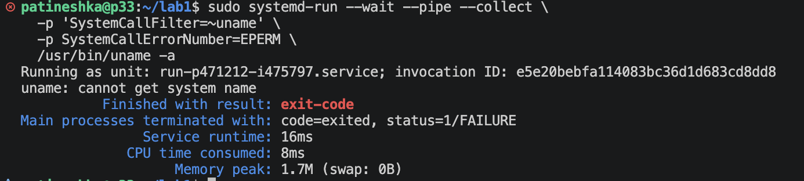

Что закрывает каждый механизм: Capabilities ограничивают привилегированные операции, а seccomp фильтрует системные вызовы. 

## Часть 5 — Сборка Docker
Все сделанное выше (создание cgroup с ограничением памяти, CPU и числа задач, создание namespace, настройка имени хоста, удаление capabilities и запуск API) было описано в `mydocker.sh`. Сервис поднимается и /health отвечает:

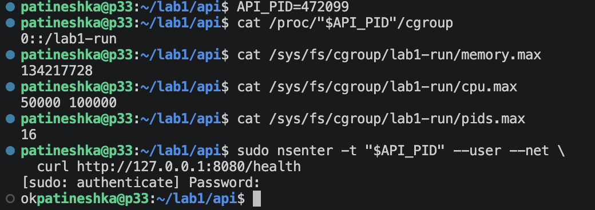

Seccomp-профиль реализован в `seccomp-run.py`. В нем задан профиль, который разрешает остальные вызовы, но для `ptrace` возвращает `EPERM`. После загрузки фильтра API запускается через `exec`.

В работающем процессе были проверены:

```text
NoNewPrivs: 1
Seccomp: 2
Seccomp_filters: 1
```
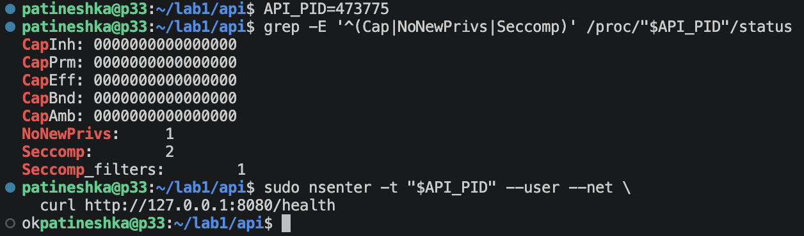

Далее в Ubuntu был установлен Docker Engine и тот же сервис запущен через `docker run`

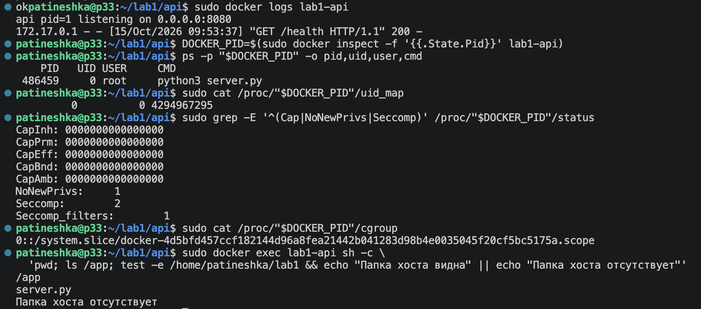

Сравнение `mydocker.sh` и Docker с `runc`:
|  | `mydocker.sh` | Docker с `runc` |
|---|---|---|
| PID внутри | 1 | 1 |
| UID на хосте | 1000 | 0 |
| Отображение UID | 0 внутри → 1000 снаружи | 0 внутри → 0 снаружи |
| Корневая ФС | Файловая система Ubuntu | Файловая система образа |
| Сеть | Только loopback | Сеть Docker и опубликованный порт |
| Capabilities | Все удалены | Все удалены через `--cap-drop=ALL` |
| Seccomp | Запрет `ptrace` | Стандартный профиль Docker |
| Cgroup | Создана скриптом | Создана Docker |

## Часть 6 — Образы
Для сервиса был написан Dockerfile на основе `python:3.14-slim`:

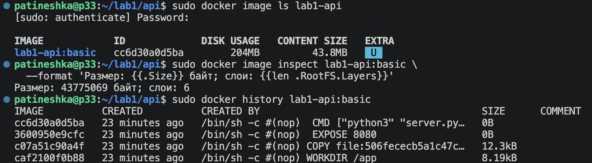

Затем была выполнена multi-stage-сборка:

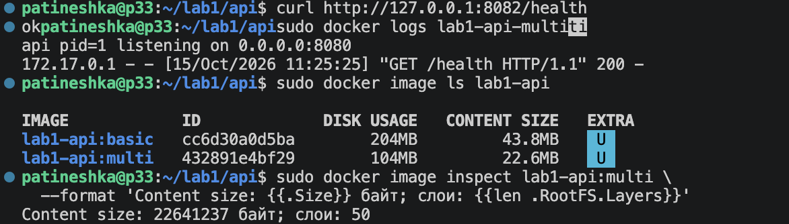

Результаты сравнения:

| Образ | Disk usage | Content size | Количество слоёв |
|---|---:|---:|---:|
| `lab1-api:basic` | 204 MB | 43,8 MB | 6 |
| `lab1-api:multi` | 104 MB | 22,6 MB | 50 |

Размер уменьшился примерно в два раза.

При повторной сборке использовался кэш. Изменение только `server.py` не требует повторного скачивания уже имеющегося базового образа.

### Сохранение файлов
В контейнер был записан `/tmp/probe.txt`. После удаления контейнера и создания нового из того же образа файл отсутствовал, так как он находился в записываемом слое удалённого контейнера

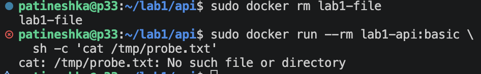

Для того, чтобы сохранить файл после удаления был создан volume `lab1-data`, подключённым в `/data`:

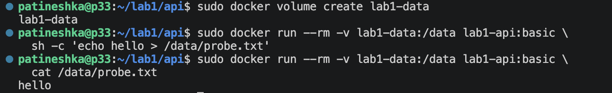

## Часть 7 — gVisor
Для запуска образа под gVisor был добавлен официальный APT-репозиторий и установлен `runsc`:

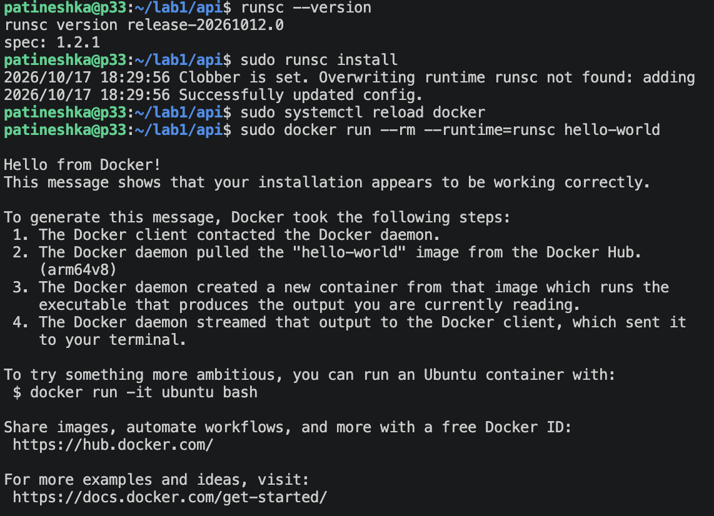

Затем тот же образ `lab1-api:basic` был запущен под gVisor. Сервис отдает `ok`, внутри работает `python3` с PID 1:

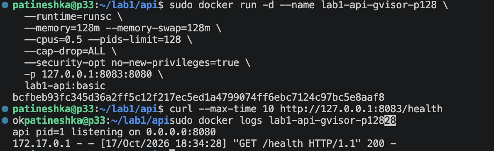

Проверка версии ядра показала:

| Где выполнена команда | `uname -r` |
|---|---|
| Ubuntu VM | `7.0.0-38-generic` |
| Docker с `runc` | `7.0.0-38-generic` |
| Docker с `runsc` | `4.19.0-gvisor` |

`4.19.0-gvisor` — версия интерфейса ядра, которую представляет gVisor, а не отдельное загруженное ядро Linux 4.19

| | `mydocker.sh` | Docker с `runc` | Docker с `runsc` |
|---|---|---|---|
| Обработка вызовов приложения | Ядро Ubuntu | Ядро Ubuntu | Sentry |
| Корневая ФС | ФС Ubuntu | ФС образа | ФС образа, доступ через механизмы gVisor |
| Процессы со стороны хоста | Процесс API | Процесс API | Процессы sandbox |
| Дополнительный слой изоляции | Настроенные namespaces и ограничения | Ограничения контейнера | Sentry и Gofer поверх ограничений хоста |

Обычный контейнер разделяет ядро Linux с хостом. Namespaces не создают отдельное ядро, поэтому его уязвимости остаются пределом такой изоляции

В gVisor системные вызовы приложения обрабатывает Sentry, который сам использует ограниченный набор возможностей ядра хоста. Gofer обслуживает доступ к файловой системе. Это уменьшает прямую доступность интерфейса ядра для приложения, но не означает полной неуязвимости

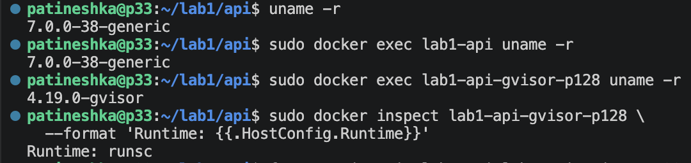

## Часть 8 - Мониторинг

Для чтения метрик обычного Docker-контейнера был создан `monitoring/exporter.py`. Он читает файлы cgroup и отдает значения на `127.0.0.1:9105/metrics`

Были запущены Prometheus и Grafana. Prometheus опрашивает экспортер каждые 5 секунд и хранит историю в отдельном томе `lab1-prometheus-data`. Grafana использует Prometheus как источник данных
Проверка работы Prometheus:
```
patineshka@p33:~/lab1$ curl -fsSG http://127.0.0.1:9090/api/v1/query 
  --data-urlencode 'query=up'
{"status":"success","data":{"resultType":"vector","result":[{"metric":{"name":"up","instance":"127.0.0.1:9105","job":"lab1-api"},"value":[1792265873.582,"1"]}]}}
```

### Дашборд

В графане были пдобавлены три графика:

| Панель | Зачем нужна | Запрос в графана |
|---|---|
| Память, % от лимита | Показывает запас памяти до установленного ограничения | `100 * lab1_memory_usage_bytes{job="lab1-api"}
  / lab1_memory_limit_bytes{job="lab1-api"}` |
| Использование CPU, % одного ядра | Показывает фактическое потребление процессорного времени | `100 * rate(lab1_cpu_usage_seconds_total{job="lab1-api"}[1m])` |
| Периоды с CPU throttling, % | Показывает, как часто контейнер исчерпывает квоту CPU | `100 * rate(lab1_cpu_throttled_periods_total{job="lab1-api"}[1m]) / clamp_min(rate(lab1_cpu_periods_total{job="lab1-api"}[1m]), 0.000001)` |

После `/burn` CPU вырос примерно до 50%, throttled до 100%, а память почти не менялась. После `/eat` график памяти вырос.

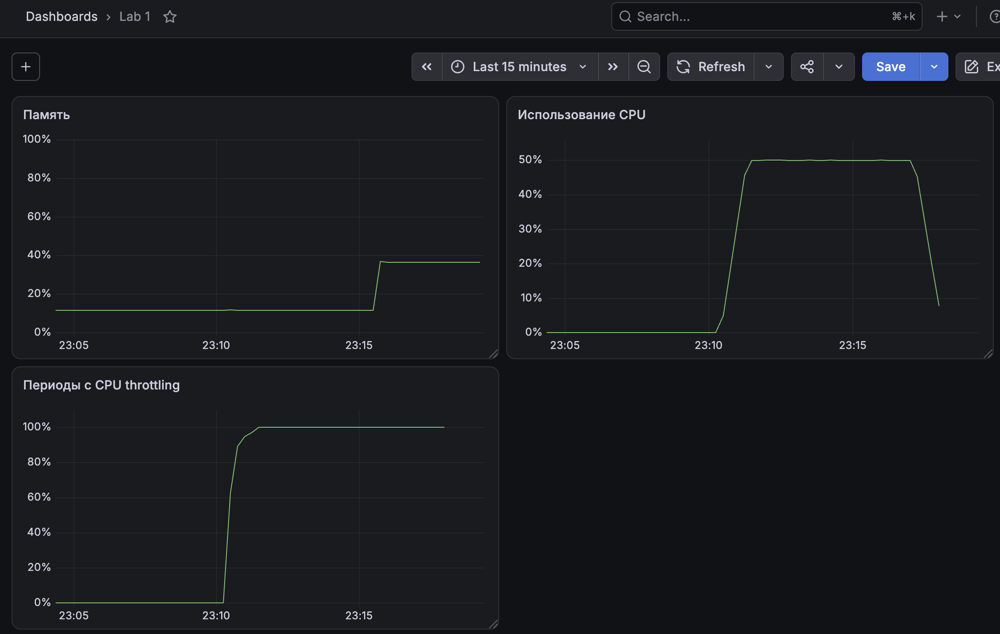

### Алерты

Правила записаны в `monitoring/alerts.yml`. Проверка через `promtool` подтвердила корректность правил:
```
patineshka@p33:~/lab1$ sudo docker run --rm   --mount type=bind,src="$HOME/lab1/monitoring",dst=/etc/prometheus,readonly   --entrypoint /bin/promtool   prom/prometheus:latest   check config /etc/prometheus/prometheus.yml
           
Checking /etc/prometheus/prometheus.yml
  SUCCESS: 1 rule files found
 SUCCESS: /etc/prometheus/prometheus.yml is valid prometheus config file syntax

Checking /etc/prometheus/alerts.yml
  SUCCESS: 3 rules found
```

| Алерт | Условие | Что ловит и чем грозит |
|---|---|---|
| `Lab1HighMemory` | Память выше 80% лимита в течение 1 минуты | Предупреждает об уменьшении запаса памяти. Возможны ошибки выделения и OOM |
| `Lab1CPUThrottling` | Более 20% периодов с throttling в течение 1 минуты | Показывает возможную нехватку квоты CPU. Запросы могут обрабатываться медленнее |
| `Lab1OOMKill` | Рост счетчика OOM kills за последние 5 минут | Сообщает, что ядро уже убило процесс из-за нехватки памяти |


Срабатывание алерта `Lab1CPUThrottling` было подтверждено состоянием `firing` после нагрузки через `/burn`:

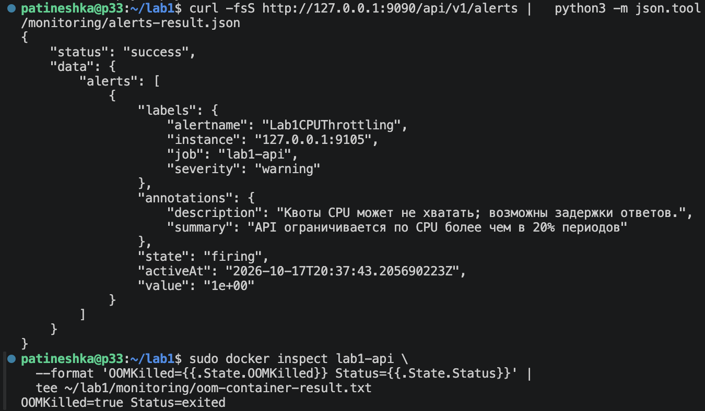


Срабатывание алерта `LablHighMemory` было подтверждено после нагрузки через `/eat?mb=`:

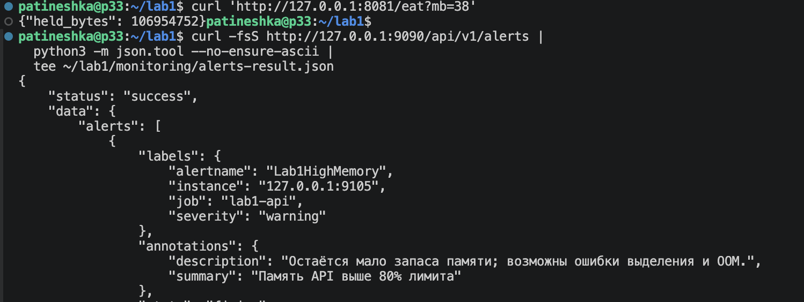


## Топ ошибок 

К сожалению, при выполнении лабораторной работы не пришлось без приключений. Вот мой топ затыков (затупов):
1. Не сохраняла файлы и не понимала, почему ничего не работает.
В какой-то момент скрипт просто молча завершался без ошибок. Оказалось, что файл с seccomp-фильтром был пустой. Так еще несколько раз повторялось с другим файлами)
   
2. После перегрузки памяти не сработал алерт на OOM_Kill.
Сервис спокойно держал больше 600 МБ при лимите 128 МБ. Оказалось, что ограничение RAM работало, но swap фактически оставался неограниченным. После явного запрета swap все наконец пошло по плану.

3. Виртуалка жила в прошлом. В Ubuntu было 15 октября, а лабу я делала 17. APT отказывался принимать обновления «из будущего», поэтому вместо свежего gVisor устанавливалась версия за 2024 год. Пришлось чинить время.

Самая главная ошибка - писать отчет после выполнения лабы, потому что вспоминать, что было сделано и разбираться в 1001 скрине было тяжковато...
