# Лаба 2 - Мониторинг сервиса: метрики, логи, трейсы
## Часть 0 — Свой сервис + настройка k8s

### Подготовка кластера
Для подготовки кластера и определения его размера необходимо понять, какие доступные ресурсы имеются на ВМ (у меня это Ubuntu Server ARM64 в UTM):

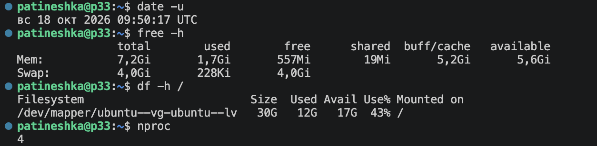

На этом этапе обнаружились две проблемы: 
- Виртуалка снова живет в прошлом (мой затык в прошлой лабе)
- У VM 7,2 ГиБ RAM и 17 ГБ свободного места - в целом окей, но на всякий случай добавлю

Было сделано несколько простых махинаций:
- для исправления времени
```
patineshka@p33:~$ sudo timedatectl set-ntp false
patineshka@p33:~$ 
patineshka@p33:~$ sudo timedatectl set-ntp true
patineshka@p33:~$ date -u
пн 19 окт 2026 18:27:18 UTC
```
- для увеличения памяти

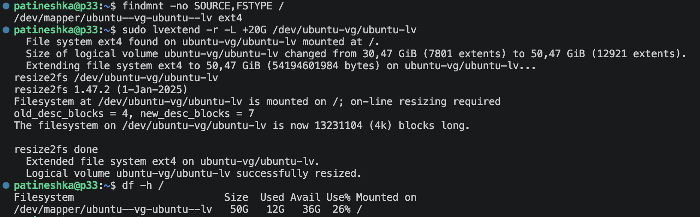

Осталось установить необходимые инструменты: 
1. Minikube - для создания локального кластера 
```
curl -fLO https://github.com/kubernetes/minikube/releases/latest/download/minikube-linux-arm64
sudo install -m 0755 minikube-linux-arm64 /usr/local/bin/minikube
```
2. Helm - для разворачивания сервиса и компонентов мониторинга
```
curl -fsSL -o get_helm.sh https://raw.githubusercontent.com/helm/helm/main/scripts/get-helm-4
```

Проверка установки: 

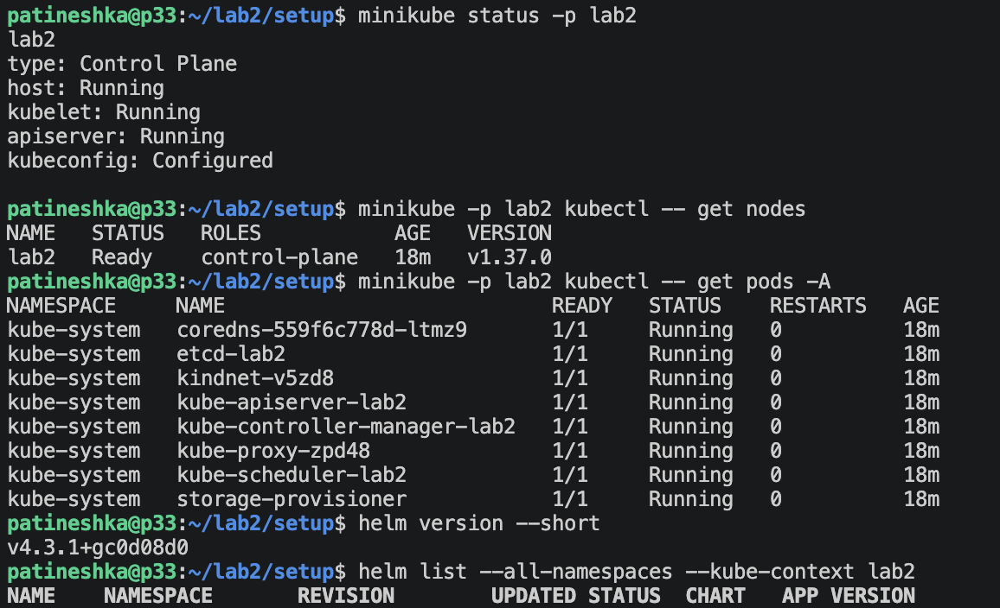

### Разворачивание сервиса 

Для сервиса были подготовлены файлы server.py, requirements.txt, Dockerfile и собран образ в minikube:
```
minikube -p lab2 image build -t lab2-api:v1 ~/lab2/api

patineshka@p33:~/lab2/setup$ minikube -p lab2 image ls | grep lab2-api
docker.io/library/lab2-api:v1
```

Далее был создан Helm Chart - файлы для запуска API в k8s:
- Chart.yaml - описывает пакет: название, версию chart и версию приложения
- values.yaml	- хранит изменяемые настройки, такие как имя образа, тег и ресурсы
- templates/deployment.yaml	- описывает запуск и поддержание одного экземпляра API
- templates/service.yaml - создает постоянный сетевой адрес для обращения к API внутри кластера

Deployment создает под с контейнером `lab2-api:v1` и поддерживает нужное число экземпляров (в моем случае один)
Service дает постоянное имя `lab2-api` и направляет трафик к подходящим подам по метке `app: lab2-api`

Для запуска проверяем chart на ошибки и затем устанавливаем:

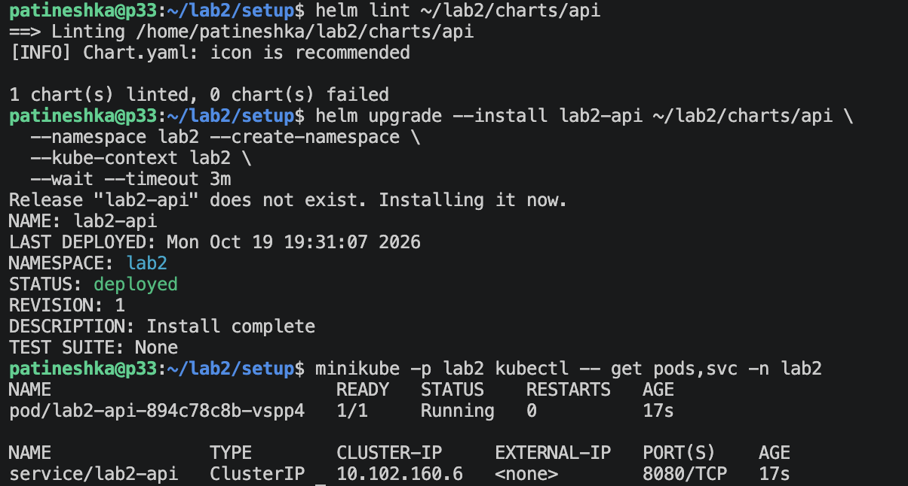

Ура! API развернут 🙂 Теперь проверим все endpoint:

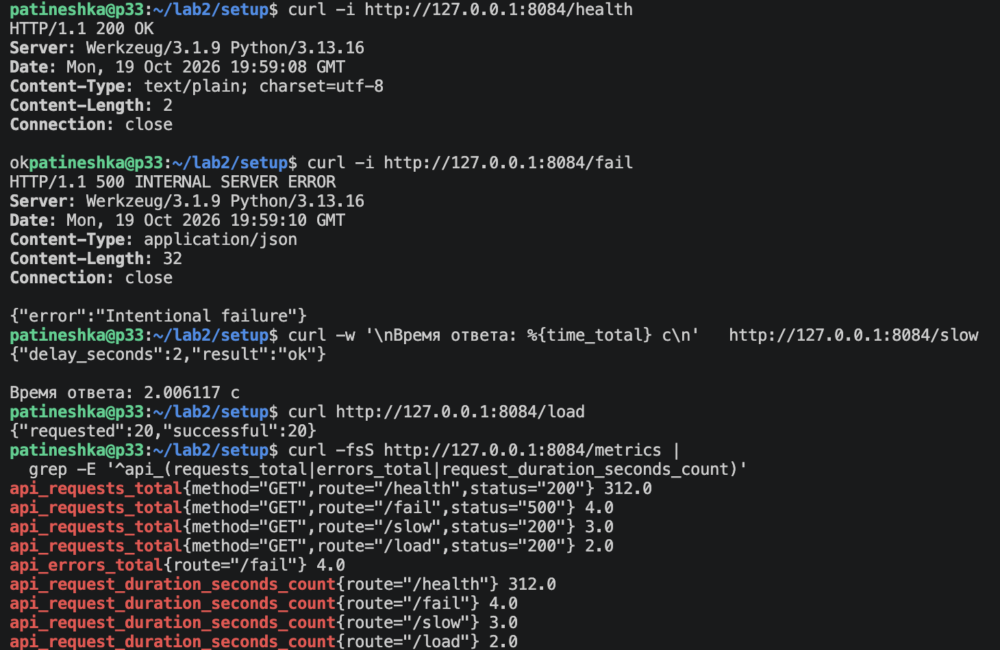

Также описание эндпоинтов:
 | Эндпоинт | Описание |
|---|---|
| `/health` | Возвращает `200 OK` и `ok` - для проверки работоспособности сервиса и Kubernetes-проб |
| `/fail` | Намеренно возвращает `500 Internal Server Error` - для проверки счетчик ошибок, логи, ошибочный спан и алерты |
| `/slow` | Выполняет операцию с задержкой 2 секунды - для проверки графика времени ответа и вложенный спан `slow-op` |
| `/load` | Делает 20 запросов к собственному `/health` - для проверки роста интенсивности запросов RPS |
| `/metrics` | Отдает метрики в формате Prometheus - количество запросов, ошибок и гистограмму времени ответа |

Observability (почти) настроен, остался мониторинг ;)

## Часть 1 — Метрики (Prometheus + Grafana)
### Prometheus
Для настройки Prometheus был добавлен Helm-репозиторий:
```
patineshka@p33:~/lab2/setup$ helm repo add prometheus-community \
  https://prometheus-community.github.io/helm-charts

helm repo update
mkdir -p ~/lab2/monitoring
"prometheus-community" has been added to your repositories
Hang tight while we grab the latest from your chart repositories...
...Successfully got an update from the "prometheus-community" chart repository
Update Complete. ⎈Happy Helming!⎈
```

Также были созданы следующие файлы:
- monitoring/values.yaml - для сохранения метрик и настройки графаны в постоянный томах. Также отключила стандартный набор правил и сбор части метрик, которые сейчас не нужны для мониторинга
- templates/servicemonitor.yaml - в нем описано, какой Service найти, какой порт и путь опрашивать для сбора метрик Prometheus оператором

Затем был установлен стек:
```
helm upgrade --install monitoring \
  prometheus-community/kube-prometheus-stack \
  --version 92.10.1 \
  --namespace monitoring --create-namespace \
  --kube-context lab2 \
  -f ~/lab2/monitoring/values.yaml \
  --wait --timeout 10m
```
Работает 🙂 :

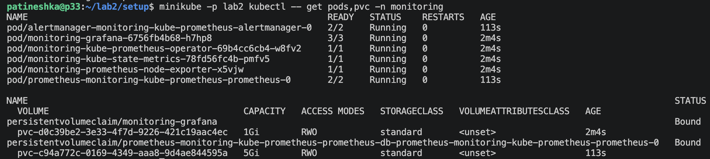

Также была обновлена установка API:

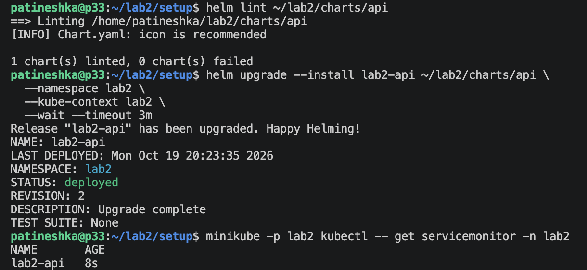

Запустила Prometheus и теперь он собирает метрики: 

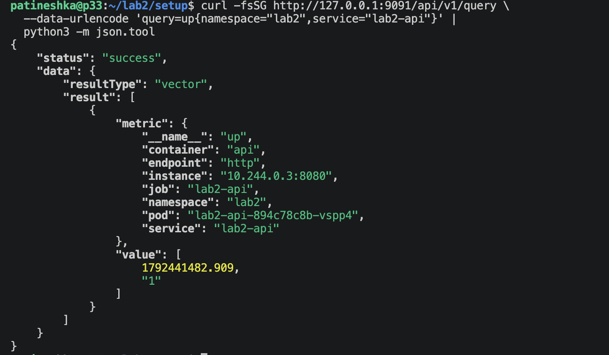

### Grafana
В графане были построены три графика:
- Интенсивность запросов, RPS - `sum(rate(api_requests_total{namespace="lab2", service="lab2-api"}[1m]))`
- Доля ошибок 5xx, % - `100 * (sum(rate(api_requests_total{namespace="lab2", service="lab2-api", status=~"5.."}[1m])) or vector(0)) / clamp_min(sum(rate(api_requests_total{
namespace="lab2", service="lab2-api"}[1m])),0.000001)`
- p95 времени ответа - `histogram_quantile(0.95, sum by (le) (rate(api_request_duration_seconds_bucket{namespace="lab2", service="lab2-api"}[1m])))`

С помощью эндпоинта /load были инициировано 20 запросов к /health и график "Интенсивность запросов" вырос до 5 req/s 

Вызов 20 раз эндпоинта /fail увеличил долю ошибок на соответствующем графике до ~80%

Эндпоинт /slow позволил проверить график "p95 времени ответа"

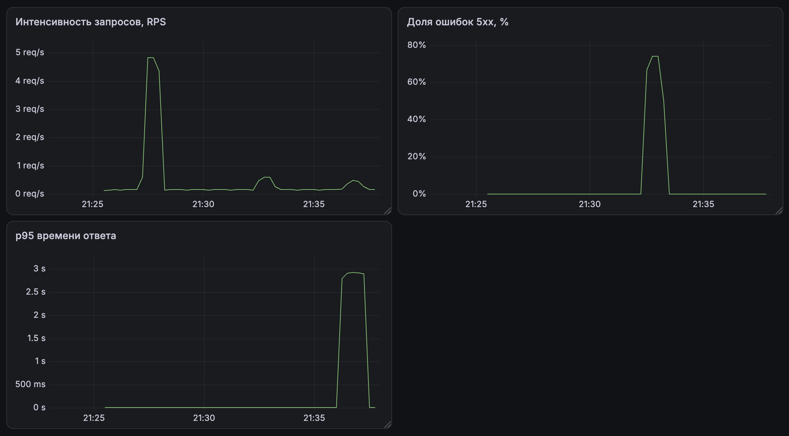

## Часть 2 — Логи (Loki + Grafana)
Начинаются флэшбеки с написания диплома... (благо не Elasticsearch..)

### Loki
Для настройки Loki был добавлен Helm-репозиторий:
```
patineshka@p33:~/lab2/setup$ helm repo add grafana https://grafana.github.io/helm-charts
"grafana" has been added to your repositories
patineshka@p33:~/lab2/setup$ helm repo add grafana-community \
  https://grafana-community.github.io/helm-charts
"grafana-community" has been added to your repositories
patineshka@p33:~/lab2/setup$ helm repo update
Hang tight while we grab the latest from your chart repositories...
...Successfully got an update from the "grafana-community" chart repository
...Successfully got an update from the "grafana" chart repository
...Successfully got an update from the "prometheus-community" chart repository
Update Complete. ⎈Happy Helming!⎈
```

Был добавлен файл `loki-values.yaml`, в котором настроены все основные функции Loki, для работы в одном процессе. Логи хранятся в файловой системе на томе. Отдельные распределенные компоненты и кэши отключены. Для одного экземпляра задан replication_factor: 1

Затем был установлен стек:
```
helm upgrade --install loki grafana-community/loki \
  --version 18.17.1 \
  --namespace monitoring \
  --kube-context lab2 \
  -f ~/lab2/monitoring/loki-values.yaml \
  --wait --timeout 10m
```
Все запустилось, под работает 🙂 :

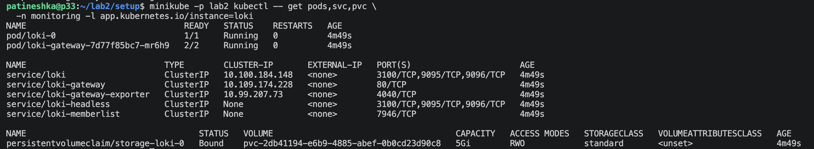

### Alloy
Для сбора логов сначала хотела подключить Promtail, но увидела, что он не больше не поддерживается (https://grafana.com/docs/loki/latest/send-data/promtail/). Для лабы скорее всего хватило бы последней версии, но хочется попробовать что-то новое. Поэтому настрою Alloy

Был добавлен файл `alloy-values.yaml`, в котором:
- /var/log ноды подключается к агенту
- local.file_match находит файлы API
- loki.source.file читает строки
- stage.cri снимает служебную обертку containerd
- loki.write отправляет строки в Loki

Также все устанавливаем: 
```
helm upgrade --install alloy grafana/alloy \
  --version 1.14.0 \
  --namespace monitoring \
  --kube-context lab2 \
  -f ~/lab2/monitoring/alloy-values.yaml \
  --wait --timeout 5m
```
Работает 🙂 :

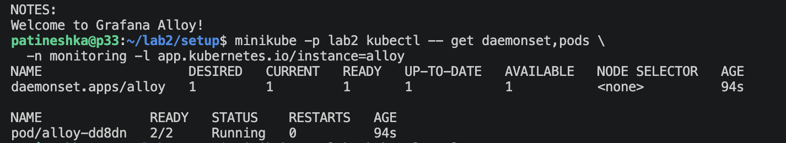

В explorer в Grafana был найден JSON-лог с /fail, статусом 500 и trace_id (соответственно после того как был вызван этот эндпоинт):

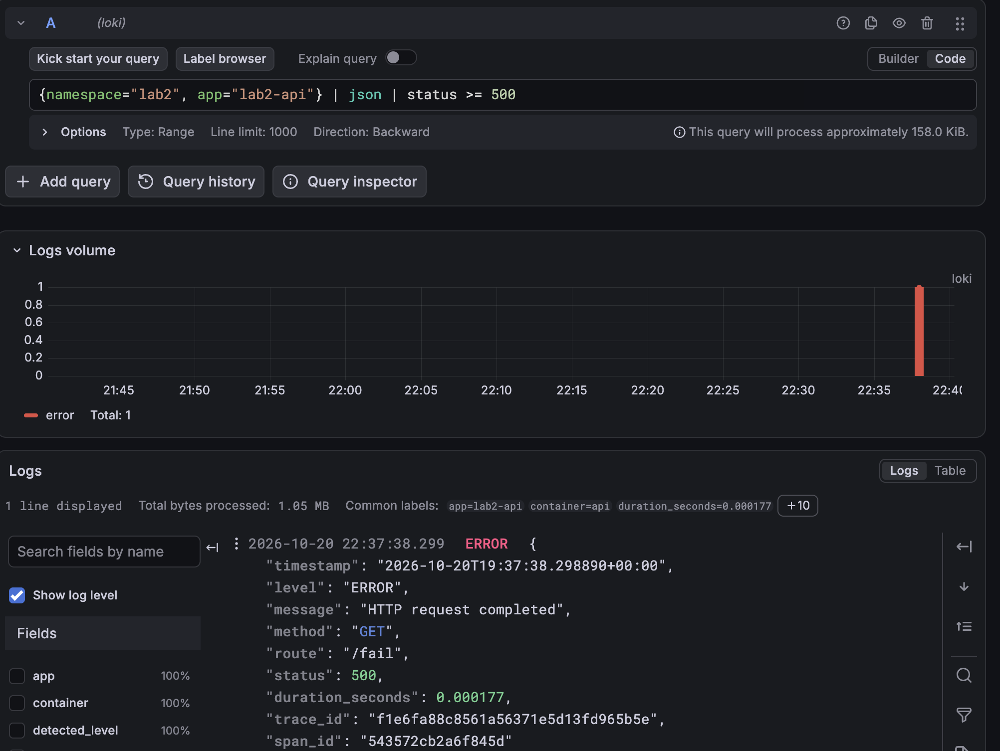

Также я еще добавила timechart по http-статусам:

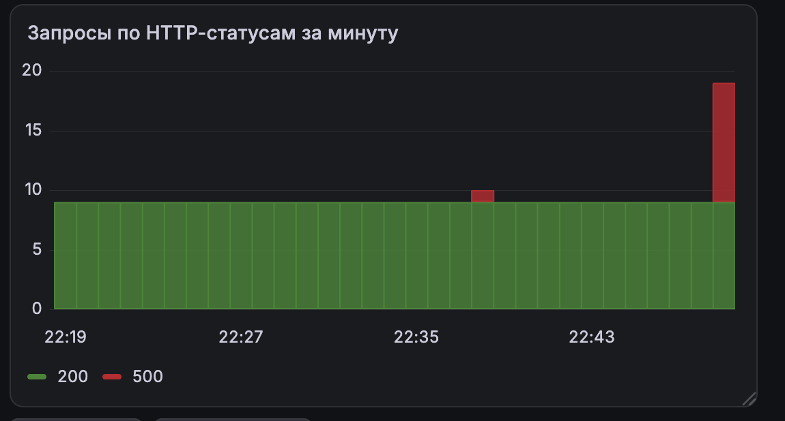

##Часть 3 — Трейсы (OpenTelemetry + Jaeger)

Также был добавлен Helm-репозиторий:
```
patineshka@p33:~/lab2/setup$ helm repo add jaegertracing \
  https://jaegertracing.github.io/helm-charts
"jaegertracing" has been added to your repositories
patineshka@p33:~/lab2/setup$ helm repo update
Hang tight while we grab the latest from your chart repositories...
...Successfully got an update from the "jaegertracing" chart repository
...Successfully got an update from the "grafana-community" chart repository
...Successfully got an update from the "grafana" chart repository
...Successfully got an update from the "prometheus-community" chart repository
Update Complete. ⎈Happy Helming!⎈
```
Добавлен файл `jaeger-values.yaml`, в котором порт `4317` принимает трейсы от API, а `16686` обслуживает интерфейс просмотра через веб-интерфейс Jaeger

Установка: 
```
helm upgrade --install jaeger jaegertracing/jaeger \
  --version 4.16.1 \
  --namespace monitoring \
  --kube-context lab2 \
  -f ~/lab2/monitoring/jaeger-values.yaml \
  --wait --timeout 5m
```
Проверка работы:


Был запущен Jaeger и три эндпоинта /slow, /fail и /health. В интерфейсе Jaeger они отображаются:

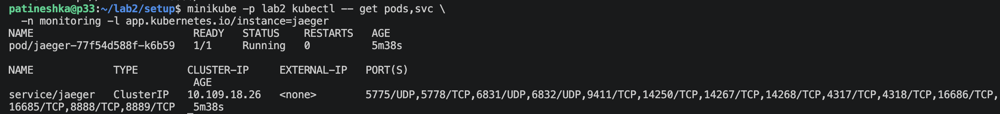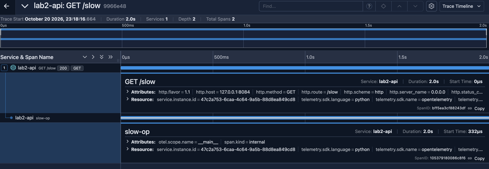

Также они найдены в Grafana по trace_id:

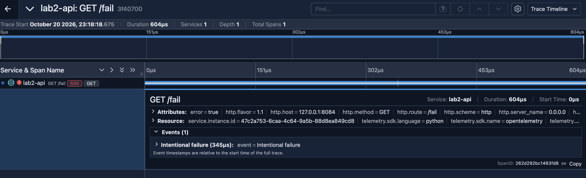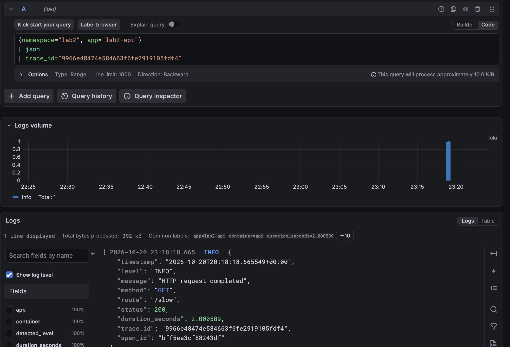

