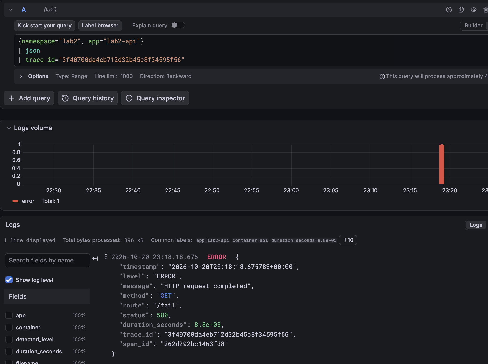
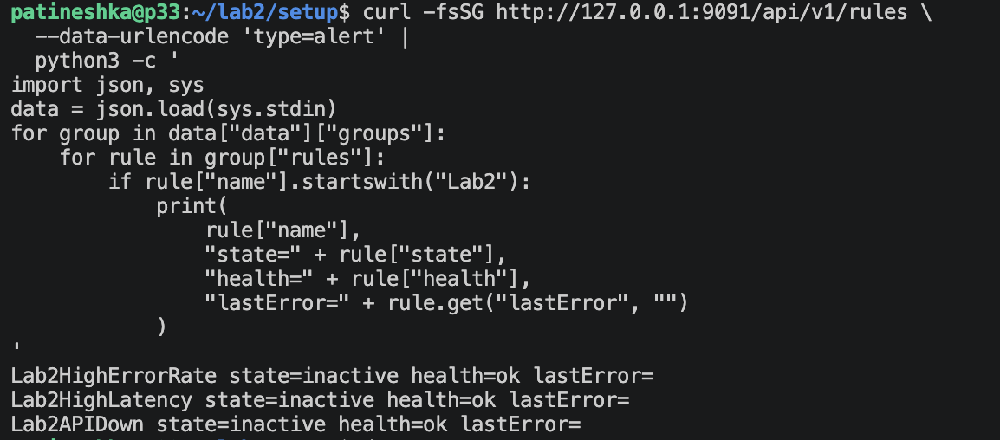
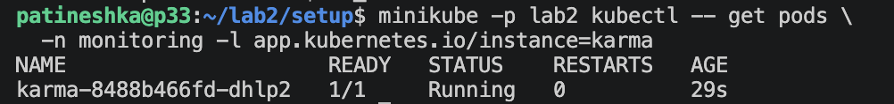
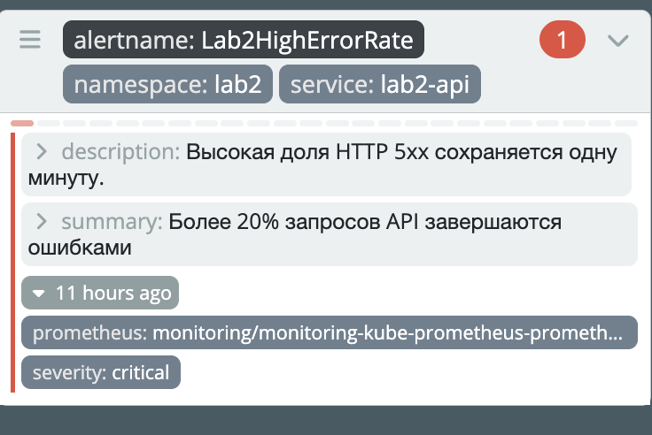
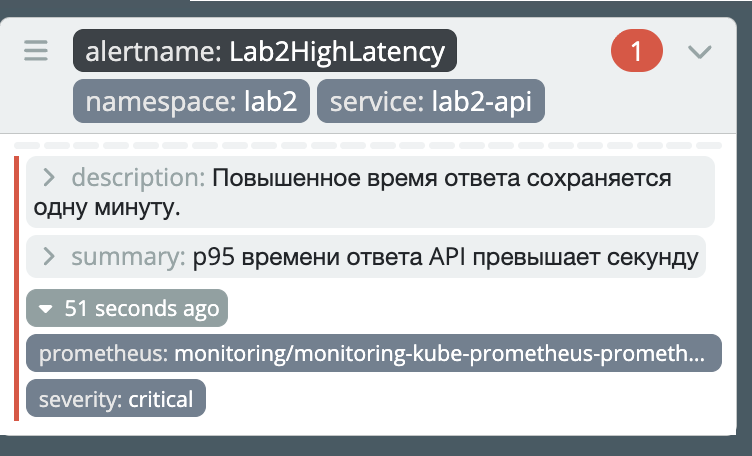
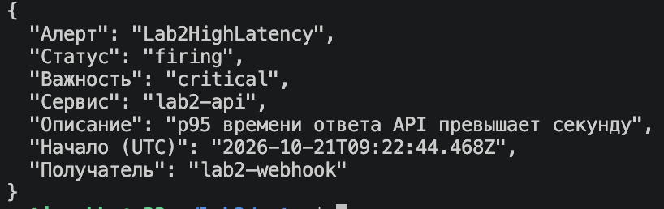
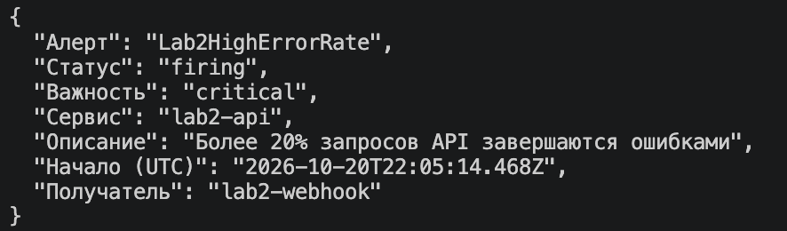
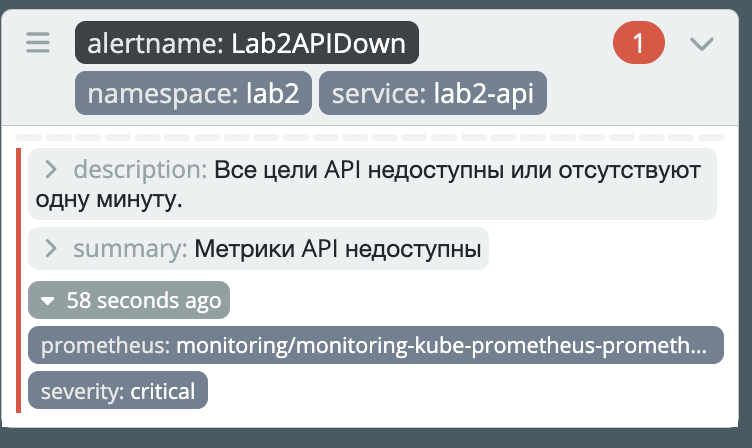
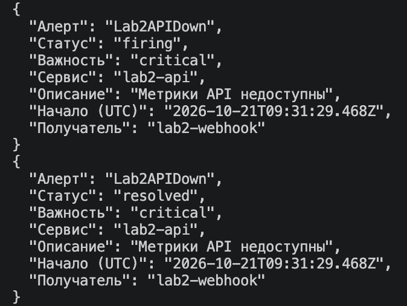

# Лаба 2 - Мониторинг сервиса: метрики, логи, трейсы
## Часть 0 — Свой сервис + настройка k8s

### Подготовка кластера
Для подготовки кластера и определения его размера необходимо понять, какие доступные ресурсы имеются на ВМ (у меня это Ubuntu Server ARM64 в UTM):


На этом этапе обнаружились две проблемы: 
- Виртуалка снова живет в прошлом (мой затык в прошлой лабе)
- У VM 7,2 ГиБ RAM и 17 ГБ свободного места - в целом окей, но на всякий случай добавлю

Было сделано несколько простых махинаций:
- для исправления времени
```
patineshka@p33:~$ sudo timedatectl set-ntp false
patineshka@p33:~$ sudo hwclock --hctosys --utc
patineshka@p33:~$ sudo timedatectl set-ntp true
patineshka@p33:~$ date -u
пн 19 окт 2026 18:27:18 UTC
```
- для увеличения памяти


Осталось установить необходимые инструменты: 
1. Minikube - для создания локального кластера 
```
curl -fLO https://github.com/kubernetes/minikube/releases/latest/download/minikube-linux-arm64
sudo install -m 0755 minikube-linux-arm64 /usr/local/bin/minikube
```
2. Helm - для разворачивания сервиса и компонентов мониторинга
```
curl -fsSL -o get_helm.sh https://raw.githubusercontent.com/helm/helm/main/scripts/get-helm-4
```

Проверка установки: 


### Разворачивание сервиса 

Для сервиса были подготовлены файлы server.py, requirements.txt, Dockerfile и собран образ в minikube:
```
minikube -p lab2 image build -t lab2-api:v1 ~/lab2/api

patineshka@p33:~/lab2/setup$ minikube -p lab2 image ls | grep lab2-api
docker.io/library/lab2-api:v1
```

Далее был создан Helm Chart - файлы для запуска API в k8s:
- Chart.yaml - описывает пакет: название, версию chart и версию приложения
- values.yaml	- хранит изменяемые настройки, такие как имя образа, тег и ресурсы
- templates/deployment.yaml	- описывает запуск и поддержание одного экземпляра API
- templates/service.yaml - создает постоянный сетевой адрес для обращения к API внутри кластера

Deployment создает под с контейнером `lab2-api:v1` и поддерживает нужное число экземпляров (в моем случае один)
Service дает постоянное имя `lab2-api` и направляет трафик к подходящим подам по метке `app: lab2-api`

Для запуска проверяем chart на ошибки и затем устанавливаем:


Ура! API развернут 🙂 Теперь проверим все endpoint:


Также описание эндпоинтов:
 | Эндпоинт | Описание |
|---|---|
| `/health` | Возвращает `200 OK` и `ok` - для проверки работоспособности сервиса и Kubernetes-проб |
| `/fail` | Намеренно возвращает `500 Internal Server Error` - для проверки счетчик ошибок, логи, ошибочный спан и алерты |
| `/slow` | Выполняет операцию с задержкой 2 секунды - для проверки графика времени ответа и вложенный спан `slow-op` |
| `/load` | Делает 20 запросов к собственному `/health` - для проверки роста интенсивности запросов RPS |
| `/metrics` | Отдает метрики в формате Prometheus - количество запросов, ошибок и гистограмму времени ответа |

Observability (почти) настроен, остался мониторинг ;)

## Часть 1 — Метрики (Prometheus + Grafana)
### Prometheus
Для настройки Prometheus был добавлен Helm-репозиторий:
```
patineshka@p33:~/lab2/setup$ helm repo add prometheus-community \
  https://prometheus-community.github.io/helm-charts

helm repo update
mkdir -p ~/lab2/monitoring
"prometheus-community" has been added to your repositories
Hang tight while we grab the latest from your chart repositories...
...Successfully got an update from the "prometheus-community" chart repository
Update Complete. ⎈Happy Helming!⎈
```

Также были созданы следующие файлы:
- monitoring/values.yaml - для сохранения метрик и настройки графаны в постоянный томах. Также отключила стандартный набор правил и сбор части метрик, которые сейчас не нужны для мониторинга
- templates/servicemonitor.yaml - в нем описано, какой Service найти, какой порт и путь опрашивать для сбора метрик Prometheus оператором

Затем был установлен стек:
```
helm upgrade --install monitoring \
  prometheus-community/kube-prometheus-stack \
  --version 92.10.1 \
  --namespace monitoring --create-namespace \
  --kube-context lab2 \
  -f ~/lab2/monitoring/values.yaml \
  --wait --timeout 10m
```
Работает 🙂 Поднялись Prometheus, Grafana, Alertmanager, оператор и экспортеры. PVC для Prometheus и Grafana перешли в `Bound`: :


После установки оператора добавила в чарт API `templates/servicemonitor.yaml`. Он описывает, какой Service найти, какой порт и путь `/metrics` опрашивать. Оператор использует ServiceMonitor для настройки сбора, а сами запросы выполняет Prometheus

Обновила установку API:


Для доступа к Prometheus:

```bash
minikube -p lab2 kubectl -- port-forward \
  -n monitoring svc/monitoring-kube-prometheus-prometheus 9091:9090
```

Проверила сбор метрик:

```bash
curl -fsSG http://127.0.0.1:9091/api/v1/query \
  --data-urlencode 'query=up{namespace="lab2",service="lab2-api"}'
```

Значение `up = 1` означает, что последний сбор метрик прошел успешно:


### Grafana
Для открытия интерфейса использовала проброс:

```bash
minikube -p lab2 kubectl -- port-forward \
  -n monitoring svc/monitoring-grafana 3001:80
```

Порт `3001` дополнительно пробросила на Mac через вкладку Ports в VSCode. Источник Prometheus уже был настроен установленным чартом

В графане были построены три графика:
- Интенсивность запросов, RPS - `sum(rate(api_requests_total{namespace="lab2", service="lab2-api"}[1m]))`
- Доля ошибок 5xx, % - `100 * (sum(rate(api_requests_total{namespace="lab2", service="lab2-api", status=~"5.."}[1m])) or vector(0)) / clamp_min(sum(rate(api_requests_total{
namespace="lab2", service="lab2-api"}[1m])),0.000001)`
- p95 времени ответа - `histogram_quantile(0.95, sum by (le) (rate(api_request_duration_seconds_bucket{namespace="lab2", service="lab2-api"}[1m])))`

Проверила реакцию графиков:
- Серия вызовов `/load` увеличила интенсивность запросов примерно до 5 req/s. Каждый вызов создает 20 внутренних запросов к `/health`
- Вызовы `/fail` увеличили долю ошибок примерно до 80% в наблюдаемом окне
- Вызовы `/slow` подняли p95. Хотя задержка задана в 2 секунды, оценка по бакетам гистограммы получилась ближе к 3 секундам


## Часть 2 — Логи (Loki + Grafana)
Начинаются флэшбеки с написания диплома... (благо не Elasticsearch..)

### Loki
Для настройки Loki был добавлен Helm-репозиторий:
```
patineshka@p33:~/lab2/setup$ helm repo add grafana https://grafana.github.io/helm-charts
"grafana" has been added to your repositories
patineshka@p33:~/lab2/setup$ helm repo add grafana-community \
  https://grafana-community.github.io/helm-charts
"grafana-community" has been added to your repositories
patineshka@p33:~/lab2/setup$ helm repo update
Hang tight while we grab the latest from your chart repositories...
...Successfully got an update from the "grafana-community" chart repository
...Successfully got an update from the "grafana" chart repository
...Successfully got an update from the "prometheus-community" chart repository
Update Complete. ⎈Happy Helming!⎈
```

Был добавлен файл `loki-values.yaml`, в котором настроены все основные функции Loki, для работы в одном процессе. Логи хранятся в файловой системе на томе. Отдельные распределенные компоненты и кэши отключены. Для одного экземпляра задан replication_factor: 1

Затем был установлен стек:
```
helm upgrade --install loki grafana-community/loki \
  --version 18.17.1 \
  --namespace monitoring \
  --kube-context lab2 \
  -f ~/lab2/monitoring/loki-values.yaml \
  --wait --timeout 10m
```
Все запустилось, под работает 🙂 :


### Alloy
Для сбора логов сначала хотела подключить Promtail, но увидела, что он не [больше не поддерживается](https://grafana.com/docs/loki/latest/send-data/promtail/). Для лабы скорее всего хватило бы последней версии, но хочется попробовать что-то новое. Поэтому настрою Alloy

Был добавлен файл `alloy-values.yaml`, в котором:
- /var/log ноды подключается к агенту
- local.file_match находит файлы API
- loki.source.file читает строки
- stage.cri снимает служебную обертку containerd
- loki.write отправляет строки в Loki

Также все устанавливаем: 
```
helm upgrade --install alloy grafana/alloy \
  --version 1.14.0 \
  --namespace monitoring \
  --kube-context lab2 \
  -f ~/lab2/monitoring/alloy-values.yaml \
  --wait --timeout 5m
```
Работает 🙂 :


В explorer в Grafana был найден JSON-лог с /fail, статусом 500 и trace_id (соответственно после того как был вызван этот эндпоинт):


Также я еще добавила timechart по http-статусам:


## Часть 3 — Трейсы (OpenTelemetry + Jaeger)

Сервис инструментирован через OpenTelemetry:
- `FlaskInstrumentor` автоматически создает корневые спаны входящих HTTP-запросов
- `RequestsInstrumentor` инструментирует исходящие запросы библиотеки requests, в том числе из `/load`
- внутри `/slow` вручную создан вложенный спан `slow-op`
- для `/fail` устанавливается статус ошибки и добавляется событие `Intentional failure`
- в JSON-логи записываются `trace_id` и `span_id` текущего спана

Добавила Helm-репозиторий:
```
patineshka@p33:~/lab2/setup$ helm repo add jaegertracing \
  https://jaegertracing.github.io/helm-charts
"jaegertracing" has been added to your repositories
patineshka@p33:~/lab2/setup$ helm repo update
Hang tight while we grab the latest from your chart repositories...
...Successfully got an update from the "jaegertracing" chart repository
...Successfully got an update from the "grafana-community" chart repository
...Successfully got an update from the "grafana" chart repository
...Successfully got an update from the "prometheus-community" chart repository
Update Complete. ⎈Happy Helming!⎈
```
Добавлен файл `jaeger-values.yaml`, в котором порт `4317` принимает трейсы от API, а `16686` обслуживает интерфейс просмотра через веб-интерфейс Jaeger

Установка: 
```
helm upgrade --install jaeger jaegertracing/jaeger \
  --version 4.16.1 \
  --namespace monitoring \
  --kube-context lab2 \
  -f ~/lab2/monitoring/jaeger-values.yaml \
  --wait --timeout 5m
```
Проверка работы:


Был запущен Jaeger и три эндпоинта /slow, /fail и /health. В интерфейсе Jaeger они отображаются:

  

У `/slow` видны два спана: родительский `GET /slow` и вложенный `slow-op`. Почти все время запроса занимает именно `slow-op`

У `/fail` видны статус `500`, отметка `error=true` и событие `Intentional failure`

Также они найдены в Grafana по trace_id:

  

В логах и Jaeger совпали идентификаторы. То есть теперь можно увидеть ошибку в Loki, взять ее `trace_id` и открыть соответствующий трейс в Jaeger 🙂

## Часть 4 — Алерты (Alertmanager + Karma)

В `monitoring/alerts-values.yaml` добавила три правила через `additionalPrometheusRulesMap`

Для всех алертов указала `severity: critical` и `for: 1m` 

| Алерт | Почему важно | Что делать дежурному |
|---|---|---|
| Lab2HighErrorRate | Более 20% запросов завершаются ошибками 5xx — пользователи не могут выполнить часть действий | Проверить логи ошибок в Loki, найти соответствующие трейсы в Jaeger, проверить последние изменения приложения |
| Lab2HighLatency | p95 времени ответа превышает секунду — пользователи долго ждут ответа | Найти медленные трейсы, определить долгую операцию, проверить нагрузку и ограничения ресурсов |
| Lab2APIDown | Prometheus не может получить метрики ни с одного экземпляра API или цели отсутствуют | Проверить Deployment, количество реплик, состояние подов, Service и readiness-пробы |

Затем были применены настройки:
```
helm upgrade monitoring prometheus-community/kube-prometheus-stack \
  --version 92.10.1 \
  --namespace monitoring \
  --kube-context lab2 \
  --reuse-values \
  -f ~/lab2/monitoring/alerts-values.yaml \
  --wait --timeout 5m
```

Правила для алертов применились: 



После этого была установлена Karma для получения алертов через веб-интерфейс:



Для проверки срабатывания алертов были запущены запросы к /fail и /load в течение двух минут, после чего в Karma отобразились алерты Lab2HighErrorRate и Lab2HighLatency:

  

Также была проверена доставка этих алертов:

  

Для проверки последнего алерта было уменьшено число реплик API до нуля через Helm:
```
helm upgrade lab2-api ~/lab2/charts/api \
  --namespace lab2 \
  --kube-context lab2 \
  --reuse-values \
  --set replicaCount=0 \
  --wait --timeout 3m
```
Через несколько минут алерт отобразился в Karma:



Также сработала доставка алерта (после увеличения реплики до 1 и восстановления API):



## Что получилось

Теперь у сервиса есть весь стек мониторинга:
- Prometheus собирает метрики API через ServiceMonitor
- Grafana показывает RPS, долю ошибок и p95, а также позволяет искать логи в Loki
- Alloy читает логи подов и отправляет их в Loki
- OpenTelemetry отправляет трейсы в Jaeger
- По `trace_id` можно связать лог с трейсом одного запроса
- Prometheus вычисляет три критичных алерта, Alertmanager доставляет их webhook-получателю
- Karma показывает активные алерты

Основные файлы:

| Путь | Для чего нужен |
|---|---|
| `api/` | Код API, зависимости и Dockerfile |
| `charts/api/` | Helm-чарт API, Service и ServiceMonitor |
| `charts/alert-receiver/` | Helm-чарт получателя уведомлений |
| `monitoring/values.yaml` | Настройки kube-prometheus-stack |
| `monitoring/loki-values.yaml` | Настройки Loki |
| `monitoring/alloy-values.yaml` | Чтение и отправка логов |
| `monitoring/jaeger-values.yaml` | Прием и хранение трейсов |
| `monitoring/alerts-values.yaml` | Правила Prometheus и получатель Alertmanager |
| `monitoring/karma-values.yaml` | Подключение Karma к Alertmanager |
| `images/` | Скриншоты проверок |

Полный стек мониторинга настроен! ;)

## Топ ошибок
И снова они...

1. **Графана решила, что ей мало памяти.**
Перезапускалась, роняла port-forward и мешала строить графики. Оказалось, что словила `OOMKilled`. Увеличила лимит с `512Mi` до `1Gi`, и стало спокойнее)

5. **Алерт есть, уведомления нет.**
Karma показывала алерт, а webhook молчал. Настройки в Helm выглядели правильно, но Alertmanager использовал старую конфигурацию. Оказалось оставшийся маршрут на несуществующего получателя `null`. Помогли логи оператора и явное задание `routes: []`
