# Лаба 3 — Собери платформу для shop

В этой лабораторной собрала платформу для небольшого магазина: API, worker и PostgreSQL. Настроила политики допуска, проверила восстановление подов, rolling update и rollback, а потом специально отключила API-сервер и посмотрела, что продолжит работать 🙂

Использовала ту же Ubuntu Server ARM64 в UTM на Mac с Apple Silicon и кластер Minikube `lab2` из второй лабы. Название профиля оставила прежним: в нем уже работает мониторинг. Приложение разместила в namespace `lab3`.

## Часть 0 — Сервисы и подготовка стенда

Перед началом проверила время, память, место на диске и состояние кластера. На VM доступно около 11 ГиБ RAM, на корневой файловой системе оставалось 28 ГБ. Нода была `Ready`, все компоненты мониторинга работали.

Новый стек мониторинга не устанавливала — дальше использовала Prometheus, Grafana, Alertmanager и Karma из второй лабораторной.

Для приложения подготовлены два сервиса:

| Сервис | Что делает |
|---|---|
| `api` | Принимает заказы и возвращает их список из PostgreSQL |
| `worker` | Читает новые заказы из PostgreSQL и помечает обработанными |

Основные эндпоинты API:

| Эндпоинт | Назначение |
|---|---|
| `GET /health` | Возвращает `ok`; при `HEALTH_FAIL=true` — ошибку 503 |
| `POST /order` | Создает заказ в PostgreSQL |
| `GET /orders` | Возвращает последние 100 заказов |
| `GET /metrics` | Отдает метрики Prometheus |
| `GET /fail` | Намеренно возвращает 500 для проверки алерта |
| `GET /slow`, `GET /load` | Сохранены для проверок задержки и нагрузки |

У worker тоже есть HTTP-сервер с `/health` и `/metrics`. Его health-проверка учитывает работу фонового цикла, но не требует постоянной доступности БД: сбой PostgreSQL не должен перезапускать все приложения по liveness.

Для каждого сервиса подготовлены `server.py`, `observability.py`, `db.py`, `requirements.txt`, `Dockerfile` и `.dockerignore`. Сохранены JSON-логи, метрики и инструментация OpenTelemetry. Пароли в исходники не записывала.

Две реплики worker выбирают заказы через `FOR UPDATE SKIP LOCKED`: занятая одной репликой строка пропускается другой. Выбор заказа и отметка `processed` выполняются в одной транзакции. В этой лабе обработка — только изменение записи в БД, без внешних платежей и других побочных действий.

Сначала подготовила сервисы, но устанавливать их стала только после настройки политик.

## Часть 1 — Ограждения на кластер

### Установка Kyverno

Выбрала Kyverno: политики описываются Kubernetes-манифестами с CEL-выражениями, для этой лабы такой вариант понятнее, чем отдельно осваивать Rego в Gatekeeper.

При создании ресурса API-сервер обращается к admission webhook. Если политика запрещает Pod, его создание отклоняется до сохранения — kubelet такой Pod запускать не начинает.

Установила Kyverno через Helm:

```bash
helm repo add kyverno https://kyverno.github.io/kyverno/
helm repo update

helm upgrade --install kyverno kyverno/kyverno   --version 3.9.2   --namespace kyverno --create-namespace   --kube-context lab2   --wait --timeout 10m
```

Версия Kyverno — `1.19.2`, Kubernetes — `1.37.0`. Эта версия Kubernetes была новее диапазона, указанного в проверенной таблице совместимости Kyverno, поэтому установку и работу правил проверяла на своем стенде. Успешные проверки не означают гарантированную совместимость всех возможностей.

Все четыре контроллера запустились, webhook-конфигурации зарегистрировались:

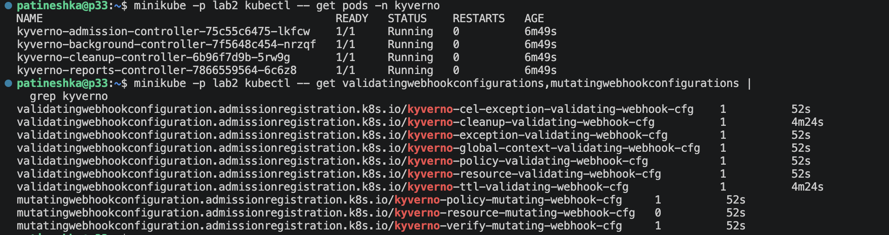

*img1 — Контроллеры Kyverno и зарегистрированные webhook-конфигурации*

При установке появилось предупреждение об устаревании `ClusterPolicy`. Поэтому использовала новый тип `policies.kyverno.io/v1`, `ValidatingPolicy`.

Настроила пять кластерных политик:

| Файл | Правило | Польза |
|---|---|---|
| `disallow-privileged.yaml` | Запрет `privileged: true` у обычных и init-контейнеров | Контейнер не получает чрезмерные привилегии |
| `require-limits.yaml` | Обязательные лимиты CPU и памяти | Ограничение потребления ресурсов отдельным контейнером |
| `require-labels.yaml` | Непустые метки `app` и `owner` | Понятно, к чему относится Pod и кто за него отвечает |
| `disallow-host-namespaces.yaml` | Запрет `hostNetwork`, `hostPID`, `hostIPC` | Сохранение изоляции от сети, процессов и IPC ноды |
| `allowed-images.yaml` | Разрешены только выбранные репозитории образов | Произвольный образ не пройдет admission |

У всех политик задано `validationActions: [Deny]`. Проверяются операции создания и обновления Pod.

Из области действия явно исключены `kube-system`, `kube-public`, `kube-node-lease`, `kyverno`, `monitoring`, позднее добавлен `cnpg-system`. Это инфраструктурные исключения: например, агентам мониторинга может понадобиться доступ к ноде. Namespace `lab3`, в том числе Pod PostgreSQL, остается под проверками. Поэтому «кластерная политика» здесь не означает отсутствие исключений.

### Запрет privileged

Первую политику сначала проверила через серверный dry-run, затем применила:

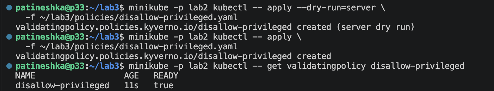

*img2 — Проверка и применение disallow-privileged*

Условие разрешает контейнер, если `securityContext` отсутствует, поле `privileged` не указано или равно `false`. Проверка `.all(...)` требует соответствия каждого контейнера, а не хотя бы одного.

Pod с `privileged: true` отклоняется:

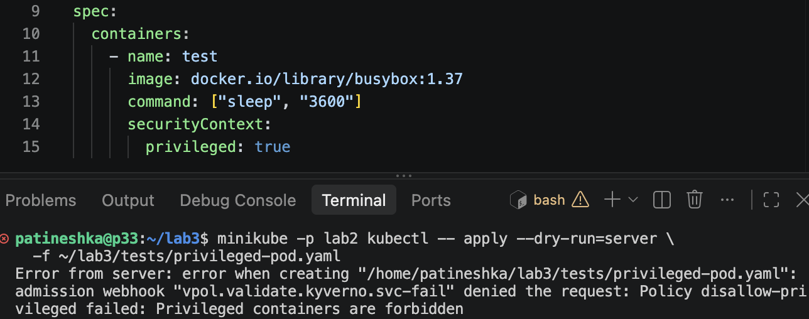

*img3 — Отказ для привилегированного контейнера*

При замене на `false` тот же тест проходит:

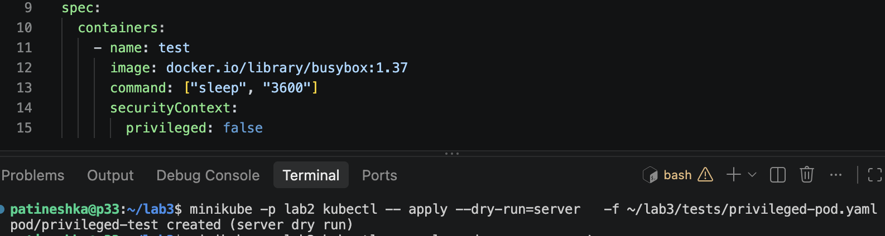

*img4 — Безопасный вариант проходит серверный dry-run*

Init-контейнеры проверяются отдельно. Если списка `initContainers` нет, проверять нечего — это допустимый вариант.

### Обязательные лимиты

Следующая политика требует оба поля: `resources.limits.cpu` и `resources.limits.memory`. Условия соединены через `&&`: нужен не любой из лимитов, а оба.

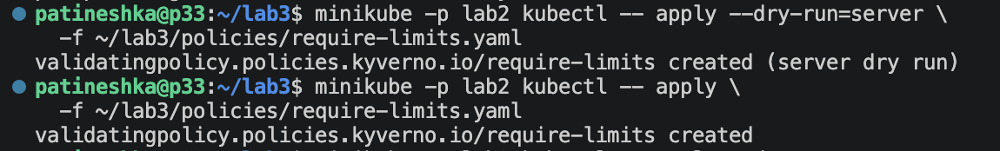

*img5 — Применение политики обязательных лимитов*

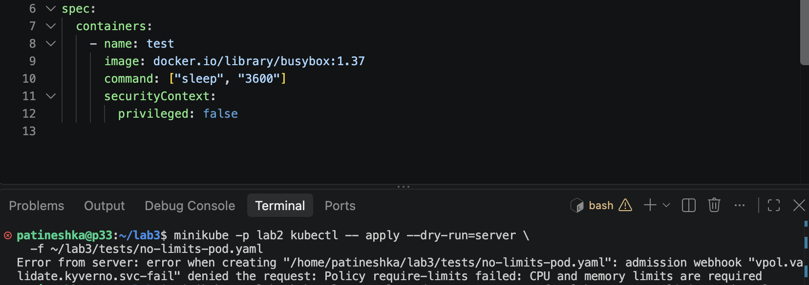

*img6 — Отказ для Pod без лимитов*

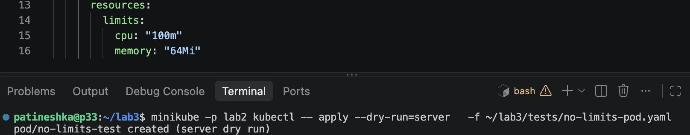

*img7 — После добавления CPU и memory limits тест проходит*

CPU limit ограничивает потребление сверху, а не гарантирует выделение такого количества CPU.

### Обязательные метки

Добавила правило для непустых `app` и `owner`. Метки относятся ко всему Pod, поэтому перебирать контейнеры здесь не нужно.

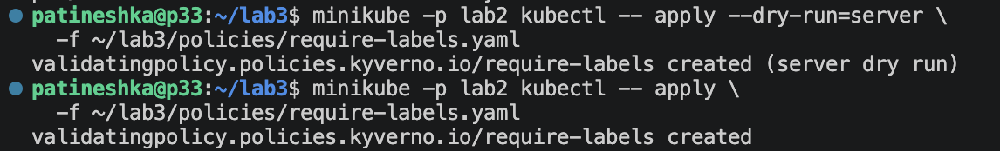

*img8 — Применение require-labels*

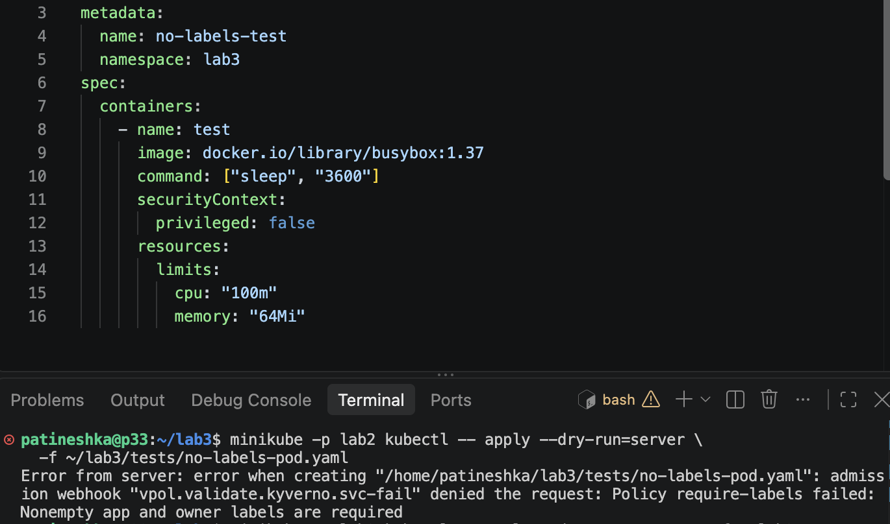

*img9 — Отказ для Pod без меток*

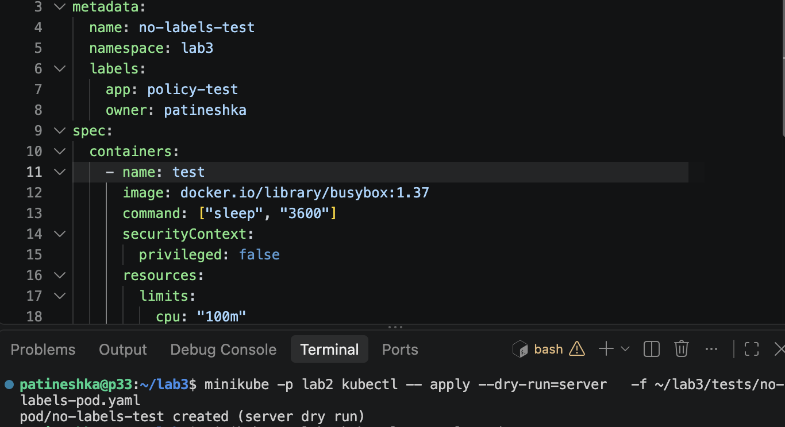

*img10 — Pod с app и owner проходит проверку*

Тут пришлось разобраться с уровнями метаданных: для обычного Pod нужны `metadata.labels`, а в Deployment метки будущих Pod задаются в `spec.template.metadata.labels`. Метки самого Deployment автоматически в Pod не копируются.

### Запрет host namespaces

Следующая политика проверяет три поля в `spec` самого Pod. Отсутствие поля или `false` разрешено, `true` — запрещено.

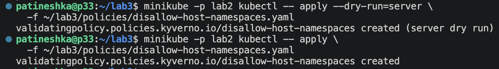

*img11 — Применение политики запрета host namespaces*

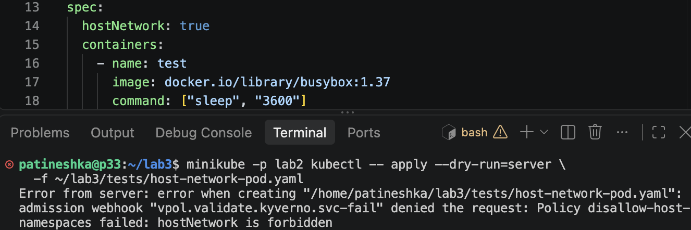

*img12 — Проверка запрета hostNetwork*

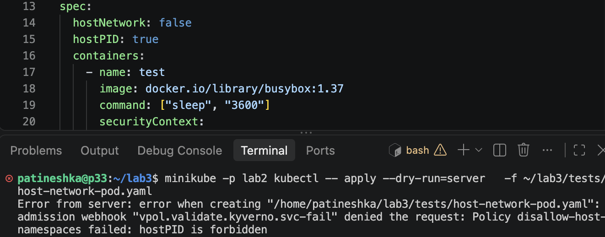

*img13 — Проверка запрета hostPID*

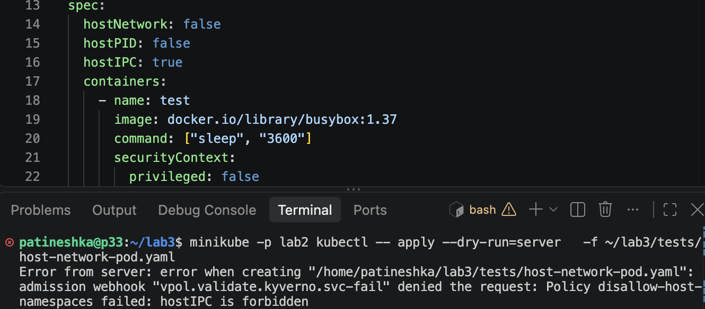

*img14 — Проверка запрета hostIPC*

Если все три поля равны `false`, серверный dry-run проходит. Это настройки всего Pod, повторять их для каждого контейнера не нужно.

### Разрешенные образы

Для образов разрешила конкретные репозитории приложения и тестов: `docker.io/library/shop-api`, `shop-worker`, `busybox`, `lab2-api`. Для них проверяется префикс с двоеточием перед тегом: например, `shop-api-unknown:v1` уже не совпадет.

Позднее для PostgreSQL добавила `ghcr.io/cloudnative-pg/postgresql:` и конкретный служебный образ `ghcr.io/cloudnative-pg/cloudnative-pg:1.30.1`.

Это проверка имени образа, а не его подписи, наличия в реестре или возможности скачивания.

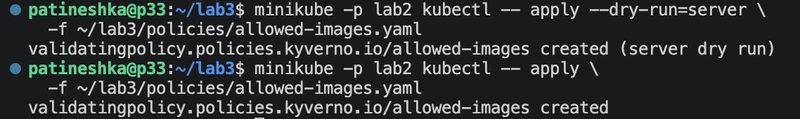

*img15 — Применение allowed-images*

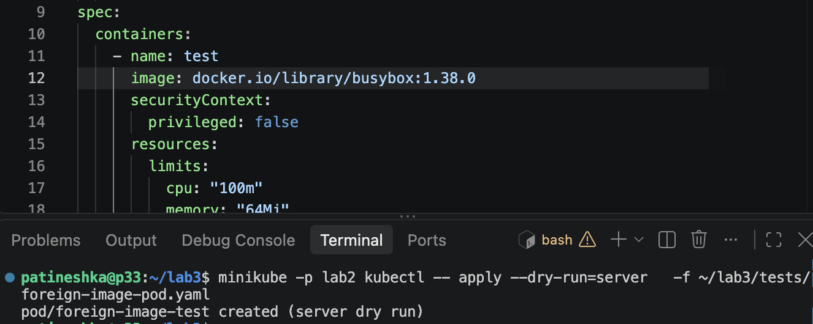

*img16 — Разрешенный образ busybox проходит проверку*

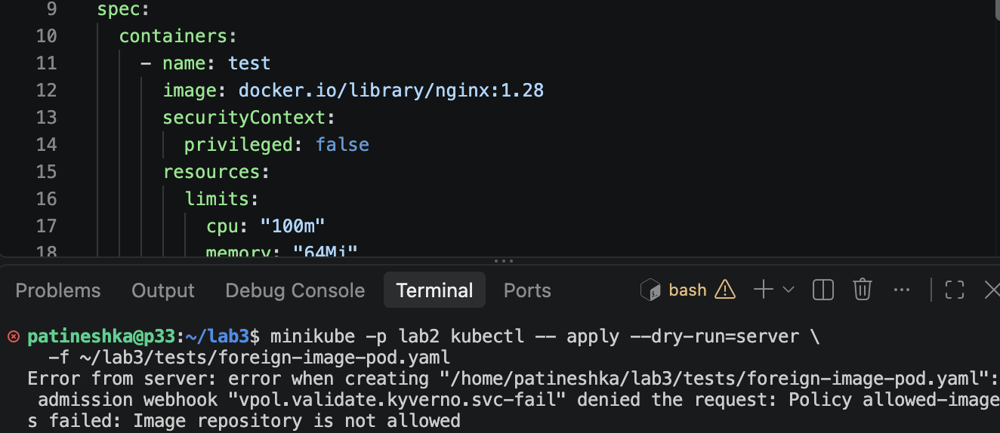

*img17 — nginx не входит в список разрешенных репозиториев и отклоняется*

### Общая проверка пяти нарушений

Подготовила пять сырых манифестов в `tests/`. Проверяла их через API-сервер без фактического запуска опасных контейнеров:

```bash
for file in ~/lab3/tests/*-pod.yaml; do
  echo "Проверка: $file"
  minikube -p lab2 kubectl -- apply --dry-run=server -f "$file"
done
```

Сначала тесты получились не совсем независимыми: Pod без лимитов одновременно не имел меток, а privileged-тест тоже нарушал несколько правил. При исправлении еще сбились отступы YAML — получила `mapping values are not allowed in this context`.

Исправила отступы и привела каждый файл к одному нарушению. В итоге:

| Тест | Единственный отказ |
|---|---|
| `foreign-image-pod.yaml` | `allowed-images` |
| `host-network-pod.yaml` | `disallow-host-namespaces` |
| `no-labels-pod.yaml` | `require-labels` |
| `no-limits-pod.yaml` | `require-limits` |
| `privileged-pod.yaml` | `disallow-privileged` |

Важно: `created (server dry run)` означает, что запрос прошел проверку, но объект не был сохранен. Политики применяла отдельно, уже без dry-run.

## Часть 2 — Helm-чарт api и worker

### Сборка и установка

Образы собрала сразу в Minikube, без публикации в реестр:

```bash
minikube -p lab2 image build   -t docker.io/library/shop-api:v1 ~/lab3/api

minikube -p lab2 image build   -t docker.io/library/shop-worker:v1 ~/lab3/worker
```

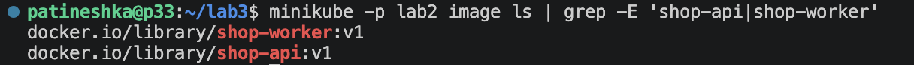

*img18 — Оба образа доступны внутри Minikube*

Для `shop` создала Helm-чарт:

| Файл | Назначение |
|---|---|
| `Chart.yaml` | Название и версия чарта |
| `values.yaml` | Реплики, образы, ресурсы, параметры БД |
| `api-deployment.yaml`, `worker-deployment.yaml` | Запуск приложений, пробы и обновления |
| `api-service.yaml`, `worker-service.yaml` | Постоянные адреса и выбор Pod по меткам |
| `postgres-cluster.yaml` | Объект Cluster оператора БД, добавлен позднее |
| `servicemonitors.yaml` | Сбор метрик API и worker |
| `prometheusrules.yaml` | Три правила алертов |

Начальные значения: API — 3 реплики, worker — 2. В шаблоны сразу добавлены обязательные метки и лимиты, разрешенные имена образов. `privileged` и host namespaces не включены.

Для локальных образов использовала `imagePullPolicy: Never`. Если нужного образа нет на ноде, контейнер не запустится с `ErrImageNeverPull`, скачивать его Kubernetes не будет.

У обоих сервисов настроены readiness и liveness на `/health`. Readiness управляет готовностью к трафику, liveness — перезапуском неисправного контейнера. `Running` сам по себе не означает готовность обслуживать запросы.

Проверила шаблоны и установила чарт:

```bash
helm lint ~/lab3/charts/shop
helm template shop ~/lab3/charts/shop --namespace lab3

helm upgrade --install shop ~/lab3/charts/shop   --namespace lab3   --kube-context lab2   --wait --timeout 5m
```

Чарт установился без отклонений политиками. API — `3/3`, worker — `2/2`. Ура! 🙂

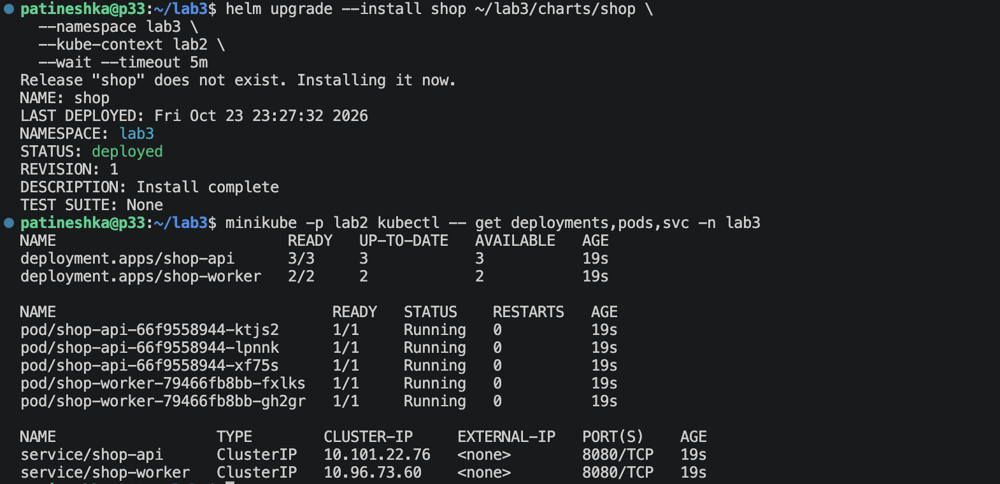

*img19 — Первая установка shop и готовые Pod*

### Reconciliation: удаление Pod

Включила наблюдение и удалила один Pod API:

```bash
minikube -p lab2 kubectl -- get pods -n lab3 -l app=shop-api --watch

minikube -p lab2 kubectl -- delete pod   -n lab3 shop-api-66f9558944-ktjs2
```

ReplicaSet увидел, что вместо трех Pod осталось два, и создал замену. Helm повторно не запускала — желаемое количество уже сохранено в кластере.

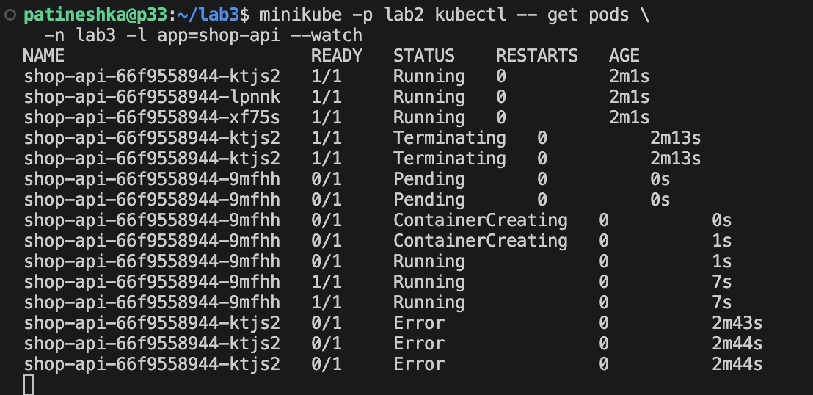

*img20 — Вместо удаленного Pod появляется новый*

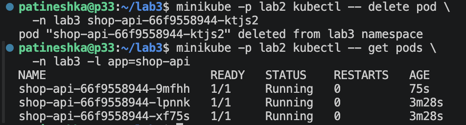

*img21 — Количество готовых реплик восстановлено до трех*

### Изменение числа реплик

В `values.yaml` поменяла `api.replicas` с 3 на 4 и выполнила `helm upgrade`. Появился еще один Pod, три существующих пересоздавать не потребовалось: шаблон Pod не менялся.

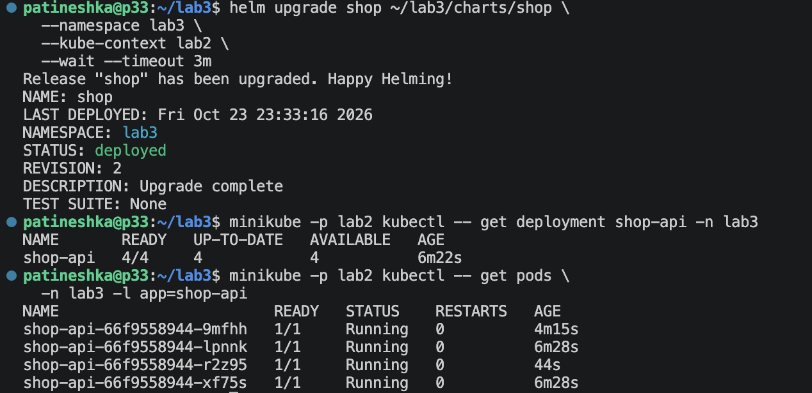

*img22 — Масштабирование API до четырех готовых реплик*

### Rolling update

Для управляемого обновления задала:

```yaml
strategy:
  type: RollingUpdate
  rollingUpdate:
    maxUnavailable: 0
    maxSurge: 1
minReadySeconds: 5
progressDeadlineSeconds: 120
```

При четырех желаемых репликах можно создать один дополнительный Pod. Исправные старые Pod не удаляются, пока не появится достаточно доступных новых. Завершающиеся Pod некоторое время еще могут отображаться в списке.

Подготовила отдельный образ `shop-api:v2`, затем поменяла тег API в `values.yaml` и запустила обновление.

Одновременно из существующего worker непрерывно отправляла запросы к `http://shop-api:8080/health` через Service. Каждый запрос открывал новое соединение. Для этого теста не использовала port-forward как путь нагрузки: он выбирает один Pod, и его удаление могло бы оборвать проверку независимо от состояния Service.

Обновление завершилось сообщением `successfully rolled out`: четыре готовых Pod перешли на `v2`. Данные о версии также выводятся приложением; колонка `APP VERSION` в истории Helm — отдельное поле из `Chart.yaml`, а не доказательство тега запущенного образа.

### Сломанное обновление и rollback

Теперь специально сломала новую конфигурацию: установила `api.healthFail: true` и снова сделала `helm upgrade`.

Новый Pod запускался, но возвращал 503 на `/health`: readiness не проходила, трафик в него не направлялся. Liveness также перезапускала контейнер. Четыре старых исправных Pod остались работать.

Обновление завершилось ошибкой `Progress deadline exceeded` по нашему `progressDeadlineSeconds`, раньше общего таймаута Helm. Это ожидаемая часть эксперимента, автоматического отката не произошло:

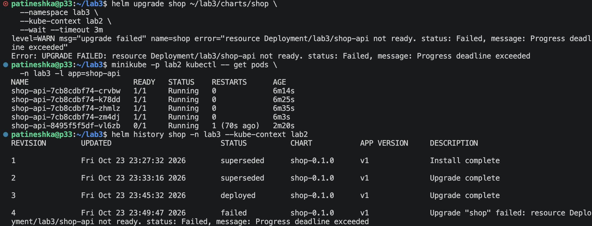

*img23 — Неудачная ревизия 4: четыре исправных Pod и один неготовый*

Откатилась на последнюю успешную ревизию 3:

```bash
helm rollback shop 3   --namespace lab3   --kube-context lab2   --wait --timeout 3m
```

Rollback создал новую ревизию 5 с прежней рабочей конфигурацией, история сохранилась:

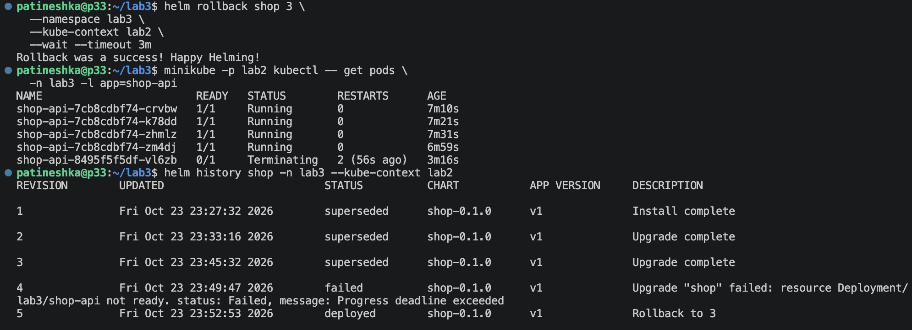

*img24 — Успешный rollback на конфигурацию ревизии 3*

После отката отдельно вернула `api.healthFail: false` в локальный `values.yaml`. Helm rollback меняет релиз в кластере, но файл на диске не исправляет — иначе следующий upgrade снова внес бы поломку.

За время непрерывного наблюдения, включая обновление, сломанную версию и откат, получилось **1444 запроса, `failed=0`**. Это результат нашего тестового потока, а не гарантия отсутствия ошибок при любой нагрузке.

## Часть 3 — PostgreSQL через оператор

### Установка CloudNativePG

Для БД выбрала CloudNativePG. Сначала добавила репозиторий:

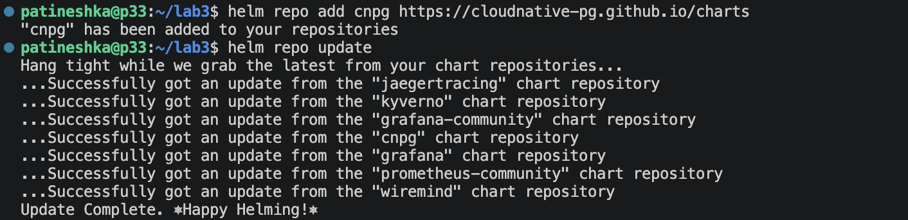

*img25 — Добавление Helm-репозитория CloudNativePG*

В пяти политиках явно исключила namespace `cnpg-system` для самого оператора. При этом Pod базы в `lab3` остались под проверками.

```bash
helm upgrade --install cnpg cnpg/cloudnative-pg   --version 0.29.1   --namespace cnpg-system --create-namespace   --kube-context lab2   --wait --timeout 5m
```

Оператор `1.30.1` запустился, появился CRD `clusters.postgresql.cnpg.io`:

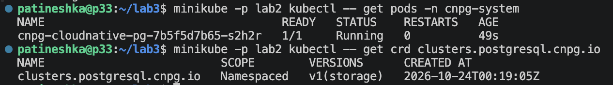

*img26 — Оператор работает, новый тип Cluster зарегистрирован*

Сам CRD только добавляет тип объектов. База создается после появления конкретного объекта `Cluster`.

### База в чарте shop

Добавила в чарт `postgres-cluster.yaml`. В `spec` указала один экземпляр, базу `shop`, пользователя `shop`, PVC на 2 GiB со StorageClass `standard` и лимиты CPU/памяти.

Обязательные метки передала через `spec.inheritedMetadata.labels`: метки самого объекта `Cluster` не заменяют метки создаваемых Pod.

В разрешенные образы добавила репозиторий PostgreSQL CloudNativePG и образ оператора для служебного init-контейнера. Иначе политики могли бы отклонить Pod при инициализации.

После обновления чарта оператор создал PVC и Job инициализации:

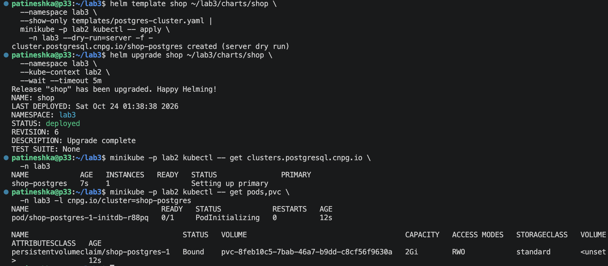

*img27 — Объект Cluster создан; PVC Bound, начинается initdb*

Промежуточный `PodInitializing` не означал поломку. По событиям Job `initdb` завершился, после чего запустился основной `shop-postgres-1`. Дождалась условия `Ready`: кластер перешел в `Cluster in healthy state`.

Фактический образ зафиксировала в values и шаблоне: `ghcr.io/cloudnative-pg/postgresql:18.6-system-trixie`.

### Подключение API и worker

Оператор создал Service `shop-postgres-rw` для записи и Secret `shop-postgres-app` с учетными данными.

В оба Deployment добавила `PGHOST`, `PGPORT`, `PGDATABASE`, `PGUSER`, `PGPASSWORD`. Значения базы, пользователя и пароля берутся через `secretKeyRef`. Пароль в values и README не сохраняла.

Приложения подключаются по имени Service, а не по IP Pod: после пересоздания PostgreSQL его адрес может измениться, настройки приложений менять не требуется.

После обновления релиза API и worker перезапустились с настройками БД:

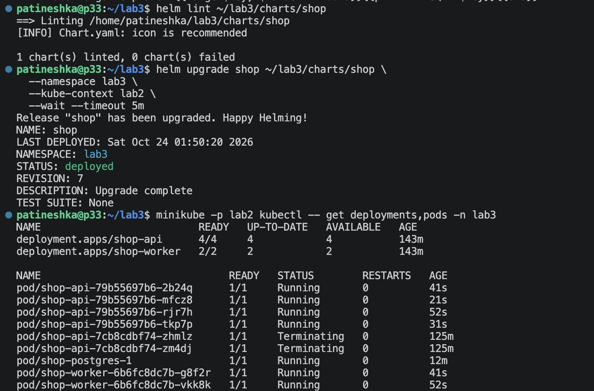

*img28 — API, worker и PostgreSQL работают после подключения базы*

Для проверки пробросила порт API:

```bash
minikube -p lab2 kubectl -- port-forward -n lab3 svc/shop-api 8086:8080
```

Создала заказ:

```bash
curl -i --max-time 10   -X POST http://127.0.0.1:8086/order   -H 'Content-Type: application/json'   -d '{"item":"book","quantity":2}'
```

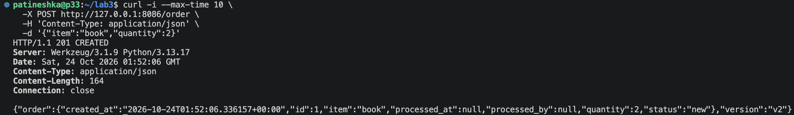

*img29 — Заказ №1 создан: HTTP 201, начальный статус new*

Через несколько секунд запросила `/orders`:

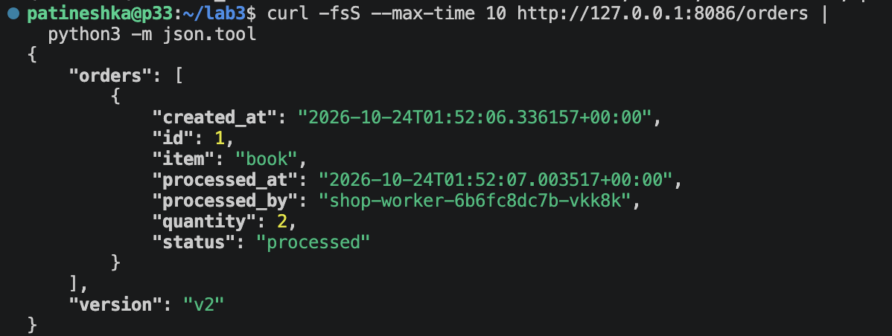

*img30 — Заказ обработан worker, статус изменился на processed*

В логах worker нашлась строка `Order processed` с `order_id: 1`. Сначала ее не было в `--tail=10` — запись вытеснили регулярные health-проверки. Убрала короткое ограничение и отфильтровала нужное сообщение.

### Восстановление PostgreSQL

Перед удалением записала UID Pod и том PVC:

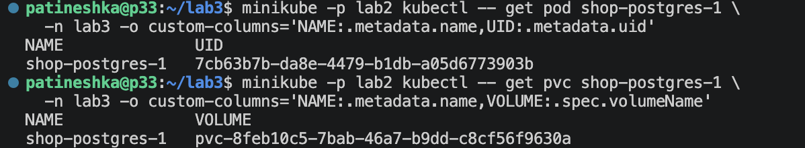

*img31 — UID исходного Pod PostgreSQL и связанный постоянный том*

Удалила только Pod, PVC не трогала. Оператор восстановил экземпляр:

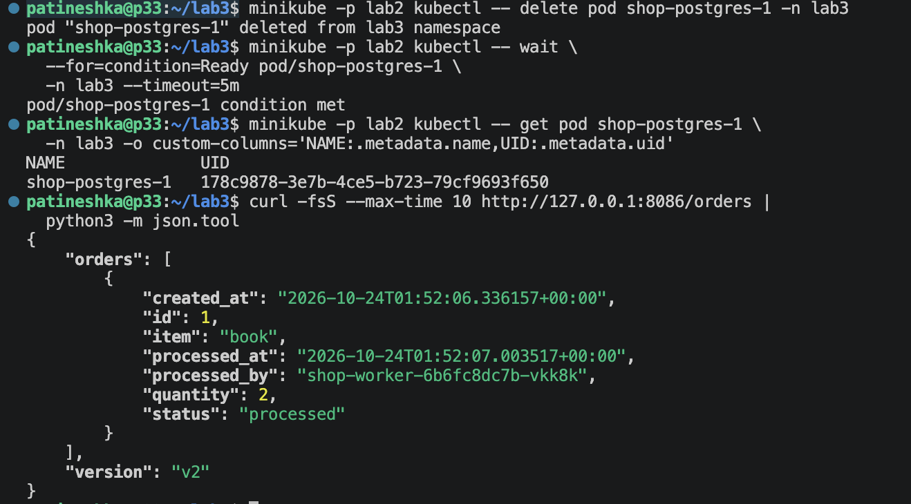

*img32 — Новый UID Pod, база снова готова, заказ сохранился*

UID изменился с `7cb63b7b…` на `178c9878…`, хотя имя осталось `shop-postgres-1`. Значит, это новый объект Pod. Заказ №1 сохранился со статусом `processed` благодаря сохраненному тому.

Один экземпляр БД не обеспечивает непрерывной доступности во время восстановления. Этот тест проверяет автоматическое восстановление и сохранность данных на PVC, а не failover на резервный экземпляр.

### spec, status и отличие оператора от controller-manager

Посмотрела объект:

```bash
minikube -p lab2 kubectl -- get cluster.postgresql.cnpg.io   shop-postgres -n lab3 -o yaml
```

- `spec` — желаемое состояние: число экземпляров, образ, ресурсы и хранилище
- `status` — наблюдаемое состояние, которое записывает оператор: `readyInstances: 1`, `currentPrimary: shop-postgres-1`, условие `Ready=True`

Для API цепочка управления — Deployment → ReplicaSet → Pod. Контроллер ReplicaSet входит в стандартный kube-controller-manager и поддерживает количество Pod.

PostgreSQL управляет отдельный контроллер CloudNativePG: он понимает собственный CRD `Cluster`, роли primary, инициализацию БД, сертификаты и хранилище. Механизм reconciliation общий, но предметная логика разная. Именно CloudNativePG восстановил Pod нашей базы.

## Часть 4 — Падение control plane

### Подготовка независимой проверки

В этом эксперименте остановила только API-сервер, сам Minikube и VM оставила работать.

Заранее проверила доступ к ноде через Docker-драйвер Minikube и контейнерам через CRI, а также расположение статического манифеста API-сервера:

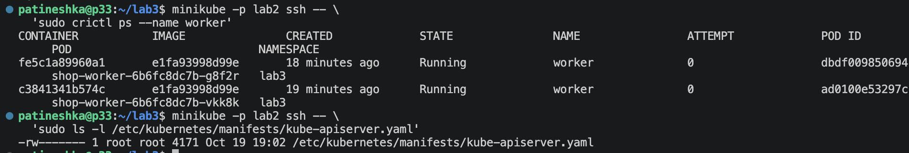

*img33 — Доступ к worker через crictl и путь манифеста API-сервера*

Подготовила `tests/check-shop.py`: цикл обращается к `/health` и `/orders`, считает запросы и ошибки, печатает JSON.

Отдельный `tests/start-check.py` запускает проверку фоном внутри worker и записывает результат в `/tmp/check-shop.log`. Так проверка не зависит от открытого соединения `kubectl exec`.

Читать результат научилась через runtime, в обход Kubernetes API. Здесь `fe5c1a89960a1` — ID контейнера worker именно в моем эксперименте, при повторении его нужно получить заново:

```bash
minikube -p lab2 ssh --   'sudo crictl exec fe5c1a89960a1 tail -n 8 /tmp/check-shop.log'
```

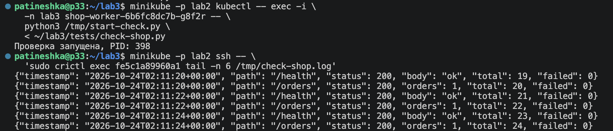

*img34 — Фоновая проверка запущена, результаты читаются через runtime*

### Отключение API-сервера

Чтобы kubelet остановил статический Pod API-сервера, переместила его манифест за пределы отслеживаемого каталога:

```bash
minikube -p lab2 ssh --   'sudo mv /etc/kubernetes/manifests/kube-apiserver.yaml /etc/kubernetes/kube-apiserver.lab3-disabled.yaml'
```

Небольшой затык: сначала по невнимательности выполнила обратную команду — восстановления, хотя отключать еще не успела. Получила `cannot stat`: отключенного файла пока не существовало. Проверила исходный путь и затем выполнила нужное перемещение.

После остановки API-сервера чтение Pod и попытка создания ConfigMap через серверный dry-run завершались `connection refused`. При этом фоновый процесс внутри worker продолжал получать 200 от `/health` и `/orders`:

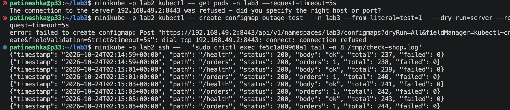

*img35 — Kubernetes API недоступен, приложение и чтение PostgreSQL продолжают работать*

Счетчик вырос до 244 запросов, ошибок не было. Это подтверждает выполнение проверки в worker и доступность HTTP API и чтения данных PostgreSQL. Создание новых заказов во время отключения отдельно не проверяла.

Приложение не обращается к Kubernetes API-серверу на каждом пользовательском запросе. Контейнеры уже запущены, существующие сетевые правила Service работают, БД доступна. Но контроллеры не могут сохранять изменения через API и создавать новые Pod.

### Восстановление управления

Вернула манифест обратно:

```bash
minikube -p lab2 ssh --   'sudo mv /etc/kubernetes/kube-apiserver.lab3-disabled.yaml /etc/kubernetes/manifests/kube-apiserver.yaml'
```

После запуска API-сервера нода снова доступна через kubectl, все Pod работают, создание ConfigMap в dry-run проходит:

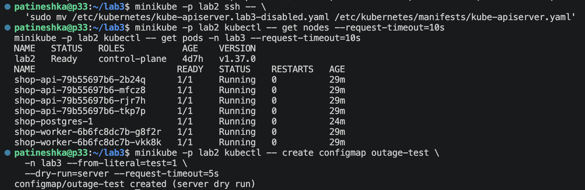

*img36 — После восстановления API-сервера кластер снова управляем*

Фоновую проверку остановила, ее лог сохранила для отчета.

## Часть 5 — Мониторинг

### Подключение к стеку второй лабы

Метрики приложения уже доступны на `/metrics`:

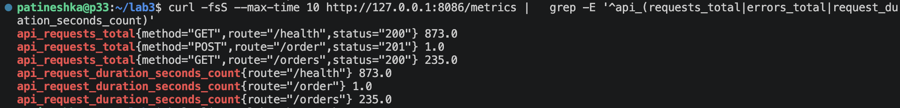

*img37 — Счетчики запросов API и наблюдений времени ответа*

Добавила в чарт `servicemonitors.yaml`: отдельные ServiceMonitor для API и worker. Они выбирают Service по `app`, используют именованный порт `http` и путь `/metrics` с интервалом 15 секунд.

Метка `release: monitoring` нужна, чтобы существующий Prometheus выбрал новые ServiceMonitor. Сам ServiceMonitor метрики не скачивает — он описывает сбор.

После первого обновления query `up` вернул пустой результат:

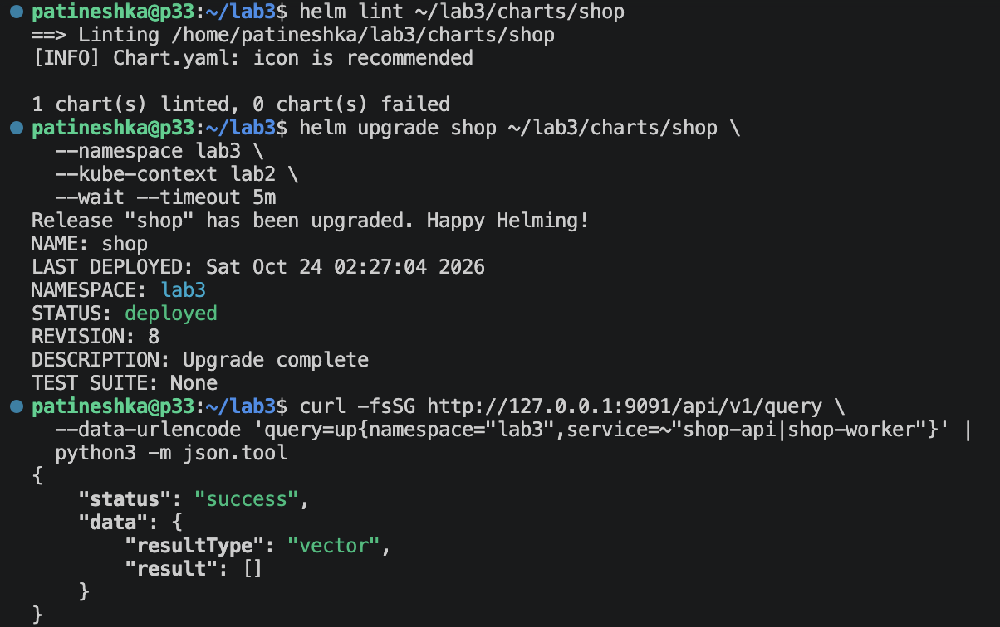

*img38 — ServiceMonitor установлены, но первые ряды up еще не появились*

Проверила селекторы Prometheus, метки ServiceMonitor и Service. Они совпадали. Затем в `/api/v1/targets` появились все шесть целей с `health: up`, а запрос `up{namespace="lab3"}` вернул шесть единиц: четыре API и два worker.

Пустой `result` и `up=0` — разные случаи. В первом нет подходящих рядов, во втором ряд существует и указывает на неудачный сбор.

### Три алерта в чарте

В `templates/prometheusrules.yaml` добавила объект `PrometheusRule` с меткой `release: monitoring`.

| Алерт | Условие | Почему важно и что делать |
|---|---|---|
| `ShopAPIDown` | Все существующие цели API имеют up=0 либо цели отсутствуют; `for: 1m` | Проверить Pod, readiness, Service и пользовательскую доступность API |
| `ShopHighErrorRate` | Общая доля 5xx выше 20% в минутном окне; `for: 1m` | Пользователи получают ошибки; проверить логи, PostgreSQL и последние изменения |
| `ShopWorkerStalled` | Нет свежего успешного опроса БД среди доступных worker более 60 секунд либо подходящие метрики отсутствуют; `for: 1m` | Обработка заказов может остановиться; проверить worker и базу |

Все три имеют `severity: critical`. `ShopAPIDown` по метрике up проверяет доступность сбора метрик, а не полноценный пользовательский HTTP-сценарий.

Для доли ошибок сначала суммируются скорости ошибок и всех запросов по репликам, затем выполняется деление. Складывать проценты реплик нельзя: они могут получать разное количество запросов.

Для worker используется максимальная временная метка последнего успешного опроса среди Pod с `up=1`. Даже если один worker давно не работал, второй может продолжать обрабатывать очередь. Проверка успешного опроса не доказывает выполнение каждого заказа, но обнаруживает отсутствие успешного доступа worker к БД.

Правила загрузились в Prometheus, у всех `health=ok`, ошибок вычисления нет:

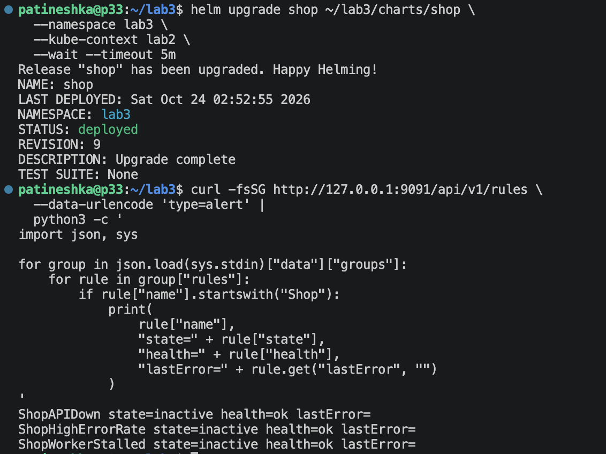

*img39 — Три правила Shop загружены и успешно вычисляются*

### Проверка firing и доставки

Для проверки `ShopHighErrorRate` отправляла запросы к `/fail`:

```bash
for i in $(seq 1 600); do
  curl -sS --max-time 3 -o /dev/null http://127.0.0.1:8086/fail
  sleep 0.2
done
```

Доля ошибок превысила 20% и сохранялась достаточно долго. Алерт появился в Karma:

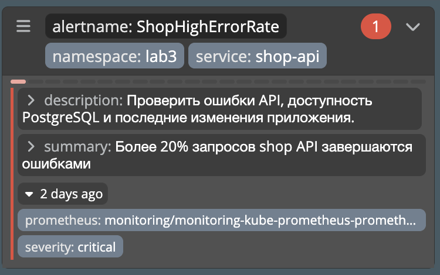

*img40 — ShopHighErrorRate в Karma: namespace lab3, severity critical*

Alertmanager отправил уведомления прежнему получателю `lab2-webhook` из второй лабы. Несмотря на название, он принимает и алерты shop.

Для удобного чтения создала `tests/format-alerts.py`: он оставляет только полезные поля и форматирует JSON. Подтвердила и `firing`, и последующий `resolved`:

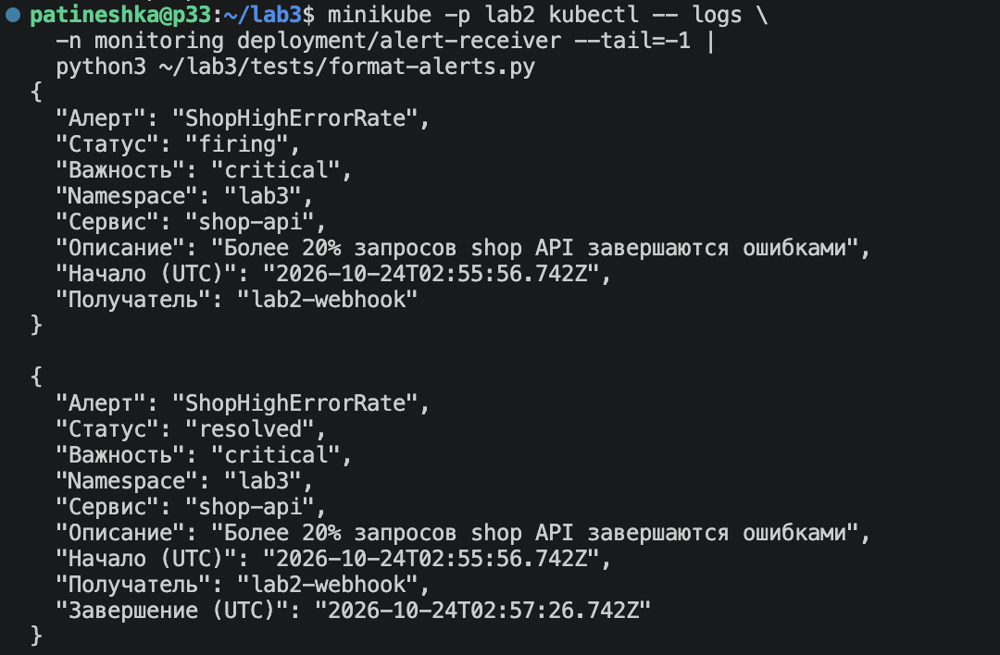

*img41 — Webhook-получатель получил срабатывание и восстановление алерта*

Два других правила загружены и вычисляются без ошибок; отдельное намеренное срабатывание каждого в этой лабе не проводила. Для задания показано срабатывание одного из трех.

### Дашборд Grafana

В существующей Grafana собрала дашборд shop с тремя панелями.

**1. Доступные цели по сервисам:**

```promql
sum by (service) (
  up{namespace="lab3", service=~"shop-api|shop-worker"}
)
```

В норме API — 4, worker — 2. Здесь нужна сумма значений up, а не число рядов: при одной неработающей цели из четырех `sum(up)=3`, но `count(up)=4`.

**2. Доля ошибок API, %:**

```promql
100 * (
  sum(rate(api_requests_total{
    namespace="lab3", service="shop-api", status=~"5.."
  }[1m])) or vector(0)
)
/
clamp_min(
  sum(rate(api_requests_total{
    namespace="lab3", service="shop-api"
  }[1m])),
  0.000001
)
```

На панели показан порог 20%. Линия порога — оформление графика, само правило алерта находится в PrometheusRule.

**3. Время с последнего успешного опроса БД worker:**

```promql
time() - max(
  shop_worker_last_success_timestamp_seconds{
    namespace="lab3", service="shop-worker"
  }
  and on(namespace, pod)
  (
    up{namespace="lab3", service="shop-worker"} == 1
  )
)
```

При пустой очереди значение тоже обновляется: worker успешно опрашивает БД, даже если заказов нет. Если метрик нет вообще, панель может показать No data; алерт отдельно учитывает это через `absent`.

И конечно, без времени на виртуалке снова не обошлось... На Mac было около 19:30, а VM жила примерно в 19:18. Графики заканчивались раньше правого края, а после перевода часов появлялись разрывы. Рост старого участка панели worker сам по себе не стал доказательством сбоя БД: текущий запрос в Prometheus показывал последние успехи около 4 и 16 секунд назад.

Сначала еще и запустила команду синхронизации из Ubuntu, подключившись по SSH к ней же. Время виртуалки успешно скопировалось на ту же виртуалку — полезность примерно нулевая :)

В итоге выполнила команду именно в терминале Mac, чтобы взять его текущее время:

```bash
ssh -t patineshka@192.168.64.2   "sudo timedatectl set-ntp false && sudo date -u -s '@$(date -u +%s)' && sudo hwclock --systohc --utc && sudo timedatectl set-ntp true"
```

После синхронизации подождала появления свежих метрик. Пропущенный из-за перевода часов промежуток не заполняется автоматически, поэтому на общем скриншоте еще виден исторический разрыв. По нему нельзя делать вывод о недоступности приложения.

Также один раз получила `Failed to fetch`. Grafana на VM была исправна: `/api/health` отвечал, Pod не перезапускался. Пересоздала проброс 3001 во вкладке Ports VSCode и открыла страницу заново. Запуск второго port-forward на занятый 3001 давал ожидаемый `address already in use`.

Дашборд сохранен и экспортирован в [shop-dashboard.json](shop-dashboard.json):

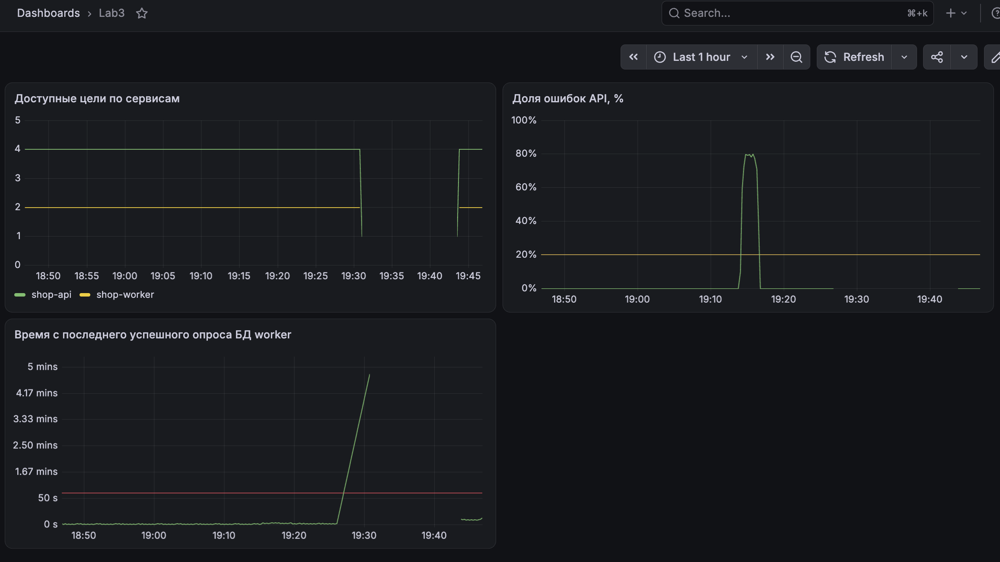

*img42 — Дашборд shop; справа свежие данные, в истории виден разрыв после перевода часов*

## Что получилось

- Пять кластерных политик с явными инфраструктурными исключениями; нарушающие Pod отклоняются
- Helm-чарт shop с API, worker, объектом PostgreSQL, ServiceMonitor и PrometheusRule
- Восстановление Pod API через ReplicaSet и Pod базы через CloudNativePG
- Обновление API и rollback сломанной конфигурации; в тестовом потоке 1444 запроса без ошибок
- Заказ сохраняется в PostgreSQL, обрабатывается worker и переживает пересоздание Pod БД
- При отключенном API-сервере управление ресурсами недоступно, но работающие сервисы продолжают отвечать
- Метрики шести целей в Prometheus, три правила алертов, firing в Karma и доставка webhook
- Дашборд и экспорт его конфигурации

Текущие значения для стенда: API — 4 реплики после теста масштабирования (начинала с 3), worker — 2, PostgreSQL — 1. `HEALTH_FAIL` возвращен в `false`, API-сервер восстановлен, нагрузочные проверки остановлены.

## Топ ошибок

К сожалению, без приключений снова не обошлось. Вот мой топ затыков (затупов):

1. **Тестировала одно правило, нарушала сразу три.** В privileged-тесте забывала лимиты и метки, а потом получала несколько отказов. Для понятной проверки каждому манифесту оставила ровно одно нарушение.

2. **YAML и отступы — отдельный вид отношений.** При добавлении labels получила `mapping values are not allowed in this context`. Исправила отступы, и только после этого запрос вообще дошел до политик.

3. **Путала readiness и liveness.** Обе ходили на один `/health`, поэтому казалось, что делают одно и то же. Но одна убирает Pod из обслуживания трафика, а другая перезапускает контейнер. Особенно хорошо это стало видно на сломанном обновлении.

4. **Метки есть, но не там.** Метки Deployment, метки его Pod и inheritedMetadata у Cluster — разные места. Наличие owner у управляющего объекта еще не означает, что owner появился у Pod.

5. **Попыталась восстановить то, что еще не отключила.** Первой выполнила обратную команду перемещения манифеста API-сервера и получила `cannot stat`. Хорошо, что файл просто не существовал, а ничего другого не произошло.

6. **Думала, worker ничего не обработал, потому что в tail нет записи.** Запись была, но ее уже вытеснили health-пробы. Отфильтровала полный доступный лог и нашла `Order processed`.

7. **Время на VM снова решило жить своей жизнью.** К третьей лабе это уже почти традиция. Отдельное достижение — синхронизировать VM с ней же, запустив команду не в том терминале. Теперь перед разбором пустых графиков сначала сравниваю часы Mac и Ubuntu.

8. **Failed to fetch выглядел страшнее причины.** Grafana работала, а проблема оказалась на пути через проброс VSCode. И да, второй port-forward не может занять уже занятый моим же первым процессом порт.

Самое полезное в этой лабе — специально что-нибудь сломать, а потом увидеть, кто именно это чинит. ReplicaSet восстановил API, оператор — PostgreSQL, а готовность новой версии и сохранение трафика пришлось обеспечить настройками обновления. Само слово Running оказалось далеко не всей историей ;)

