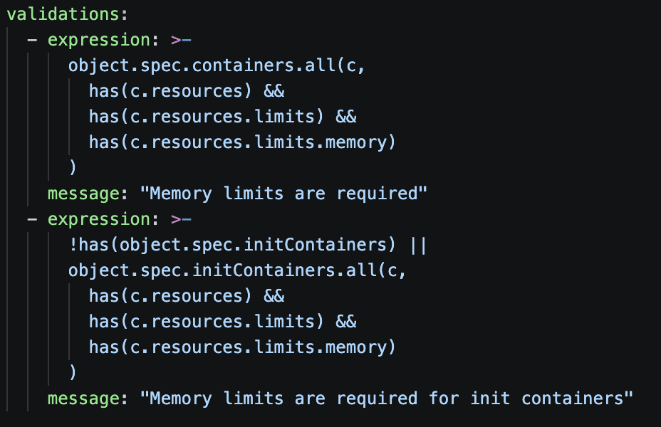

# Лаба 3 — Сборка платформы для shop

## Часть 0 — Сервисы и подготовка стенда

Я спользовала тот же кластер Minikube `lab2` из второй лабы. Название профиля оставила прежним и в нем уже работает мониторинг

Приложение разместила в namespace `lab3`. Перед началом также проверила время, память, место на диске и состояние кластера. На VM доступно около 11 ГиБ RAM, на корневой файловой системе оставалось 28 ГБ. Нода была `Ready`, все компоненты мониторинга работали:

```
patineshka@p33:~$ free -h
               total        used        free      shared  buff/cache   available
Mem:            11Gi       3,3Gi       849Mi        18Mi       7,2Gi       7,8Gi
Swap:          4,0Gi        64Ki       4,0Gi
patineshka@p33:~$ df -h /
Filesystem                         Size  Used Avail Use% Mounted on
/dev/mapper/ubuntu--vg-ubuntu--lv   50G   20G   28G  43% /
patineshka@p33:~$ minikube status -p lab2
lab2
type: Control Plane
host: Running
kubelet: Running
apiserver: Running
kubeconfig: Configured
patineshka@p33:~$ helm list -A --kube-context lab2
NAME            NAMESPACE       REVISION        UPDATED                                 STATUS          CHART                           APP VERSION
alert-receiver  monitoring      1               2026-10-20 21:30:12.645626134 +0000 UTC deployed        alert-receiver-0.1.0
alloy           monitoring      1               2026-10-20 19:32:18.931919514 +0000 UTC deployed        alloy-1.14.0                    v1.21.0
jaeger          monitoring      1               2026-10-20 20:04:21.589915203 +0000 UTC deployed        jaeger-4.16.1                   2.22.0
karma           monitoring      1               2026-10-20 21:36:04.183051878 +0000 UTC deployed        karma-2.13.1                    v0.131
lab2-api        lab2            6               2026-10-21 09:33:09.053464287 +0000 UTC deployed        lab2-api-0.1.0                  v1
loki            monitoring      1               2026-10-20 19:16:50.018896876 +0000 UTC deployed        loki-18.17.1                    3.7.8
monitoring      monitoring      7               2026-10-20 21:53:02.718453588 +0000 UTC deployed        kube-prometheus-stack-92.10.1   v0.94.1
```

Новый стек мониторинга не устанавливала и дальше использовала Prometheus, Grafana, Alertmanager и Karma из второй лабораторной

Для приложения подготовлены два сервиса:

| Сервис | Что делает |
|---|---|
| `api` | Принимает заказы и возвращает их список из PostgreSQL |
| `worker` | Читает новые заказы из PostgreSQL и помечает обработанными |

Основные эндпоинты API:

| Эндпоинт | Назначение |
|---|---|
| `GET /health` | Возвращает `ok`, при `HEALTH_FAIL=true` — ошибку 503 |
| `POST /order` | Создает заказ в PostgreSQL |
| `GET /orders` | Возвращает последние 100 заказов |
| `GET /metrics` | Отдает метрики Prometheus |
| `GET /fail` | Возвращает 500 для проверки алерта |
| `GET /slow`, `GET /load` | Сохранены для проверок задержки и нагрузки |

У worker тоже есть HTTP-сервер с `/health` и `/metrics`. Его health-проверка учитывает работу фонового цикла, но не требует постоянной доступности БД, так как сбой PostgreSQL не должен перезапускать все приложения по liveness

Для каждого сервиса подготовлены `server.py`, `observability.py`, `db.py`, `requirements.txt`, `Dockerfile` и `.dockerignore`. Сохранены JSON-логи, метрики и инструментация OpenTelemetry

Сервисы подготовлены, но установлю их только после подготовки политик 🙂

## Часть 1 — Ограждения на кластер

### Установка Kyverno

Выбрала Kyverno, так как политики описываются Kubernetes манифестами с CEL выражениями, для этой лабы такой вариант понятнее, чем отдельно осваивать Rego в Gatekeeper

При создании ресурса API-сервер обращается к admission webhook. Если политика запрещает Pod, его создание отклоняется до сохранения и kubelet такой Pod запускать не начинает

Установила Kyverno через Helm:

```bash
helm repo add kyverno https://kyverno.github.io/kyverno/
helm repo update

helm upgrade --install kyverno kyverno/kyverno   --version 3.9.2   --namespace kyverno --create-namespace   --kube-context lab2   --wait --timeout 10m
```

Версия Kyverno — `1.19.2`, Kubernetes — `1.37.0`. Эта версия Kubernetes была новее диапазона, указанного в проверенной таблице совместимости Kyverno, поэтому установку и работу правил проверяла на своем стенде

Все четыре контроллера запустились, webhook-конфигурации зарегистрировались:


Настроила пять кластерных политик:

| Файл | Правило | Польза |
|---|---|---|
| `disallow-privileged.yaml` | Запрет `privileged: true` у обычных и init-контейнеров | Контейнер не получает чрезмерные привилегии |
| `require-limits.yaml` | Обязательные лимиты CPU и памяти | Ограничение потребления ресурсов отдельным контейнером |
| `require-labels.yaml` | Непустые метки `app` и `owner` | К чему относится Pod и кто за него отвечает |
| `disallow-host-namespaces.yaml` | Запрет `hostNetwork`, `hostPID`, `hostIPC` | Сохранение изоляции от сети, процессов и IPC ноды |
| `allowed-images.yaml` | Разрешены только выбранные репозитории образов | Произвольный образ не пройдет admission |

У всех политик задано `validationActions: [Deny]`. Проверяются операции создания и обновления Pod

Из области действия явно исключены `kube-system`, `kube-public`, `kube-node-lease`, `kyverno`, `monitoring`, позднее добавлен `cnpg-system`. Это инфраструктурные исключения, так как, например, агентам мониторинга может понадобиться доступ к ноде

### Запрет privileged

Первую политику сначала проверила через серверный dry-run, затем применила:


Условие разрешает контейнер, если `securityContext` отсутствует, поле `privileged` не указано или равно `false`. Проверка `.all(...)` требует соответствия каждого контейнера, а не хотя бы одного

Pod с `privileged: true` отклоняется:


При замене на `false` тот же тест проходит:


Init-контейнеры проверяются отдельно. Если списка `initContainers` нет, проверять нечего 

### Обязательные лимиты

Следующая политика требует поля: `resources.limits.cpu` и `resources.limits.memory`

Применение политики обязательных лимитов:


Отказ для Pod без лимитов:


После добавления CPU и memory limits тест проходит:


! UPD Убрала CPU лимиты, так как это bad practice:



### Обязательные метки

Добавила правило для непустых `app` и `owner`. Метки относятся ко всему Pod, поэтому перебирать контейнеры здесь не нужно

Применение require-labels:


Отказ для Pod без меток:


Pod с app и owner проходит проверку:


Тут пришлось разобраться с уровнями метаданных: для обычного Pod нужны `metadata.labels`, а в Deployment метки будущих Pod задаются в `spec.template.metadata.labels`. Метки самого Deployment автоматически в Pod не копируются

### Запрет host namespaces

Следующая политика проверяет три поля в `spec` самого Pod. Отсутствие поля или `false` разрешено, `true` запрещено

Применение политики запрета host namespaces:


Проверка запрета hostNetwork:


Проверка запрета hostPID:


Проверка запрета hostIPC:


Если все три поля равны `false`, серверный dry-run проходит

### Разрешенные образы

Для образов разрешила конкретные репозитории приложения и тестов: `docker.io/library/shop-api`, `shop-worker`, `busybox`, `lab2-api`. Для них проверяется префикс с двоеточием перед тегом

Применение allowed-images:


Разрешенный образ busybox проходит проверку%


Nginx не входит в список разрешенных репозиториев и отклоняется:


### Общая проверка пяти нарушений

Подготовила пять сырых манифестов в `tests/`. Проверяла их через API-сервер :

```bash
for file in ~/lab3/tests/*-pod.yaml; do
  echo "Проверка: $file"
  minikube -p lab2 kubectl -- apply --dry-run=server -f "$file"
done
```
Привела каждый файл к одному нарушению. В итоге:

```
patineshka@p33:~/lab3$ for file in ~/lab3/tests/*.yaml; do   echo "Проверка: $file";   minikube -p lab2 kubectl -- apply --dry-run=server -f "$file"; done
Проверка: /home/patineshka/lab3/tests/foreign-image-pod.yaml
Error from server: error when creating "/home/patineshka/lab3/tests/foreign-image-pod.yaml": admission webhook "vpol.validate.kyverno.svc-fail" denied the request: Policy allowed-images failed: Image repository is not allowed
Проверка: /home/patineshka/lab3/tests/host-network-pod.yaml
Error from server: error when creating "/home/patineshka/lab3/tests/host-network-pod.yaml": admission webhook "vpol.validate.kyverno.svc-fail" deniedthe request: Policy disallow-host-namespaces failed: hostNetwork is forbidden
Проверка: /home/patineshka/lab3/tests/no-labels-pod.yaml
Error from server: error when creating "/home/patineshka/lab3/tests/no-labels-pod.yaml": admission webhook "vpol.validate.kyverno.svc-fail" denied the request: Policy require-labels failed: Nonempty app and owner labels are required
Проверка: /home/patineshka/lab3/tests/no-limits-pod.yaml
Error from server: error when creating "/home/patineshka/lab3/tests/no-limits-pod.yaml": admission webhook "vpol.validate.kyverno.svc-fail" denied the request: Policy require-limits failed: CPU and memory limits are required
Проверка: /home/patineshka/lab3/tests/privileged-pod.yaml
Error from server: error when creating "/home/patineshka/lab3/tests/privileged-pod.yaml": admission webhook "vpol.validate.kyverno.svc-fail" denied the request: Policy disallow-privileged failed: Privileged containers are forbidden
```

| Тест | Единственный отказ |
|---|---|
| `foreign-image-pod.yaml` | `allowed-images` |
| `host-network-pod.yaml` | `disallow-host-namespaces` |
| `no-labels-pod.yaml` | `require-labels` |
| `no-limits-pod.yaml` | `require-limits` |
| `privileged-pod.yaml` | `disallow-privileged` |

## Часть 2 — Helm-чарт api и worker

### Сборка и установка

Образы собрала сразу в Minikube, без публикации в реестр:

```bash
minikube -p lab2 image build   -t docker.io/library/shop-api:v1 ~/lab3/api

minikube -p lab2 image build   -t docker.io/library/shop-worker:v1 ~/lab3/worker
```
Оба образа доступны внутри Minikube:


Для shop создала Helm-чарт:

| Файл | Назначение |
|---|---|
| `Chart.yaml` | Название и версия чарта |
| `values.yaml` | Реплики, образы, ресурсы, параметры БД |
| `api-deployment.yaml`, `worker-deployment.yaml` | Запуск приложений, пробы и обновления |
| `api-service.yaml`, `worker-service.yaml` | Постоянные адреса и выбор Pod по меткам |
| `postgres-cluster.yaml` | Объект Cluster оператора БД, добавлен позднее |
| `servicemonitors.yaml` | Сбор метрик API и worker |
| `prometheusrules.yaml` | Три правила алертов |

Начальные значения: 
- API — 3 реплики
- worker — 2 реплики

В шаблоны сразу добавлены обязательные метки и лимиты, разрешенные имена образов. `privileged` и host namespaces не включены

У обоих сервисов настроены readiness и liveness на `/health`

Проверила шаблоны и установила чарт:

```bash
helm lint ~/lab3/charts/shop
helm template shop ~/lab3/charts/shop --namespace lab3

helm upgrade --install shop ~/lab3/charts/shop   --namespace lab3   --kube-context lab2   --wait --timeout 5m
```

Чарт установился без отклонений политиками. API — `3/3`, worker — `2/2`. Ура! 🙂


### Удаление Pod

Включила наблюдение и удалила один Pod API:

```bash
minikube -p lab2 kubectl -- get pods -n lab3 -l app=shop-api --watch

minikube -p lab2 kubectl -- delete pod   -n lab3 shop-api-66f9558944-ktjs2
```

ReplicaSet увидел, что вместо трех Pod осталось два, и создал замену:


Количество готовых реплик восстановлено до трех:


### Изменение числа реплик

В `values.yaml` поменяла `api.replicas` с 3 на 4 и выполнила `helm upgrade`. Появился еще один Pod:


### Rolling update

Для управляемого обновления задала:

```yaml
strategy:
  type: RollingUpdate
  rollingUpdate:
    maxUnavailable: 0
    maxSurge: 1
minReadySeconds: 5
progressDeadlineSeconds: 120
```

Подготовила отдельный образ `shop-api:v2`, затем поменяла тег API в `values.yaml` и запустила обновление

Одновременно из существующего worker непрерывно отправляла запросы к `http://shop-api:8080/health` через Service. Каждый запрос открывал новое соединение. 

Обновление завершилось сообщением `successfully rolled out`: четыре готовых Pod перешли на `v2`. Данные о версии также выводятся приложением; колонка `APP VERSION` в истории Helm — отдельное поле из `Chart.yaml`, а не доказательство тега запущенного образа.

### Сломанное обновление и rollback

Теперь специально сломала новую конфигурацию, установив `api.healthFail: true` и снова сделала `helm upgrade`:


Эксперимент сработал:
- Четыре исправных Pod остались 1/1
- Новый Pod — 0/1, readiness не проходит
- Liveness уже перезапустила неисправный контейнер
- Обновление остановилось по progressDeadlineSeconds: 120, раньше трёхминутного таймаута Helm. Автоматического rollback не произошло

Откатилась на последнюю успешную ревизию 3:

```bash
helm rollback shop 3   --namespace lab3   --kube-context lab2   --wait --timeout 3m
```

Rollback создал новую ревизию 5 с прежней рабочей конфигурацией, история сохранилась:


После отката отдельно вернула `api.healthFail: false` в локальный `values.yaml`. Helm rollback меняет релиз в кластере, но файл на диске не исправляет, иначе следующий upgrade снова внес бы поломку

## Часть 3 — PostgreSQL через оператор

### Установка CloudNativePG

Для БД выбрала CloudNativePG. Сначала добавила репозиторий:


В пяти политиках исключила namespace `cnpg-system` для самого оператора. При этом Pod базы в `lab3` остались под проверками

```bash
helm upgrade --install cnpg cnpg/cloudnative-pg   --version 0.29.1   --namespace cnpg-system --create-namespace   --kube-context lab2   --wait --timeout 5m
```

Оператор `1.30.1` запустился, появился CRD `clusters.postgresql.cnpg.io`:


### База в чарте shop

Добавила в чарт `postgres-cluster.yaml`. В spec указала один экземпляр, базу shop, пользователя shop, PVC на 2 GiB со StorageClass standard и лимиты CPU/памяти (все что необходимо по добавленным политикам)

В разрешенные образы добавила репозиторий PostgreSQL CloudNativePG и образ оператора для служебного init-контейнера, иначе политики могли бы отклонить Pod при инициализации

После обновления чарта оператор создал PVC и Job инициализации:


Фактический образ зафиксировала в values и шаблоне: `ghcr.io/cloudnative-pg/postgresql:18.6-system-trixie`.

### Подключение API и worker

В оба Deployment добавила `PGHOST`, `PGPORT`, `PGDATABASE`, `PGUSER`, `PGPASSWORD`. Значения базы, пользователя и пароля берутся через `secretKeyRef`

После обновления релиза API и worker перезапустились с настройками БД:


Для проверки пробросила порт API:

```bash
minikube -p lab2 kubectl -- port-forward -n lab3 svc/shop-api 8086:8080
```

Создала заказ:

```bash
curl -i --max-time 10   -X POST http://127.0.0.1:8086/order   -H 'Content-Type: application/json'   -d '{"item":"book","quantity":2}'
```

Заказ №1 создан. HTTP 201, начальный статус new:


Через несколько секунд запросила `/orders`:


### Восстановление PostgreSQL

Перед удалением записала UID Pod и том PVC:


Удалила только Pod, PVC не трогала. Оператор восстановил экземпляр:


UID изменился, хотя имя осталось `shop-postgres-1`. Заказ №1 сохранился со статусом `processed` благодаря сохраненному тому

### Отличие оператора от controller-manager

Посмотрела объект:

```bash
patineshka@p33:~/lab3$ minikube -p lab2 kubectl -- get cluster.postgresql.cnpg.io   shop-postgres -n lab3 -o yaml
apiVersion: postgresql.cnpg.io/v1
kind: Cluster
metadata:
  annotations:
    meta.helm.sh/release-name: shop
    meta.helm.sh/release-namespace: lab3
  creationTimestamp: "2026-10-24T01:38:39Z"
  generation: 1
  labels:
    app.kubernetes.io/managed-by: Helm
  name: shop-postgres
  namespace: lab3
  resourceVersion: "193414"
  uid: aaa3fc8b-5bff-4511-89fa-f6a1b2870a25
spec:
  affinity:
    podAntiAffinityType: preferred
  bootstrap:
    initdb:
      database: shop
      encoding: UTF8
      localeCType: C
      localeCollate: C
      owner: shop
  enablePDB: true
  ... и тд (тут много строк)

status:
  availableArchitectures:
  - goArch: amd64
    hash: 6d915657dadd72f66b0cdeca4d8f357d00de769bee14d4f6ea8adb501dab80d4
  - goArch: arm64
    hash: 37e47ffea358929899c8fd2b54139307934492108f5a0cde76e491248145fd4d
  certificates:
... и тд (тут еще много строк)

```

- `spec` — желаемое состояние (число экземпляров, образ, ресурсы и хранилище)
- `status` — наблюдаемое состояние, которое записывает оператор 

Для API цепочка управления — Deployment затем ReplicaSet затем Pod. Контроллер ReplicaSet входит в стандартный kube-controller-manager и поддерживает количество Pod

PostgreSQL управляет отдельный контроллер CloudNativePG. Он понимает собственный CRD Cluster, роли primary, инициализацию БД, сертификаты и хранилище. Механизм reconciliation общий, но предметная логика разная. Именно CloudNativePG восстановил Pod базы

## Часть 4 — Падение control plane

### Подготовка

В этом эксперименте остановила только API-сервер, сам Minikube и VM оставила работать

Заранее проверила доступ к ноде через Docker-драйвер Minikube и контейнерам через CRI, а также расположение статического манифеста API-сервера:


Подготовила `tests/check-shop.py`, в котором цикл обращается к `/health` и `/orders`, считает запросы и ошибки, печатает JSON

Отдельный `tests/start-check.py` запускает проверку фоном внутри worker и записывает результат в `/tmp/check-shop.log`

```bash
minikube -p lab2 ssh --   'sudo crictl exec fe5c1a89960a1 tail -n 8 /tmp/check-shop.log'
```

Фоновая проверка запущена, результаты читаются через runtime:


### Отключение API-сервера

Чтобы kubelet остановил статический Pod API-сервера, переместила его манифест за пределы отслеживаемого каталога:

```bash
minikube -p lab2 ssh --   'sudo mv /etc/kubernetes/manifests/kube-apiserver.yaml /etc/kubernetes/kube-apiserver.lab3-disabled.yaml'
```

После остановки API-сервера чтение Pod и попытка создания ConfigMap через серверный dry-run завершались `connection refused`. При этом фоновый процесс внутри worker продолжал получать 200 от `/health` и `/orders`:


### Восстановление 

Вернула манифест обратно:

```bash
minikube -p lab2 ssh --   'sudo mv /etc/kubernetes/kube-apiserver.lab3-disabled.yaml /etc/kubernetes/manifests/kube-apiserver.yaml'
```

После запуска API-сервера нода снова стала доступна через kubectl и все Pod работают:


## Часть 5 — Мониторинг

Метрики приложения уже доступны на `/metrics`:


Добавила в чарт `servicemonitors.yaml` отдельные ServiceMonitor для API и worker

После первого обновления query `up` вернул пустой результат:


В `templates/prometheusrules.yaml` добавила правила для алертов:

| Алерт | Условие | Почему важно и что делать |
|---|---|---|
| `ShopAPIDown` | Все существующие цели API имеют up=0 либо цели отсутствуют; `for: 1m` | Проверить Pod, readiness, Service и пользовательскую доступность API |
| `ShopHighErrorRate` | Общая доля 5xx выше 20% в минутном окне; `for: 1m` | Пользователи получают ошибки. Нужно проверить логи, PostgreSQL и последние изменения |
| `ShopWorkerStalled` | Нет свежего успешного опроса БД среди доступных worker более 60 секунд либо подходящие метрики отсутствуют; `for: 1m` | Обработка заказов может остановиться. Нужно проверить worker и базу |

Все три имеют `severity: critical`. `ShopAPIDown` по метрике up проверяет доступность сбора метрик, а не полноценный пользовательский HTTP-сценарий

Правила загрузились в Prometheus, у всех `health=ok`, ошибок вычисления нет:


Для проверки `ShopHighErrorRate` отправляла запросы к `/fail`:

```bash
for i in $(seq 1 600); do
  curl -sS --max-time 3 -o /dev/null http://127.0.0.1:8086/fail
  sleep 0.2
done
```

Доля ошибок превысила 20% и сохранялась достаточно долго. Алерт появился в Karma:


Подтвердила firing и resolved:


Два других правила также загрузила, но отдельное срабатывание каждого не проводила

### Дашборд Grafana

В Grafana собрала дашборд  с тремя панелями:

- Доступные цели по сервисам: ```sum by (service) (up{namespace="lab3", service=~"shop-api|shop-worker"})```
- Доля ошибок API, %:
```
100 * (sum(rate(api_requests_total{namespace="lab3", service="shop-api", status=~"5.."}[1m])) or vector(0)) /
clamp_min(sum(rate(api_requests_total{namespace="lab3", service="shop-api"}[1m])),0.000001)
```
- Время с последнего успешного опроса БД worker:
```
time() - max(shop_worker_last_success_timestamp_seconds{namespace="lab3", service="shop-worker"} and on(namespace, pod)(up{namespace="lab3", service="shop-worker"} == 1))
```

И конечно, тут без задержки времени на виртуалке снова не обошлось... VM жила с отстованием на 15 минут. 
Сначала еще и запустила команду синхронизации из Ubuntu, подключившись по SSH к ней же. Время виртуалки успешно скопировалось на ту же виртуалку — полезность примерно нулевая :)

После синхронизации подождала появления свежих метрик. На общем скриншоте виден разрыв:


Дашборд сохранен и экспортирован в [shop-dashboard.json](shop-dashboard.json):

## Что получилось

- Пять кластерных политик с явными инфраструктурными исключениями. Нарушающие Pod отклоняются
- Helm-чарт shop с API, worker, объектом PostgreSQL, ServiceMonitor и PrometheusRule
- Восстановление Pod API через ReplicaSet и Pod базы через CloudNativePG
- Обновление API и rollback сломанной конфигурации
- Заказ сохраняется в PostgreSQL, обрабатывается worker и переживает пересоздание Pod БД
- При отключенном API-сервере управление ресурсами недоступно, но работающие сервисы продолжают отвечать
- Метрики шести целей в Prometheus, три правила алертов, firing в Karma и доставка webhook
- Дашборд и экспорт его конфигурации

Три дня выполнения лабы и написания отчета, 42 скриншота... Но лаба супер! Мне очень понравилось. Раньше кубер я сильно боялась, а тут было приятно с ним работать)

## Топ ошибок

Мое любимое 🥰 

1. **Отступы в YAML** При добавлении labels получила `mapping values are not allowed in this context`. Исправила отступы, и только после этого запрос вообще дошел до политик - не сильно тут застряла, но все равно неприятно как-то с этими отступами :(

2. **Время на VM снова решило жить своей жизнью.** К третьей лабе это уже почти традиция. Отдельное достижение — синхронизировать VM с ней же, запустив команду не в том терминале. Теперь перед разбором пустых графиков сначала сравниваю часы Mac и Ubuntu

Самое полезное в этой лабе специально что-нибудь сломать, а потом увидеть, кто именно это чинит ;)

