# Лаба 4 — SLA критического пути под перегрузкой

В этой лабораторной продолжила работать с `shop` из третьей лабы. Теперь задача — сохранить оформление заказов, когда рядом запускается фоновая нагрузка. Добавила бесполезный batch, разнесла API между нодами, подобрала ресурсы по метрикам и специально создала нехватку CPU и давление по памяти 🙂

Критический путь — `api → postgres`: запрос `POST /order` должен сохранить заказ и вернуть HTTP 201. Worker обрабатывает заказ позже, поэтому время его фоновой обработки в HTTP-задержку этого теста не входит.

## Подготовка стенда

Использовала Ubuntu Server ARM64 в UTM на Mac с Apple Silicon. У виртуалки 4 CPU, около 11 ГиБ RAM и примерно 25 ГБ свободного места на диске перед началом работы.

Продолжила работу в Minikube `lab2`, с Kubernetes `v1.37.0`, Docker-драйвером и containerd `2.3.4`. Релиз оставила `shop`, namespace — `lab3`, а файлы четвертой лабы разместила в `~/lab4`. Названия не меняла, чтобы использовать существующую PostgreSQL и уже подключенный мониторинг.

**Отличие от задания:** вместо kind/k3d использовала Minikube с двумя нодами. Это позволило сохранить стенд из предыдущих лабораторных, но не является буквальным выполнением требования к дистрибутиву кластера.

Новый стек мониторинга не устанавливала: использовала Prometheus, Grafana, Alertmanager, Karma и webhook receiver из второй лабы, ServiceMonitor и PrometheusRule — из чарта третьей.

### Добавление второй ноды

Начала с добавления worker:

```bash
minikube node add -p lab2
```

И сразу приключение: containerd не мог запустить CRI из-за ошибки `failed to create fsnotify watcher: too many open files`. На Ubuntu увеличила лимиты inotify и перезапустила containerd внутри worker:

```bash
sudo sysctl -w fs.inotify.max_user_instances=8192
sudo sysctl -w fs.inotify.max_user_watches=1048576
docker exec lab2-m02 systemctl restart containerd
```

Эти изменения sysctl были внесены в работающую систему; отдельную постоянную настройку после перезагрузки в этом эксперименте не проверяла.

Попытка `minikube start -p lab2 --nodes=2` запустила существующие контейнеры, но не завершила подключение worker. Сообщение «Готово» еще не означает, что API-сервер видит две ноды:

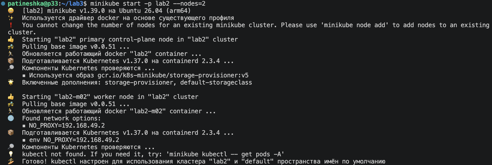

*img1 — Промежуточный запуск Minikube; готовность второй ноды проверяла отдельно*

У kubelet отсутствовали `config.yaml` и kubeconfig-файлы: первоначальное добавление оборвалось до bootstrap. Завершила подключение через `kubeadm join`, добавив каталог бинарников Minikube в PATH. Проверку `SystemVerification` пришлось пропустить из-за недоступного модуля ядра `configs` внутри Docker-ноды. Остальные проверки не отключала.

После подключения дождалась `Ready` и проверила обе ноды:

```bash
minikube -p lab2 kubectl -- wait \
  --for=condition=Ready node/lab2-m02 --timeout=3m

minikube -p lab2 kubectl -- get nodes -o wide
```

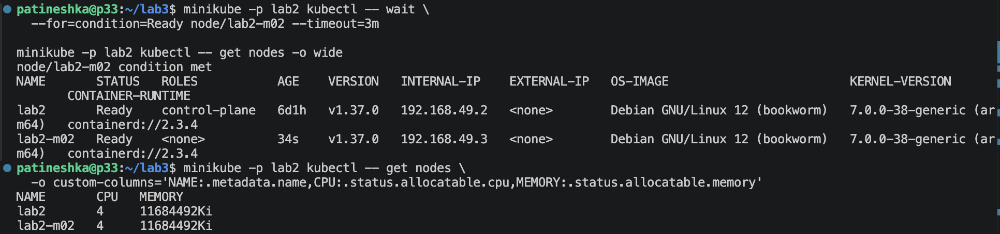

*img2 — `lab2` и `lab2-m02` в Ready*

| Нода | IP | Ограничение RAM Docker-контейнера |
|---|---|---:|
| `lab2` | `192.168.49.2` | 8 GiB |
| `lab2-m02` | `192.168.49.3` | 3 GiB |

При этом Kubernetes показывал по 4 CPU и `11684492Ki` памяти на каждой ноде. Эти значения нельзя складывать как независимые физические ресурсы: обе ноды используют одну виртуалку с четырьмя ядрами. Несовпадение видимой памяти и Docker-лимита дальше учитывала при настройке eviction.

## Часть 0 — Сервис batch

Для фоновой нагрузки подготовила `batch/main.py` и Dockerfile на `python:3.13-slim`. Приложение работает от пользователя `10001:10001`, дополнительные Python-библиотеки не нужны.

| Параметр | Что меняет |
|---|---|
| `CPU_WORKERS` | Количество процессов с непрерывными вычислениями; `0` отключает вычисления |
| `MEMORY_MIB` | Размер выделяемого массива в MiB |

Программа касается каждой страницы массива, чтобы память действительно использовалась. Массив удерживается до завершения процесса, а не увеличивается бесконечно. CPU-процессы работают непрерывно, основной процесс пишет JSON-логи каждые 10 секунд. SIGTERM завершает нагрузку и дочерние процессы.

Собрала образ и загрузила его на обе ноды:

```bash
minikube -p lab2 image build \
  -t docker.io/library/lab4-batch:v1 ~/lab4/batch

docker exec lab2 ctr -n k8s.io images export - \
  docker.io/library/lab4-batch:v1 > ~/lab4/images/batch-image.tar

docker exec -i lab2-m02 ctr -n k8s.io images import - \
  < ~/lab4/images/batch-image.tar
```

У приложения стоит `imagePullPolicy: Never`, поэтому наличие образа только на основной ноде было бы недостаточно. Таким же способом перенесла `shop-api:v2` и `shop-worker:v1`.

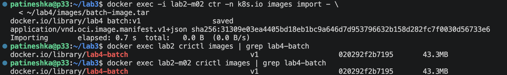

*img3 — Проверка образа через crictl на lab2 и lab2-m02*

В `allowed-images.yaml` добавила точный префикс `docker.io/library/lab4-batch:` для обычных и init-контейнеров. Сам namespace из политик не исключала. После этого выполнила временную smoke-проверку одной реплики:

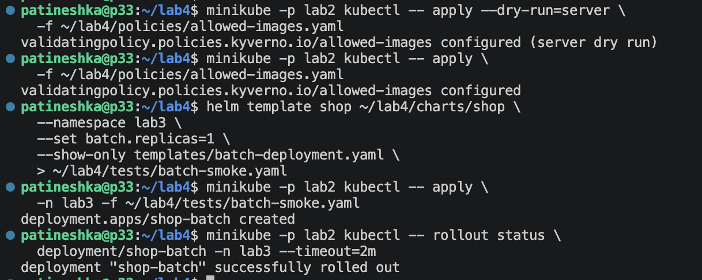

*img4 — Образ разрешен политикой, временный Deployment успешно запущен*

В логах — один работающий CPU-процесс и массив `67108864` байта. Pod запустился на worker, класс QoS — Burstable:

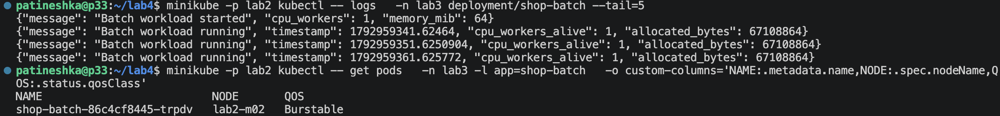

*img5 — Batch работает, выделено 64 MiB памяти*

Для первой проверки задала CPU request `100m`, limit `500m`, memory request `64Mi`, limit `128Mi`. В Prometheus получила:

| Метрика | Результат |
|---|---:|
| CPU | 0,499877 ядра, примерно 500m |
| Working set памяти | 87,0039 MiB |

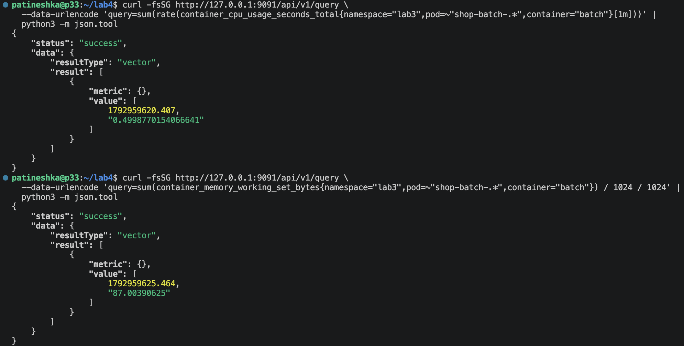

*img6 — CPU ограничен квотой 500m, память выше размера массива из-за расходов Python*

Requests не ограничивают потребление сверху. Поэтому request 100m не помешал программе использовать почти 500m — верхнюю границу задавал limit.

После smoke-проверки временный Deployment удалила, дальнейшие эксперименты запускала через Helm.

## Часть 1 — Выбор механизма разнесения

В `values.yaml` добавила переключатель:

```yaml
scheduling:
  mode: spread  # spread или antiAffinity
```

| Вариант | Поведение |
|---|---|
| `spread` | `topologySpreadConstraints`, `maxSkew: 1`, `DoNotSchedule` по `kubernetes.io/hostname` |
| `antiAffinity` | Мягкая `podAntiAffinity`, вес 100, по `kubernetes.io/hostname` |

Выбрала **spread**, потому что нужно разместить четыре реплики на двух нодах и контролировать равномерность. При двух доступных подходящих нодах и достаточных ресурсах ожидаю 2 + 2.

Мягкая anti-affinity только предпочитает разнести Pod, но не гарантирует равномерное размещение. Жесткая anti-affinity с запретом совместного размещения любых двух API Pod на одной ноде позволила бы запустить только две из четырех реплик.

В spread-правиле есть `matchLabelKeys: [pod-template-hash]`: при rolling update реплики каждой версии Deployment учитываются отдельно. Это не устраняет ограничения по ресурсам и не заставляет scheduler автоматически переселять уже работающие Pod.

Проверила рендеринг обоих режимов через `helm template`, затем установила выбранный вариант через `helm upgrade`.

## Часть 2 — Тесная площадка и batch в чарте

Использовала ровно две ноды. В чарт добавила `templates/batch-deployment.yaml`, параметры нагрузки, ресурсы и количество реплик вынесла в values. В обычном состоянии `batch.replicas: 0`, чтобы эксперимент случайно не продолжал нагружать стенд.

У batch есть метки `app` и `owner`, memory и CPU limits, обычная изоляция Pod и разрешенный образ. Ни privileged, ни host namespaces для него не включала. Существующие инфраструктурные исключения Kyverno сохранились, новых исключений для приложения не добавляла.

Для разных проверок использовала отдельные файлы значений:

| Файл | Назначение |
|---|---|
| `values.yaml` | Основная конфигурация, выбор spread, приоритеты и PDB |
| `values-resources.yaml` | Выбранные ресурсы API, worker, PostgreSQL и привязка БД к ноде |
| `values-scheduling.yaml` | Большие requests batch для Pending и preemption |
| `values-eviction.yaml` | Рост потребления памяти batch |
| `values-overload.yaml` | Четыре вычислительные batch-реплики для теста SLA |

При обновлении порядок `-f` важен: последний профиль переопределяет предыдущие значения. Все экспериментальные профили одновременно не подключала.

## Часть 3 — Реальные числа вместо угадывания

### Нагрузка по пути заказа

В `tests/orders.js` подготовила k6-тест: `POST /order`, JSON с товаром и количеством, ожидаемый ответ — HTTP 201.

| Настройка | Значение |
|---|---|
| Executor | `constant-arrival-rate` |
| Частота | 5 итераций в секунду |
| Основной прогон | 10 минут |
| VU | 5 заранее выделенных, максимум 20 |
| Порог задержки | p95 < 300 мс |
| HTTP-ошибки | < 1% |
| Успешные проверки HTTP 201 | > 99% |
| Пропущенные итерации | 0 |

Использовала официальный Docker-образ k6, его digest сохранила в `reports/k6-image.txt`:

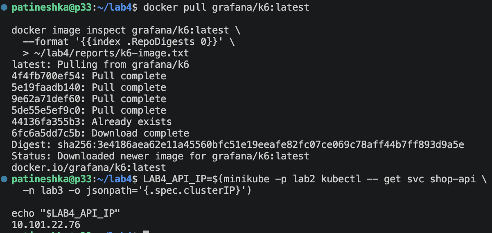

*img8 — k6 запускается в Docker, запросы идут к Service shop-api*

Запускала k6 в сетевом пространстве основной ноды через `--network container:lab2`, с обращением к ClusterIP Service. Поэтому запросы проходили через Service ко всем API, а не были привязаны port-forward к одному Pod.

```bash
LAB4_API_IP=$(minikube -p lab2 kubectl -- get svc shop-api \
  -n lab3 -o jsonpath='{.spec.clusterIP}')

set -o pipefail
docker run --rm -i \
  --network container:lab2 \
  -e BASE_URL="http://${LAB4_API_IP}:8080" \
  -e DURATION=10m \
  grafana/k6:latest run - \
  < ~/lab4/tests/orders.js \
  2>&1 | tee ~/lab4/reports/orders-baseline.txt
```

Генератор тоже работает на этой виртуалке и использует ее CPU, но находится в отдельном Docker-контейнере, а не в cgroup самой ноды.

Сначала короткая проверка: 150 заказов, 0 ошибок, p95 11,33 мс. Затем baseline: 3001 заказ, 0 ошибок, p95 16,06 мс.

### KRR на ARM64

Готовый Ubuntu-архив KRR `v1.31.1` оказался x86-64. На ARM64 такой бинарник напрямую не подходит, поэтому собрала KRR из исходников этой версии в Docker с Python 3.12.

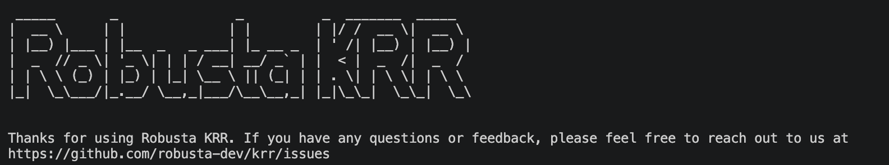

*img9 — KRR запускается из собственного Docker-образа*

Prometheus доступен через port-forward `9091:9090`. В KRR передала kubeconfig и каталог сертификатов Minikube только для чтения:

```bash
docker run --rm \
  --network host \
  -v "$HOME/.kube/config:/root/.kube/config:ro" \
  -v "$HOME/.minikube:$HOME/.minikube:ro" \
  lab4-krr:v1.31.1 simple \
  --kubeconfig /root/.kube/config \
  --context lab2 \
  --namespace lab3 \
  --prometheus-url http://127.0.0.1:9091 \
  --history_duration 1 \
  --timeframe-duration 0.25 \
  --points_required 20 \
  --width 160 \
  2>&1 | tee ~/lab4/reports/krr-baseline.txt
```

Сначала указала историю 10 минут и получила ValidationError: KRR требует минимум один час. В итоге окно — последний час, включая baseline-нагрузку, шаг — 15 секунд, минимум — 20 точек. Это короткий лабораторный замер, а не оценка всех суточных пиков приложения.

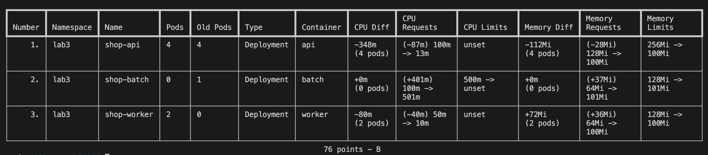

*img10 — KRR обнаружил API, worker и batch, включая исторические Pod*

| Компонент | Начальный CPU request | KRR CPU request | Начальная память request / limit | KRR память request / limit |
|---|---:|---:|---|---|
| API, на Pod | 100m | 13m | 128Mi / 256Mi | 100Mi / 100Mi |
| Worker, на Pod | 50m | 10m | 64Mi / 128Mi | 100Mi / 100Mi |
| Batch, smoke-профиль | 100m | 501m | 64Mi / 128Mi | 101Mi / 101Mi |

В момент анализа у batch было 0 действующих Pod и 1 исторический — поэтому рекомендация в таблице есть, хотя нагрузка уже остановлена. Рекомендацию batch механически не применяла: в дальнейших профилях намеренно меняла соотношение requests и фактического потребления.

У API и worker исходный CPU request оказался заметно выше измеренного p95. Для worker KRR предложил увеличить память относительно первоначальных 64Mi. При этом 100Mi — минимальное значение памяти в настройках KRR, а не утверждение, что процесс всегда потребляет ровно столько.

Стратегия Simple рекомендует CPU request по p95 и не задает CPU limit. Память оценивает как максимум плюс 15%, с учетом минимального значения рекомендации.

### Что получилось с PostgreSQL

**PostgreSQL в отчет KRR не попал:** его Pod напрямую управляется CloudNativePG, а не обнаруженными Deployment. Поэтому для БД выполнила отдельный расчет из Prometheus по аналогичным показателям:

```promql
1000 * quantile_over_time(
  0.95,
  (sum(rate(container_cpu_usage_seconds_total{
    namespace="lab3", pod="shop-postgres-1", container="postgres"
  }[1m])))[1h:15s]
)
```

```promql
1.15 * max_over_time(
  (sum(container_memory_working_set_bytes{
    namespace="lab3", pod="shop-postgres-1", container="postgres"
  }))[1h:15s]
) / 1024 / 1024
```

Получила примерно **46,55m CPU** и **132,59 MiB памяти с запасом 15%**. Это отдельный расчет по метрикам, а не рекомендация, выданная KRR для PostgreSQL. Требование получить рекомендации KRR для всех трех компонентов этим полностью не закрыто.

### Примененные ресурсы

По измерениям выбрала значения с дополнительным запасом и записала в `values-resources.yaml`:

| Компонент | CPU request / limit | Memory request / limit |
|---|---|---|
| API | 50m / 50m | 128Mi / 128Mi |
| Worker | 20m / без CPU limit | 128Mi / 128Mi |
| PostgreSQL | 100m / 100m | 256Mi / 256Mi |

Эти числа опираются на измерения, но **не повторяют рекомендации KRR дословно**. API получила запас относительно 13m, worker — относительно 10m. Для PostgreSQL оставила дополнительный запас к измеренному потреблению. У API и PostgreSQL CPU limit вернула для требуемого эксперимента с Guaranteed; у worker CPU limit не задавала.

Здесь не получилось просто «уменьшила ресурсы и стало лучше»: после изменения задержка выросла. Поэтому после применения повторила тот же тест и сохранила результат, а не ограничилась успешным Helm upgrade.

```bash
helm upgrade shop ~/lab4/charts/shop \
  --namespace lab3 --kube-context lab2 \
  -f ~/lab4/charts/shop/values-resources.yaml \
  --wait --timeout 5m
```

### PostgreSQL переехал, а данные — нет

Во время обновления Pod БД попал на `lab2-m02` и ушел в CrashLoopBackOff. В логах было:

```text
stat /var/lib/postgresql/data/pgdata: no such file or directory
```

Причина оказалась не в CPU limit. Стандартный provisioner Minikube создал hostPath-том на `lab2`; та же директория на другой ноде не содержит исходную БД.

Проверила наличие `pgdata/PG_VERSION` на основной ноде по пути `/tmp/hostpath-provisioner/lab3/shop-postgres-1`. Данные были на месте. Вернула Pod на `lab2`, затем закрепила настройку в чарте:

```yaml
# values-resources.yaml
postgresNodeSelector:
  kubernetes.io/hostname: lab2
```

В `Cluster.spec.affinity.nodeSelector` подставляются эти значения. PVC не удаляла, новую БД вместо старой не инициализировала. После пересоздания Pod кластер вернулся в healthy.

Это локальное хранилище учебного стенда, а не отказоустойчивая БД с переносимым томом.

## Часть 4 — Разнесение API между нодами

Проверила фактическое размещение:

```bash
minikube -p lab2 kubectl -- get pods \
  -n lab3 -l app=shop-api -o wide
```

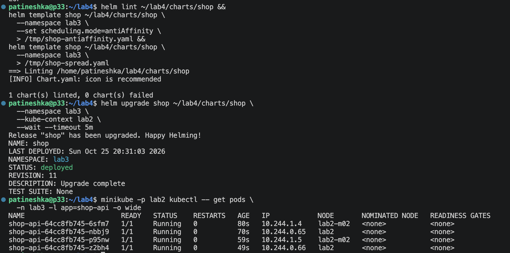

*img7 — После обновления две реплики API на lab2 и две на lab2-m02*

Разнесение уменьшает зависимость API от одной ноды. Но две Docker-ноды внутри одной VM не защищают от выключения всей VM. Отдельно отказ ноды с замером доступности в этой лабораторной не проводила. PostgreSQL осталась единственной репликой с локальным томом, поэтому отказоустойчивость всего пути заказа по одному распределению API утверждать нельзя.

## Часть 5 — Приоритеты, QoS и PDB

После применения ресурсов проверила класс Pod, а не только равенство полей в values:

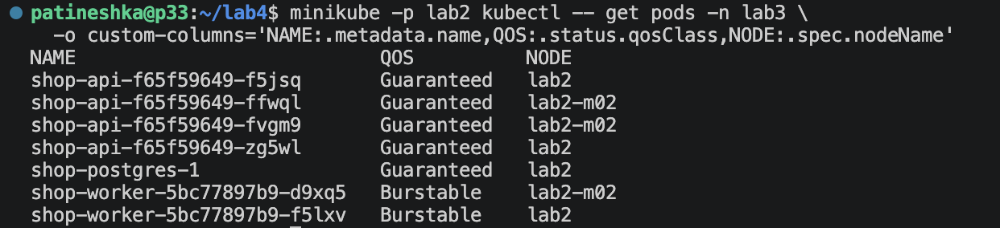

*img11 — API и PostgreSQL Guaranteed, worker Burstable*

Для Guaranteed у каждого обычного и init-контейнера должны быть заданы равные CPU requests/limits и равные memory requests/limits. У PostgreSQL проверка включала init-контейнер `bootstrap-controller`. Worker остается Burstable, потому что CPU limit отсутствует. Batch — Burstable: его requests ниже limits.

### PriorityClass

Добавила шаблон `priorityclasses.yaml`, числовые значения — в `values.yaml`:

| Класс | Приоритет | Политика preemption | Кому назначен |
|---|---:|---|---|
| `shop-critical` | 100000 | `PreemptLowerPriority` | API и PostgreSQL |
| `shop-batch` | -1000 | `Never` | Batch |

`Never` означает, что сам batch не вытесняет чужие Pod. От вытеснения высокоприоритетным Pod эта настройка его не защищает. Worker сохранила с обычным приоритетом 0.

### PodDisruptionBudget

Для API добавила `api-pdb.yaml`, параметры включения и `minAvailable: 3` вынесла в values. Для PostgreSQL использовала PDB самого CloudNativePG, включаемый через `spec.enablePDB`, тоже из values. Второй пересекающийся PDB для БД не создавала.

| PDB | minAvailable | Allowed disruptions при проверке |
|---|---:|---:|
| `shop-api` | 3 | 1 |
| `shop-postgres-primary` | 1 | 0 |

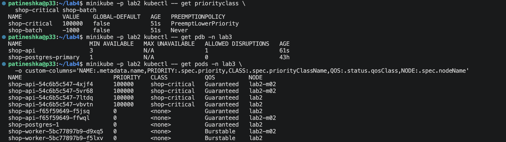

*img12 — Классы и PDB созданы; в этом промежуточном снимке еще есть старые API Pod и PostgreSQL с приоритетом 0*

Настройка `priorityClassName` в Cluster уже была `shop-critical`, но существующий Pod PostgreSQL остался со старым приоритетом. Пересоздала его на закрепленной ноде. Итоговая проверка показала:

```text
NAME              PRIORITY   CLASS           QOS          NODE
shop-postgres-1   100000     shop-critical   Guaranteed   lab2
```

PDB ограничивает добровольные выселения через Eviction API, например при drain. Он не спасает от отказа ноды и не гарантирует защиту при preemption или node-pressure eviction. Сам по себе PDB также не ограничивает rolling update Deployment — для него важны `maxUnavailable` и `maxSurge`.

Важно не смешивать два механизма: scheduler выбирает жертв preemption прежде всего по **приоритету**, а не по названию QoS. При давлении по памяти kubelet учитывает превышение requests, приоритет и величину превышения. Guaranteed не означает абсолютную неуязвимость, но в нашем сценарии batch был менее защищен и превышал свой memory request.

## Часть 6 — Pending и preemption

### Ресурсы закончились на бумаге

В `values-scheduling.yaml` задала шесть batch-реплик. Каждая запрашивала 2 CPU и 64Mi памяти, limits — 2500m и 128Mi. Вычислительные процессы отключила (`cpuWorkers: 0`), массив — 16 MiB.

Суммарный CPU request batch — 12 ядер, а scheduler видит суммарно 8 CPU на двух нодах, причем часть уже зарезервирована другими Pod. Физически у VM вообще четыре ядра.

```bash
helm upgrade shop ~/lab4/charts/shop \
  --namespace lab3 --kube-context lab2 \
  -f ~/lab4/charts/shop/values-resources.yaml \
  -f ~/lab4/charts/shop/values-scheduling.yaml
```

`--wait` намеренно не использовала: Pending здесь ожидаемый результат.

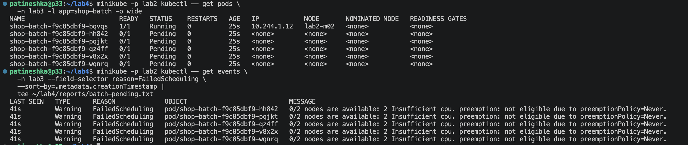

*img13 — Одна batch-реплика Running, пять Pending*

В событиях:

```text
0/2 nodes are available: 2 Insufficient cpu.
preemption: not eligible due to preemptionPolicy=Never.
```

Хотя batch почти не использовал CPU, остальные реплики не поместились. Scheduler считает по requests, а не по фактическому потреблению из Prometheus.

### Высокий приоритет вытесняет batch

Для явного наблюдения создала отдельный тестовый Pod `preemption-api` с образом API, приоритетом `shop-critical`, CPU request/limit 2 и memory request/limit 128Mi. Через nodeSelector направила его на `lab2-m02`, где уже работал batch.

Тестовая метка `app: preemption-api` не совпадает с selector основного Service, поэтому этот Pod не принимал пользовательские заказы. Это проверка механизма с образом API, **а не масштабирование рабочего Deployment**; Pod создан из отдельного файла через kubectl, в отличие от рабочих компонентов чарта.

В событиях получила:

```text
Preempted  pod/shop-batch-f9c85dbf9-bqvqs
Preempted by pod ... on node lab2-m02

FailedScheduling  pod/preemption-api
found a potential placement for pod on node lab2-m02, preempting 1 victims

Scheduled  pod/preemption-api
Successfully assigned lab3/preemption-api to lab2-m02
```

В наблюдении видно завершение batch и запуск тестового API:

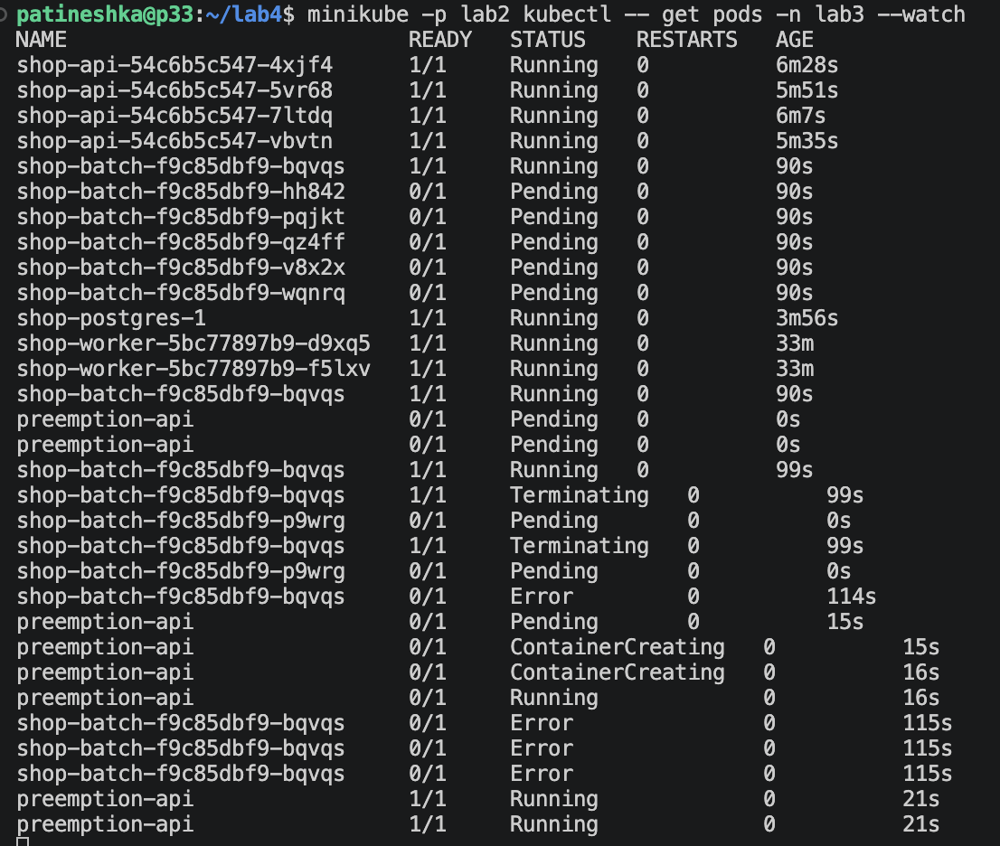

*img15 — Batch завершается, preemption-api проходит Pending → Running → Ready*

После вытеснения ReplicaSet попытался восстановить batch, но замена осталась Pending:

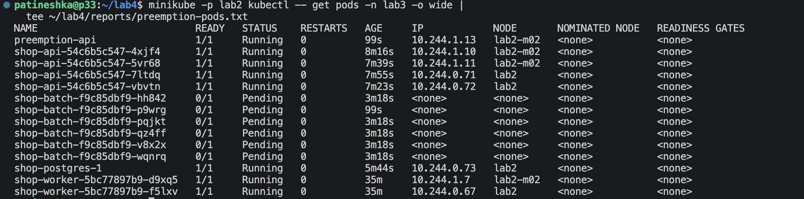

*img14 — Preemption-api 1/1 Running, все шесть batch-реплик Pending*

События сохранила в `reports/preemption-events.txt`, список Pod — в `reports/preemption-pods.txt`. Затем выключила batch через Helm и удалила тестовый Pod.

## Часть 7 — MemoryPressure и eviction

### Почему не стала просто выделять память до упора

У worker Docker-лимит 3 GiB, но kubelet видел около 11 GiB общей памяти. Перед тестом stats summary показывал:

```text
availableBytes 10842.9 MiB
workingSetBytes 567.7 MiB
usageBytes 2025.3 MiB
```

Дополнительно в конфигурации kubelet не было memory-порога eviction: `evictionHard` содержал только нулевые пороги файловых систем. Попытка занять гигабайты могла привести к OOM Docker-ноды раньше требуемого выселения Pod.

Поэтому **изменила условия эксперимента**: на worker временно настроила повышенный soft-порог `memory.available`, примерно на 192 MiB ниже свежего доступного значения. Получившийся порог — `10670Mi`, grace period — 10 секунд, максимальное время завершения Pod при soft eviction — 15 секунд.

```yaml
evictionSoft:
  memory.available: "10670Mi"
evictionSoftGracePeriod:
  memory.available: "10s"
evictionMaxPodGracePeriod: 15
```

Порог специально необычно высокий: это воспроизводимый тест механизма на стенде с несовпадением видимой памяти и Docker-лимита. Он **не доказывает**, что физическая память VM действительно была исчерпана. Конфигурацию kubelet меняла вне Helm-чарта, исходный файл сохранила для восстановления.

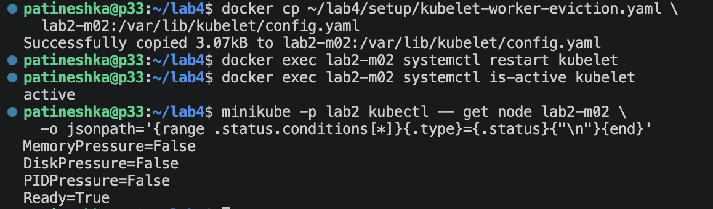

*img16 — До нагрузки worker Ready, MemoryPressure=False*

### Увеличение потребления batch

В `values-eviction.yaml` указала одну реплику, nodeSelector на worker, `cpuWorkers: 0`, массив 256 MiB, memory request 64Mi, limit 512Mi. CPU request/limit — 100m/500m. Собственный memory limit выше ожидаемого потребления, чтобы не получить обычный container OOM.

Применила профиль через Helm:

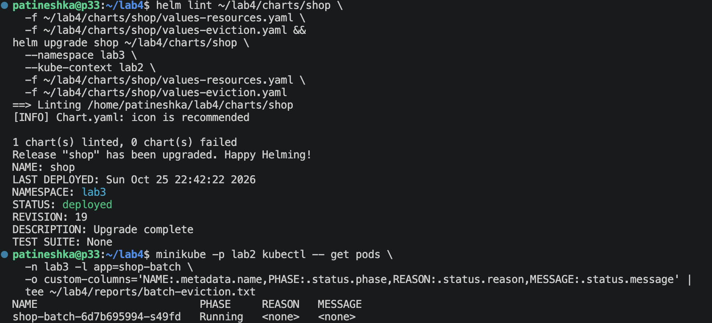

*img17 — Профиль установлен; первый снимок Pod еще показывает Running*

В параллельном наблюдении нода перешла в MemoryPressure:

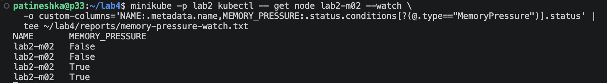

*img18 — Состояние памяти изменилось с False на True*

Затем появилось событие:

```text
Warning Evicted pod/shop-batch-6d7b695994-s49fd
The node was low on resource: memory.
Threshold quantity: 10670Mi, available: 10838604Ki.
Container batch was using 274840Ki, request is 64Mi,
has larger consumption of memory.
```

Batch использовал около 268 MiB: выше request 64Mi, но ниже limit 512Mi. Kubelet выбрал его жертвой eviction. API и PostgreSQL продолжали работать. У replacement Pod появился FailedScheduling из-за taint worker и привязки к этой ноде.

Первоначальный вывод `Running` был снят до завершения выселения. Основное доказательство — событие `Evicted`, а не эта ранняя строка. События сохранены в `reports/eviction-events.txt`.

### Evicted и OOMKilled — разные причины

| Диагноз | Что произошло |
|---|---|
| `Evicted` | Kubelet завершил Pod из-за давления ресурса на ноде; причина записана в событиях и статусе Pod |
| `OOMKilled` из-за своего лимита | Процесс контейнера превысил cgroup memory limit; причина видна в состоянии завершения контейнера |

В нашем эксперименте сработал первый вариант. Наличие memory limit у batch не мешает kubelet выселить его раньше достижения этого лимита. PDB от node-pressure eviction не защищает.

После фиксации события batch масштабировала в ноль, вернула исходный файл kubelet и перезапустила службу:

```bash
docker cp ~/lab4/setup/backups/kubelet-worker-original.yaml \
  lab2-m02:/var/lib/kubelet/config.yaml
docker exec lab2-m02 systemctl restart kubelet
```

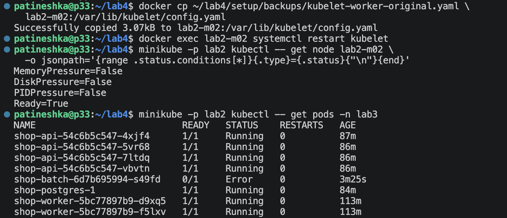

*img19 — MemoryPressure=False, worker Ready; API, PostgreSQL и worker приложения готовы*

Старый batch отображался как Error — это завершенный Pod после эксперимента, не продолжающая работать нагрузка.

## Часть 8 — SLA под нагрузкой

Сформулировала цель теста: **при 5 заказах/с p95 HTTP-времени создания заказа меньше 300 мс, доля ошибок меньше 1%, пропущенных итераций нет**. Это проверка за конкретные 10 минут, а не обещание доступности сервиса за месяц.

Для CPU-перегрузки создала `values-overload.yaml`: четыре batch-реплики на worker, по одному CPU-процессу и массиву 64 MiB. У каждой CPU request 100m, limit 1 CPU, memory request 64Mi, limit 128Mi. Batch остается Burstable и низкоприоритетным.

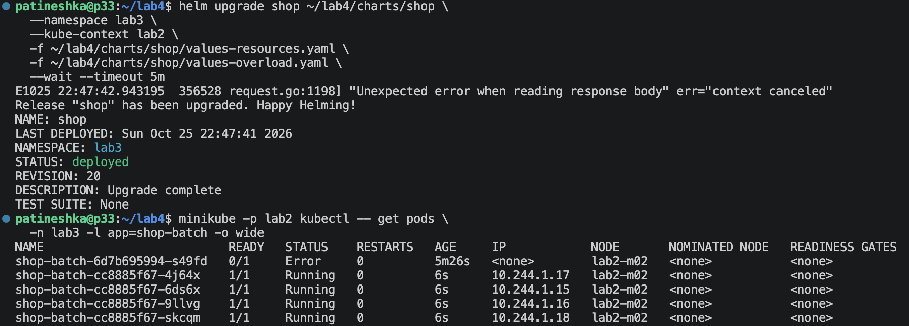

*img20 — Все четыре новые batch-реплики Running на lab2-m02; старый Error относится к предыдущему eviction*

Запрос в Prometheus показал суммарное потребление batch **3,472 CPU**:

```promql
sum(rate(container_cpu_usage_seconds_total{
  namespace="lab3", pod=~"shop-batch-.*", container="batch"
}[1m]))
```

Это существенная конкуренция на VM с четырьмя ядрами. Значение — отдельный замер во время теста, не утверждение, что все десять минут потребление было постоянным.

Повторила тот же десятиминутный `orders.js` с частотой 5 заказов/с:

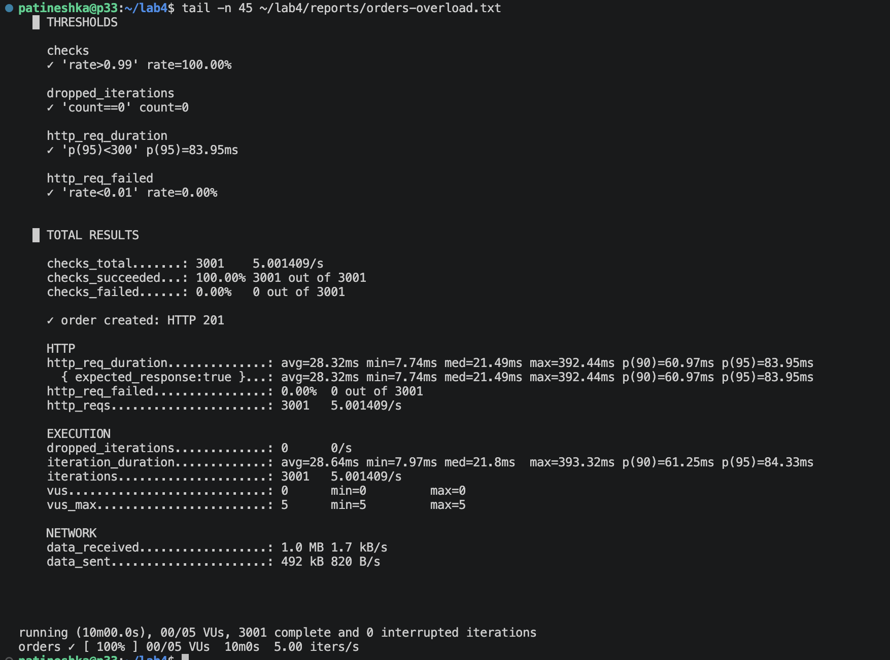

*img21 — Все пороги k6 выполнены при работающем batch*

### Сравнение трех прогонов

| Показатель | Исходные ресурсы | После подбора ресурсов | Под CPU-перегрузкой |
|---|---:|---:|---:|
| Длительность | 10 минут | 10 минут | 10 минут |
| Частота | ≈5 заказов/с | ≈5 заказов/с | ≈5 заказов/с |
| Заказы, HTTP 201 | 3001 | 3000 | 3001 |
| Ошибки | 0% | 0% | 0% |
| Среднее HTTP-время | 12,30 мс | 83,55 мс | 28,32 мс |
| p95 HTTP-времени | 16,06 мс | 117,96 мс | 83,95 мс |
| Максимум | 111,14 мс | 955,73 мс | 392,44 мс |
| Пропущенные итерации | 0 | 0 | 0 |

Во всех трех прогонах p95 ниже 300 мс. Максимум выше 300 мс в двух тестах не противоречит порогу p95: он не требует, чтобы абсолютно каждый запрос был быстрее 300 мс.

После добавления небольших CPU limits задержка выросла относительно baseline. Это совместимо с влиянием throttling, но отдельное измерение throttling для доказательства причины не проводила. Под нагрузкой p95 оказался ниже предыдущего прогона — записала полученный результат, а не сделала вывод, будто batch ускоряет API. Состояние VM, прогрев и фоновые процессы между отдельными прогонами не идентичны.

**Граница проверки:** десятиминутный SLA-тест проведен отдельно под CPU-нагрузкой. Непрерывный k6 одновременно с preemption и memory eviction не зафиксирован, поэтому сохранение SLA именно в моменты частей 6–7 не доказано. Скриншот k6 содержит итоговые метрики, а не временные графики задержки/ошибок. Новый дашборд и графики для этого эксперимента не экспортировала; дашборд из lab3 не считаю доказательством этого прогона. Эти пункты исходного задания остаются неполностью закрытыми.

После теста остановила batch, вернув основной профиль ресурсов:

```bash
helm upgrade shop ~/lab4/charts/shop \
  --namespace lab3 --kube-context lab2 \
  -f ~/lab4/charts/shop/values-resources.yaml \
  --set batch.replicas=0 \
  --wait --timeout 5m
```

## Часть 9 — Мониторинг и алерты

ServiceMonitor для API и worker и три правила PrometheusRule находятся в чарте. Использовала метку `release: monitoring`, чтобы существующий Prometheus выбирал эти объекты. Второй стек не устанавливала.

| Алерт | Условие | Зачем и что проверить |
|---|---|---|
| `ShopAPIDown` | Все API scrape-цели имеют up=0 или цели отсутствуют; `for: 1m` | Нельзя собрать метрики API: проверить Pod, readiness, Service и отдельно пользовательский запрос |
| `ShopHighErrorRate` | Общая доля HTTP 5xx >20% в окне 1m; `for: 1m` | Заказы могут завершаться ошибками: проверить логи API, БД и последние изменения |
| `ShopWorkerStalled` | Нет свежего успешного опроса БД от доступных worker больше 60 с или подходящие метрики отсутствуют; `for: 1m` | Может остановиться обработка заказов: проверить worker и подключение к PostgreSQL |

Все три правила имеют `severity: critical`. `ShopAPIDown` проверяет доступность сбора метрик, а не полный пользовательский путь. У worker успешный пустой опрос очереди тоже обновляет временную метку: отсутствие новых заказов не должно само вызывать алерт.

На скриншоте ниже правила уже в inactive и `health=ok`. Имя файла `alerts-firing.txt` не меняет фактического состояния на снимке:

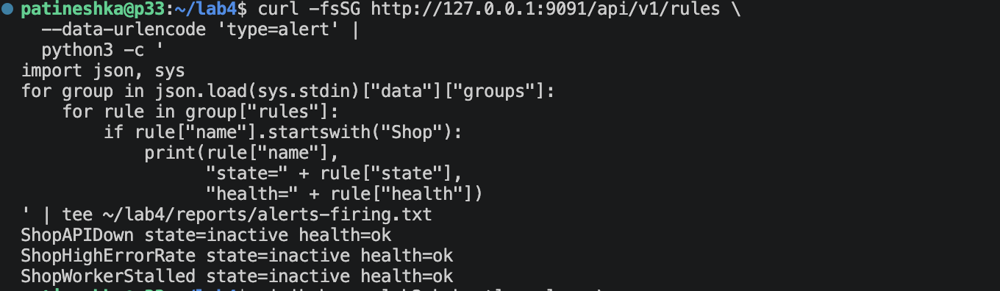

*img22 — Проверка правил после восстановления, не снимок firing*

### Проверка доставки firing и resolved

Для вызова `ShopHighErrorRate` создала `tests/trigger-error-alert.js`: 10 запросов/с к `/fail` в течение трех минут. HTTP 500 в этом тесте намеренные, проверка ожидает именно 500. Нагрузку выполняла отдельно от успешного SLA-прогона.

Alertmanager отправил уведомление receiver `lab2-webhook`. Имя осталось от второй лабы, но получатель принимает и алерты shop. По логам получателя подтверждены оба события:

| Событие | UTC |
|---|---|
| Начало алерта | `2026-10-25T23:28:41.742Z` |
| Завершение алерта | `2026-10-25T23:31:11.742Z` |

Сначала получила огромную JSON-строку со служебными ссылками, а потом вспомнила, что форматтер уже был в третьей лабе :) Переиспользовала `tests/format-alerts.py`, который выбирает алерты `Shop*` и оставляет полезные поля:

```bash
python3 ~/lab4/tests/format-alerts.py \
  < ~/lab4/reports/alert-delivery.txt | \
  tee ~/lab4/reports/alert-delivery-pretty.txt
```

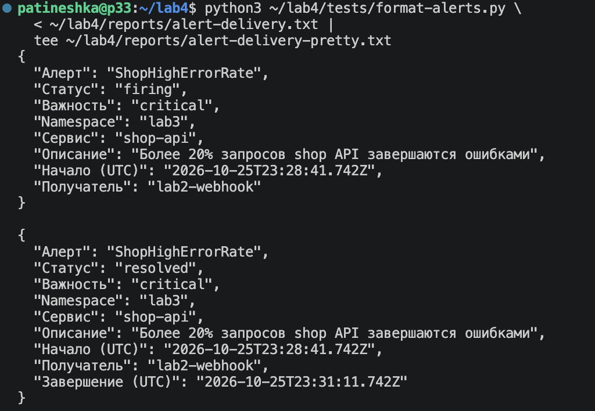

*img23 — Подтверждена доставка уведомления о проблеме и восстановлении*

Таким образом проверена цепочка **Prometheus → Alertmanager → webhook receiver**. Новый снимок Karma в этой лабораторной не делала; отдельное срабатывание остальных двух правил тоже не провоцировала.

## Что получилось

- Две готовые ноды Minikube и образы приложения на обеих
- Batch с настраиваемой нагрузкой CPU и памяти, запуск из Helm-чарта
- Переключатель spread/anti-affinity и фактическое размещение API 2 + 2
- Отчет KRR для API и worker, отдельная оценка PostgreSQL по метрикам, сравнение начальных и выбранных ресурсов
- Guaranteed и высокий приоритет у API/PostgreSQL, низкий приоритет и Burstable у batch
- PDB API и управляемый оператором PDB PostgreSQL
- Pending из-за CPU requests и подтвержденный preemption batch тестовым API Pod
- MemoryPressure и eviction batch при лабораторном soft-пороге, затем восстановление kubelet
- 3001 успешный заказ под CPU-нагрузкой batch, p95 83,95 мс при пороге 300 мс
- Три правила алертов в чарте и доставка firing/resolved одного из них

В конце нагрузку остановила, тестовый `preemption-api` удалила, конфигурацию kubelet восстановила. Рабочие компоненты — четыре API, два worker и одна PostgreSQL. БД закреплена на `lab2`, batch в обычном профиле выключен. Исторические завершенные Pod могут оставаться в списке.

### Что отличается от полного задания

Чтобы не путать полученный результат с тем, что еще нужно доказать:

| Требование | Что проверено на этом стенде |
|---|---|
| kind/k3d на 1–2 ноды | Использован Minikube на двух нодах |
| KRR для API, worker, PostgreSQL | API/worker — KRR; PostgreSQL — отдельный Prometheus-расчет |
| Ресурсы критического пути из KRR | Выбраны по измерениям с дополнительным запасом, не дословные рекомендации |
| Preemption рабочего API/PostgreSQL | Проверен отдельным тестовым Pod с образом API и высоким приоритетом |
| Eviction при нехватке памяти | Реальный eviction при временно повышенном soft-пороге kubelet |
| SLA одновременно с preemption и eviction | Проведен отдельный прогон под CPU-нагрузкой; совмещенного доказательства нет |
| Временные графики и дашборд прогона | Сохранены итог k6 и замер Prometheus; новых временных графиков нет |

## Файлы и повторение проверок

Исходники и сырые результаты экспериментов находятся на VM в `~/lab4`. При переносе в репозиторий сохраняю их рядом с этим README и `images/`. Папка отчета с Mac сама по себе не содержит автоматически выгруженные файлы VM.

| Каталог | Содержимое |
|---|---|
| `api/`, `worker/` | Сервисы из третьей лабы |
| `batch/` | Генератор нагрузки и Dockerfile |
| `charts/shop/` | Рабочие шаблоны и профили values |
| `policies/` | Политики Kyverno с разрешенным образом batch |
| `tests/` | k6-сценарии, форматтер уведомлений и тест preemption |
| `reports/` | Сохраненные результаты команд и k6 |
| `images/` | Скриншоты `img1.png`–`img23.png` |

Основные результаты на VM: `krr-baseline.txt`, `orders-baseline.txt`, `orders-rightsized.txt`, `orders-overload.txt`, `batch-pending.txt`, `preemption-events.txt`, `preemption-pods.txt`, `memory-pressure-watch.txt`, `eviction-events.txt`, `batch-overload-cpu.json`, `alert-delivery.txt` и `alert-delivery-pretty.txt`.

При обычном обновлении обязательно подключаю файл ресурсов:

```bash
helm lint ~/lab4/charts/shop \
  -f ~/lab4/charts/shop/values-resources.yaml

helm upgrade shop ~/lab4/charts/shop \
  --namespace lab3 --kube-context lab2 \
  -f ~/lab4/charts/shop/values-resources.yaml \
  --set batch.replicas=0 \
  --wait --timeout 5m
```

Архивы Docker-образов, скачанные бинарники и копию исходников KRR в Git не добавляю. Таблица [screenshots-map.csv](screenshots-map.csv) сохраняет соответствие исходных имен скриншотов и новых номеров.

## Топ ошибок

К сожалению, без приключений снова не обошлось. Вот мой топ затыков (затупов):

1. **Две ноды в списке Minikube — еще не две ноды Kubernetes.** Worker-контейнер существовал, но bootstrap оборвался. Проверять нужно `kubectl get nodes` и состояние kubelet, а не только финальное «Готово».

2. **«CPU свободен, почему Pod Pending?»** Запросила по два ядра у шести почти ничего не делающих batch. Планировщик честно посчитал requests, а не фактическую скуку приложения :)

3. **ARM64 снова напомнил о себе.** Архив назывался Ubuntu, но внутри оказался x86-64. В итоге KRR собрала из исходников в Docker с Python 3.12.

4. **KRR не согласился на десять минут истории.** Минимум оказался один час. Изменила окно анализа и честно указала, что оно включает и нагрузку, и менее активные периоды.

5. **Отсутствие port-forward выглядело как ошибка JSON.** Сначала curl не подключился к 9091, а затем Python закономерно не смог разобрать пустой ввод. Исправлять нужно было соединение с Prometheus, а не парсер.

6. **Helm «завис», а PostgreSQL искал данные на другой ноде.** Дождалась таймаута, посмотрела события и логи. HostPath на worker не стал копией тома основной ноды. Вернула БД на `lab2`, закрепила это в чарте, PVC не трогала.

7. **Резервная копия тоже попала в шаблоны.** `postgres-cluster.yaml.bak` внутри `templates/` сломал lint из-за расширения. Перенесла копию в `setup/backups/`, за пределы чарта.

8. **PriorityClass в Cluster уже есть, а Pod все еще с нулевым приоритетом.** Проверила фактический Pod и пересоздала его. Значения объекта и параметры уже запущенного контейнера — не всегда одно и то же.

9. **11 GiB у каждой ноды не превратили VM в 22 GiB.** Docker ограничивал worker тремя гигабайтами, а kubelet видел память VM. Поэтому тестировала eviction через контролируемый порог, а не заполняла память до падения всей ноды.

10. **Running сняла раньше, чем случился eviction.** В следующем выводе уже было событие Evicted. При разборе важно сравнивать время снимков, статус завершения и события, а не одну строку.

11. **Файл alerts-firing.txt оказался со статусами inactive.** Название файла — не доказательство срабатывания. Firing и resolved подтвердила по доставленным webhook-уведомлениям.

На этом стенде особенно хорошо стало видно, что requests, limits, QoS, PriorityClass и PDB решают разные задачи. Одно слово Guaranteed не заменяет проверку размещения, работу хранилища и измерение пользовательского запроса ;)

## Полезные ссылки

- [Задание лабораторной №4](https://github.com/KeladKaal/containerization-and-orchestration/blob/main-rus/lecture-4-scheduling-resources/lab.md)
- [Topology spread constraints](https://kubernetes.io/docs/concepts/scheduling-eviction/topology-spread-constraints/)
- [Priority и preemption](https://kubernetes.io/docs/concepts/scheduling-eviction/pod-priority-preemption/)
- [Node-pressure eviction](https://kubernetes.io/docs/concepts/scheduling-eviction/node-pressure-eviction/)
- [Ограничение стандартного provisioner Minikube в multi-node](https://minikube.sigs.k8s.io/docs/tutorials/multi_node/)
- [Robusta KRR](https://github.com/robusta-dev/krr)
