# Лаба 5 — Zero-trust сеть с доказательством
## Подготовка стенда

По традиции перед началом проверила память, диск и состояние кластера: доступно около 5,7 ГиБ RAM и 20 ГБ на диске, обе ноды `Ready` - пока ноут живет, это радует

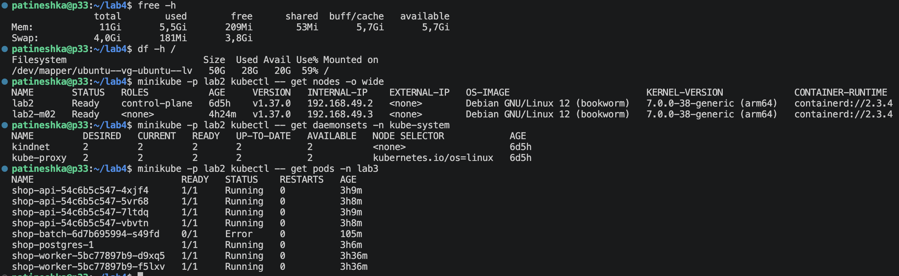

Продолжила работу в Minikube `lab2`, namespace приложения — `lab3`

| Нода | Роль | Internal IP |
|---|---|---|
| `lab2` | Control plane и приложения | `192.168.49.2` |
| `lab2-m02` | Worker | `192.168.49.3` |

У приложения четыре реплики API, две worker и одна PostgreSQL под управлением CloudNativePG. PostgreSQL оставила на `lab2`, потому что его PVC использует локальный каталог этой ноды

## Часть 0 — Выбор CNI

Выбрала Cilium, потому что вместе с сетевыми политиками он дает Hubble и можно увидеть источник, назначение, порт, направление и причину блокировки. Для этой лабы это полезно и при проверке запретов, и при поиске поломки (что бывает часто :( )

Calico тоже подходит для применения сетевых политик, но в этой работе использовала инструменты Cilium

Добавила репозиторий и посмотрела доступные версии:

```bash
helm repo add cilium https://helm.cilium.io/
helm repo update cilium
helm search repo cilium/cilium --versions | head -n 6
```

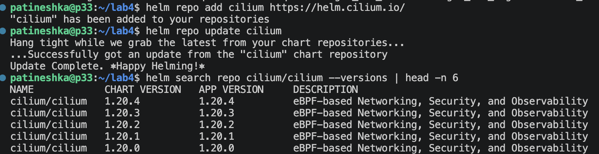

Чтобы сохранить сеть уже работающего кластера, выбрала *generic-veth chaining поверх kindnet. Kindnet оставила для базовой адресации и маршрутов, Cilium подключила к veth для наблюдаемости и проверок трафика

Основные параметры в [setup/cilium-values.yaml](setup/cilium-values.yaml):

```yaml
cni:
  chainingMode: generic-veth
  chainingTarget: kindnet
  exclusive: false

routingMode: native
enableIPv4Masquerade: false
ipv4NativeRoutingCIDR: 10.244.0.0/16
ipam:
  mode: kubernetes
kubeProxyReplacement: false

hubble:
  enabled: true
  relay:
    enabled: true
  ui:
    enabled: true
```

`kubeProxyReplacement: false` означает, что Service и NodePort продолжает обслуживать kube-proxy. Полностью заменять сетевой стек работающего кластера не стала (все же дедлайн сильно поджимает...)

```bash
helm upgrade --install cilium cilium/cilium \
  --version 1.20.4 \
  --namespace kube-system \
  --kube-context lab2 \
  -f ~/lab5/setup/cilium-values.yaml \
  --wait --timeout 5m
```

Cilium запустился на обеих нодах, Hubble Relay и UI тоже стали готовы:

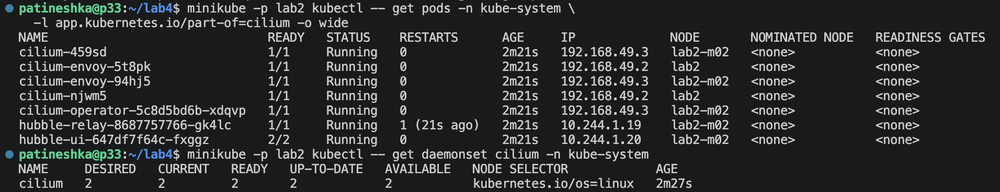

## Часть 1 — Сеть Pod

После подключения Cilium пересоздала Pod API и worker

На промежуточной проверке endpoints были у API и worker, а PostgreSQL еще работал со старой сетью:

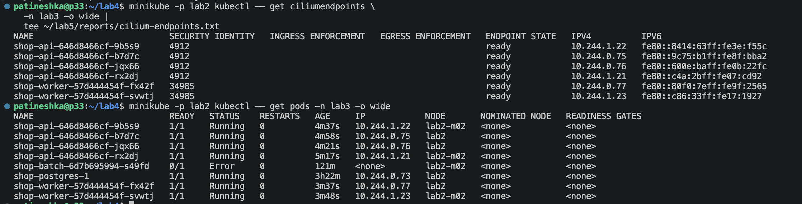

Пересоздала Pod PostgreSQL, сохранив Cluster, PVC и размещение на `lab2`. После этого endpoint появился и у базы:

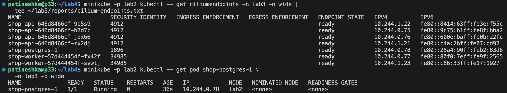

### IP, eth0 и veth

Подготовила [tests/inspect-network.sh](tests/inspect-network.sh). Скрипт выбирает worker на `lab2-m02`, находит PID его sandbox через `crictl`, входит в network namespace через `nsenter` и выводит интерфейсы и маршруты

```bash
bash ~/lab5/tests/inspect-network.sh |
  tee ~/lab5/reports/pod-network.txt
```

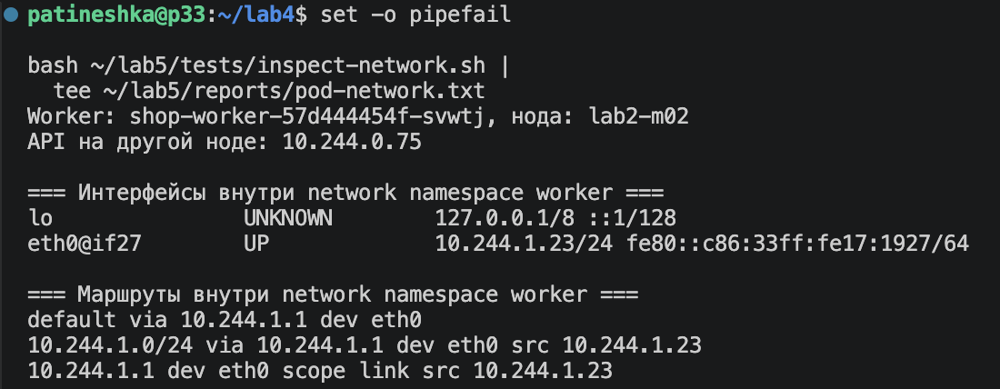

В этом запуске получила:

```text
Worker: shop-worker-57d444454f-svwtj, нода: lab2-m02
eth0@if27: 10.244.1.23/24
default via 10.244.1.1 dev eth0
```

`eth0` внутри Pod — один конец veth-пары. По `link_index` нашла второй конец на ноде:

```text
ifindex: 27
ifname: veth8d44bd4b
link_index: 2
info_kind: veth
```

У каждой ноды свой диапазон Pod IP: `10.244.0.0/24` у `lab2` и `10.244.1.0/24` у `lab2-m02`

### Запрос напрямую на другую ноду

Из worker на `lab2-m02` отправила запрос прямо на IP API, размещенного на `lab2`:

```text
URL: http://10.244.0.75:8080/health
HTTP: 200
Ответ: ok
```
Ok 🙂

## Часть 2 — Непрерывность при удалении Pod

### NodePort

В [values-networking.yaml](charts/shop/values-networking.yaml) добавила параметры Service API:

```yaml
api:
  service:
    type: NodePort
    port: 8080
    nodePort: 30080
```

Service получил ClusterIP `10.101.22.76`, а снаружи виртуалки запросы можно отправлять на IP нод и порт `30080`. Из Ubuntu проверила обе ноды `/health` вернул HTTP 200:

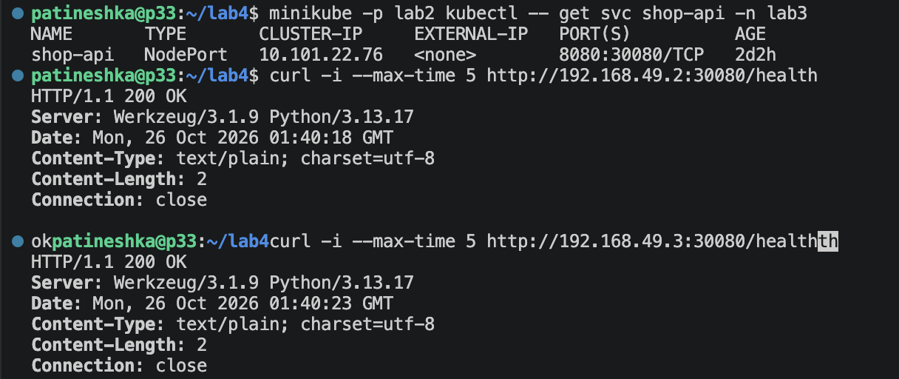

| Тип Service | Как обращаться |
|---|---|
| `NodePort` | Через IP ноды и выделенный порт. У меня это `192.168.49.2:30080` и `192.168.49.3:30080` |
| `LoadBalancer` | Через адрес внешнего балансировщика, который предоставляет облако или установленная реализация балансировки |
| Headless, `clusterIP: None` | Общего виртуального ClusterIP нет, DNS может вернуть адреса самих endpoint. Выбор адреса и переподключение тогда зависят от клиента |

### Время хаоса

Для постоянного клиента создала отдельный Pod `shop-client`. Его не включала в выборку удаляемых Pod, чтобы не останавливать сам измеритель

[tests/check-continuity.py](tests/check-continuity.py) каждую секунду последовательно создает два заказа (через DNS-имя Service и через NodePort чередуя обе ноды) Успехом считается только HTTP 201, ошибки и тайм-ауты записываются в JSONL. Повторных попыток, скрывающих неудачные запросы, в клиенте нет

Запустила клиент на пять минут:

```bash
minikube -p lab2 kubectl -- exec -i \
  -n lab3 shop-client -- \
  env DURATION_SECONDS=300 python3 -u - \
  < ~/lab5/tests/check-continuity.py |
  tee ~/lab5/reports/continuity-chaos.jsonl
```

Параллельно в другом терминале запустила [tests/chaos-pods.py](tests/chaos-pods.py):

```bash
python3 -u ~/lab5/tests/chaos-pods.py |
  tee ~/lab5/reports/chaos-events.jsonl
```

Скрипт работает четыре минуты, раз в пять секунд случайно выбирает готовый Pod API или worker и удаляет обычным `kubectl delete`. Если готовых реплик мало, пропускает шаг и оставляет минимум три API и один worker

В Deployment API добавила `preStop` с паузой 5 секунд. Это дает время убрать завершающийся Pod из маршрутизации до остановки приложения. Readiness исключает неготовые endpoint, а оставшиеся реплики продолжают отвечать

После эксперимента все новые Pod были готовы:

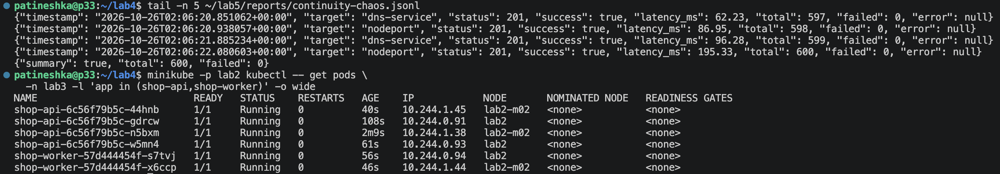

### График непрерывности

По журналам клиента и удалений построила один график:

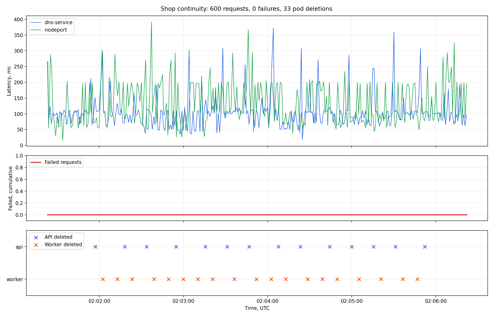

Сверху — задержки запросов через DNS и NodePort, посередине — накопленное число ошибок, снизу — моменты удаления API и worker. Все три панели используют общую шкалу времени

Итого получилась такая статистика: 
- Запросы через DNS - 300
- Запросы через NodePort - 300
- Всего запросов - 600 
- Ошибки - 0 
- Удаления API во время запросов - 14 
- Удаления worker во время запросов - 19 
- Всего удалений - 33 

Клиент не заметил смены Pod в этом прогоне 🙂 

### Как это работает

DNS возвращает клиенту стабильный адрес обычного Service. Service выбирает Pod по меткам, а контроллер EndpointSlice обновляет список адресов и готовность endpoint при создании и завершении Pod. Kube-proxy получает эти изменения и обновляет правила передачи трафика к backend

Клиент обращается к Service, поэтому ему не требуется заранее знать новый Pod IP. ReplicaSet восстанавливает число реплик, а readiness и оставшиеся готовые Pod позволяют пережить промежуток до запуска замены. Удаление worker также не равно остановке HTTP API, так как создание заказа и его последующая фоновая обработка находится на разных этапах

Проверила режим kube-proxy по логам:

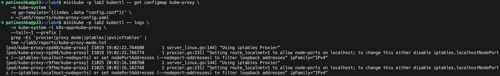

На обеих нодах получила `Using iptables Proxier`. Конфигурацию и логи сохранила в [kube-proxy-config.yaml](reports/kube-proxy-config.yaml) и [kube-proxy-mode.txt](reports/kube-proxy-mode.txt)

В режиме iptables Service обслуживают правила netfilter. IPVS использует механизмы виртуальных сервисов ядра и другую организацию балансировки. Разница в стоимости обновления правил и обработке трафика заметнее на большом количестве сервисов и endpoint

## Часть 3 — Целевая матрица доступа

До применения запретов спроектировала целевую матрицу:

| Источник | Назначение | Порт | Ожидаемо |
|---|---|---|---|
| `shop-client` | API | TCP 8080 | Разрешено |
| Тестовый клиент через NodePort | API | TCP 8080 | Разрешено |
| API | PostgreSQL | TCP 5432 | Разрешено |
| Worker | PostgreSQL | TCP 5432 | Разрешено |
| Клиент | Worker / PostgreSQL | TCP 8080 / 5432 | Запрещено |
| API | Worker | TCP 8080 | Запрещено |
| Worker | API | TCP 8080 | Запрещено |
| PostgreSQL | API / worker | TCP 8080 | Запрещено |
| Посторонний Pod | API / worker / PostgreSQL | Порты приложений | Запрещено |

Отдельно были учтены инфраструктурные соединения:

| Источник | Назначение | Порт | Зачем |
|---|---|---|---|
| API, worker, PostgreSQL, клиент | CoreDNS | UDP и TCP 53 | Разрешение имен |
| Prometheus из `monitoring` | API и worker | TCP 8080 | Сбор `/metrics` |
| API и worker | Jaeger из `monitoring` | TCP 4317 | Экспорт трейсов |
| Контроллер из `cnpg-system` | Instance manager PostgreSQL | TCP 8000 | Работа оператора |
| PostgreSQL instance manager | Kubernetes API | TCP 443 / 8443 | Работа с кластером |
| Gateway-адреса нод | API / worker / instance manager | TCP 8080 / 8000 | Health-пробы |

## Часть 4 — Включение zero-trust

### Подготовка endpoint и меток

Проверила CiliumEndpoint приложения и CoreDNS:

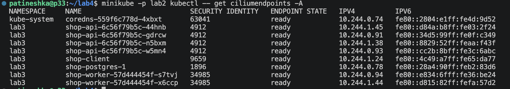

Чтобы разрешения мониторинга и оператора сопоставлялись с нужными Pod, посмотрела реальные метки Prometheus, Jaeger, CloudNativePG и DNS:

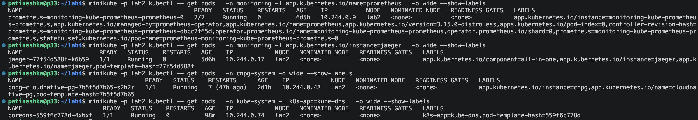

Затем пересоздала нужные инфраструктурные Pod, чтобы они тоже получили CiliumEndpoint:

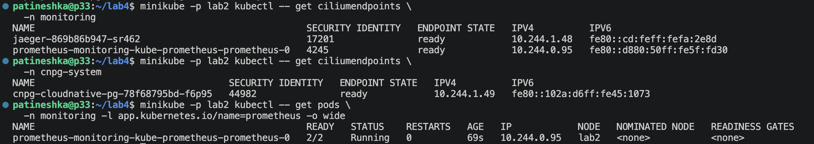

### Правила в Helm

Параметры политик находятся в [values-networkpolicy.yaml](charts/shop/values-networkpolicy.yaml). В нем задаются selectors, направления, порты и инфраструктурные исключения

Итоговые правила рендерит [templates/cilium-networkpolicies.yaml](charts/shop/templates/cilium-networkpolicies.yaml). Включаются они через `networkPolicy.enabled: true`, поэтому постоянные правила не применяла отдельным `kubectl apply`

Для namespace используется default-deny в обоих направлениях:

```yaml
endpointSelector:
  matchLabels: {}
enableDefaultDeny:
  ingress: true
  egress: true
ingress:
  - {}
egress:
  - {}
```

Остальные политики добавляют разрешения по меткам и портам. Для health-проб отдельно разрешены адреса `10.244.0.1/32` и `10.244.1.1/32` на нужных портах. Для NodePort учтены `host` и `remote-node`, а для внешнего клиента стенда `192.168.49.1/32`

Сначала одновременно использовала обычные NetworkPolicy и три дополнительных CiliumNetworkPolicy. Все объекты принимались:

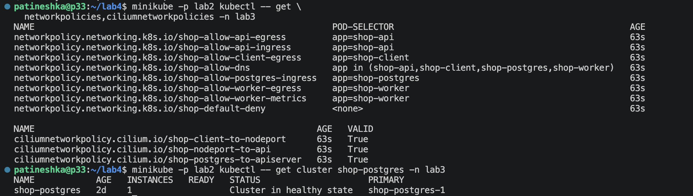

После включения правил появились тайм-ауты:

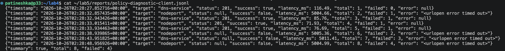

Дальше начинаются танцы с бубном:

Проверку проводила отдельными скриптами с восстановлением рабочих настроек. Сначала нашла блокировки health-проб, которые приходили с gateway-адресов, и добавила точечные разрешения. DNS и обращения к ClusterIP заработали, но NodePort продолжал отваливаться:

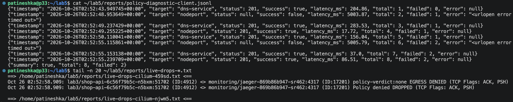

Hubble показывал исходящий SYN на 30080 как `EGRESS ALLOWED`, а клиент все равно получал тайм-аут:

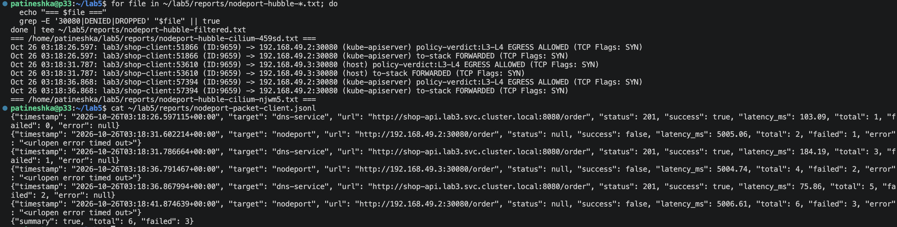

Сняла пакеты через tcpdump, проверила маршруты и счетчики iptables. Затем добавила временный TRACE только для TCP 30080. В трассировке обнаружилась дополнительная таблица `kindnet-network-policies`, в которой обычные NetworkPolicy в этом стенде обрабатывал и kindnet, а разрешения CiliumNetworkPolicy он не учитывал

Поэтому перевела правила приложения в CiliumNetworkPolicy. В финальном values `networkPolicy.policies: null`, а все 13 правил находятся в `ciliumPolicies`. После перехода короткая проверка DNS и NodePort дала запросы без ошибок

При преобразовании поймала еще одну ошибку: пустые списки `ingress: []`, `egress: []` у общей default-deny дали `VALID=False`:

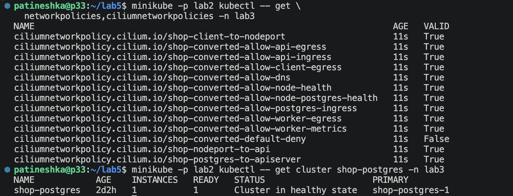

Исправила на списки с пустым правилом `[{}]`, после чего все 13 политик стали валидными. Итоговую проверку сохранила в [reports/final-state.txt](reports/final-state.txt)

## Часть 5 — Проверка матрицы доступа

### Разрешенные и запрещенные соединения

При включенных финальных политиках снова создала заказы через DNS и NodePort. Получила 60 запросов, 0 ошибок (Сохранила тут: [continuity-with-policies.jsonl](reports/continuity-with-policies.jsonl))

Затем проверила подключения: клиент → PostgreSQL и клиент → worker. Оба соединения завершились тайм-аутом, а Hubble подтвердил причину: `EGRESS DENIED` и `Policy denied DROPPED`

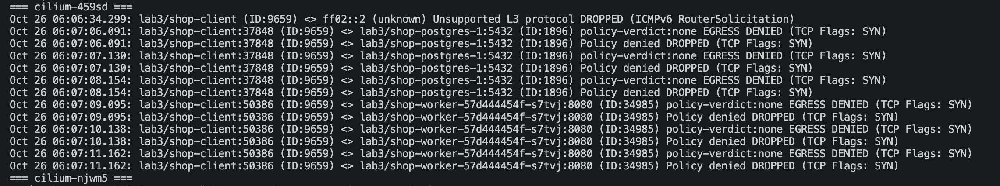

Из API и worker подключения к PostgreSQL проходили. Прямые подключения API → worker и worker → API блокировались:

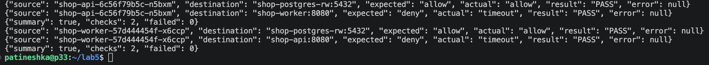

### Посторонний Pod

Создала `outsider` в отдельном namespace `lab5-outsider`. DNS-имена сервисов разрешились, но подключиться к API, worker и PostgreSQL у него не вышло:

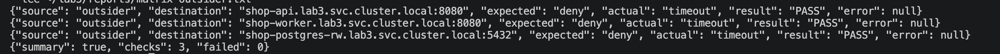

Hubble показал `INGRESS DENIED` для всех трех назначений:

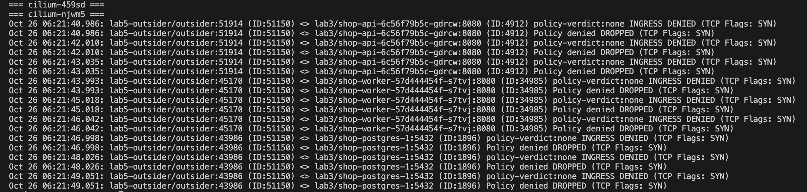

### Финальная проверка

Запустила [tests/check-full-matrix.py](tests/check-full-matrix.py), чтобы пройти целевые связи из всех четырех API, обоих worker, PostgreSQL, клиента и outsider

```bash
python3 -u ~/lab5/tests/check-full-matrix.py |
  tee ~/lab5/reports/access-matrix-full.txt


PASS | shop-api-6c56f79b5c-44hnb -> shop-postgres-rw:5432 | ожидаемо=allow, фактически=allow
PASS | shop-api-6c56f79b5c-44hnb -> shop-worker:8080 | ожидаемо=deny, фактически=timeout
PASS | shop-api-6c56f79b5c-gdrcw -> shop-postgres-rw:5432 | ожидаемо=allow, фактически=allow
PASS | shop-api-6c56f79b5c-gdrcw -> shop-worker:8080 | ожидаемо=deny, фактически=timeout
PASS | shop-api-6c56f79b5c-n5bxm -> shop-postgres-rw:5432 | ожидаемо=allow, фактически=allow
PASS | shop-api-6c56f79b5c-n5bxm -> shop-worker:8080 | ожидаемо=deny, фактически=timeout
PASS | shop-api-6c56f79b5c-w5mn4 -> shop-postgres-rw:5432 | ожидаемо=allow, фактически=allow
PASS | shop-api-6c56f79b5c-w5mn4 -> shop-worker:8080 | ожидаемо=deny, фактически=timeout
PASS | shop-client -> shop-api:8080 | ожидаемо=allow, фактически=allow
PASS | shop-client -> shop-worker:8080 | ожидаемо=deny, фактически=timeout
PASS | shop-client -> shop-postgres-rw:5432 | ожидаемо=deny, фактически=timeout
PASS | shop-postgres-1 -> shop-api:8080 | ожидаемо=deny, фактически=timeout
PASS | shop-postgres-1 -> shop-worker:8080 | ожидаемо=deny, фактически=timeout
PASS | shop-worker-57d444454f-s7tvj -> shop-postgres-rw:5432 | ожидаемо=allow, фактически=allow
PASS | shop-worker-57d444454f-s7tvj -> shop-api:8080 | ожидаемо=deny, фактически=timeout
PASS | shop-worker-57d444454f-x6ccp -> shop-postgres-rw:5432 | ожидаемо=allow, фактически=allow
PASS | shop-worker-57d444454f-x6ccp -> shop-api:8080 | ожидаемо=deny, фактически=timeout
PASS | outsider -> shop-api:8080 | ожидаемо=deny, фактически=timeout
PASS | outsider -> shop-worker:8080 | ожидаемо=deny, фактически=timeout
PASS | outsider -> shop-postgres-rw:5432 | ожидаемо=deny, фактически=timeout
{
  "started_utc": "2026-10-29T10:52:26.698035+00:00",
  "finished_utc": "2026-10-29T10:53:15.966708+00:00",
  "source_pods": 9,
  "checks": 20,
  "failed": 0
}
```

Итого: 9 Pod, 20 проверок, 0 ошибок - полная проверка матрицы проведена 🙂

Результаты сохранены в [access-matrix-full.md](reports/access-matrix-full.md) и [access-matrix-full.json](reports/access-matrix-full.json), события блокировок в [access-matrix-full-drops.txt](reports/access-matrix-full-drops.txt)

## Часть 6 — Скрытая поломка связности

Подготовила [tests/test-network-fault.py](tests/test-network-fault.py) с тремя вариантами:

| Вариант | Что меняется |
|---|---|
| `api-db` | Разрешенный исходящий порт API к PostgreSQL меняется с 5432 на 5433 |
| `worker-db` | Такое же изменение в исходящем правиле worker |
| `client-dns` | Клиент исключается из selector политики разрешения DNS |

Случайно выбирается один вариант, создается отдельный Helm values-overlay и применяется. Затем проверяется разрешенные связи и происходит сборка Hubble drops. В блоке `finally` восстанавливает исходные политики и повторяет матрицу

```bash
python3 -u ~/lab5/tests/test-network-fault.py |
  tee ~/lab5/reports/network-fault-run.txt
```

В этом запуске получила:

```text
API → PostgreSQL: allow, PASS
Worker → PostgreSQL: timeout, FAIL
Клиент → API: allow, PASS
```

Проблема локализовалась на связи worker с БД. Hubble показал блокировки обеих реплик worker:

```text
lab3/shop-worker-57d444454f-x6ccp → lab3/shop-postgres-1:5432
policy-verdict:none EGRESS DENIED (TCP Flags: SYN)
Policy denied DROPPED
```

Направление `EGRESS` указывает на исходящее ограничение, назначение и порт совпадают с PostgreSQL

Проверила созданный overlay: в `converted-allow-worker-egress` был разрешен 5433 вместо 5432 - так получилось отличить ошибку порта от недоступности самой базы и от входящего запрета

Скрипт в конце раскрыл сценарий `worker-db`. После возврата исходных значений worker снова подключился к PostgreSQL, повторная матрица из представителей ролей дала 10 успешных проверок. Позднее отдельно прошла финальная проверка всех 9 Pod из части 5

В этом варианте HTTP API мог продолжать принимать заказы, так как нарушена связь фонового обработчика с БД. В диагностическом прогоне фиксировала TCP-связность и drops, отдельную задержку обработки очереди не измеряла. Из трех подготовленных вариантов в сохраненном запуске выпал именно `worker-db`

## Часть 7 — Мониторинг сети

Использовала Prometheus, Grafana, Alertmanager и webhook receiver из второй лабы

ServiceMonitor API и worker остались шаблонами `shop`. Для Cilium и Hubble включила экспорт метрик и создание ServiceMonitor через параметры их Helm-чарта — [setup/cilium-metrics-values.yaml](setup/cilium-metrics-values.yaml). У всех ServiceMonitor задана метка `release: monitoring`, которую выбирает существующий Prometheus

```bash
helm upgrade cilium cilium/cilium \
  --version 1.20.4 \
  --namespace kube-system \
  --kube-context lab2 \
  --reuse-values \
  -f ~/lab5/setup/cilium-metrics-values.yaml \
  --wait --timeout 5m
```

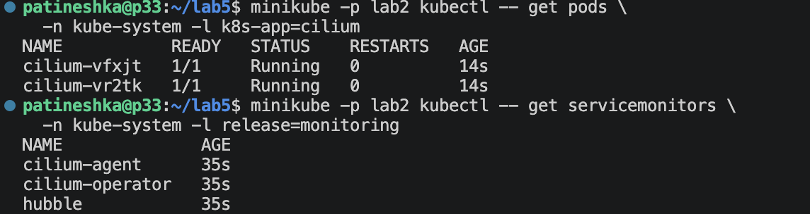

### Алерты

В [templates/network-prometheusrules.yaml](charts/shop/templates/network-prometheusrules.yaml) добавила отдельную группу `shop-network`:

| Алерт | Условие | Зачем |
|---|---|---|
| `ShopNetworkPolicyDrops` | Наблюдаемые POLICY_DENIED для трафика `lab3` продолжаются минуту | Обнаружить запрещенные обращения или ошибочное ограничение нужного соединения |
| `ShopDNSHighErrorRate` | Доля SERVFAIL и REFUSED выше 5% в окне 2 минуты, условие держится минуту | Обнаружить проблемы DNS-сервера или upstream |
| `ShopNetworkMetricsUnavailable` | Меньше четырех доступных целей agent/Hubble или отсутствуют все такие ряды, в течение минуты | Не принять отсутствие наблюдаемости за исправную сеть |

Для всех трех алертов указала `severity: warning`, `namespace: lab3`, `service: shop-network`

При настройке проверяла загрузку правил и отсутствие ошибок вычисления:

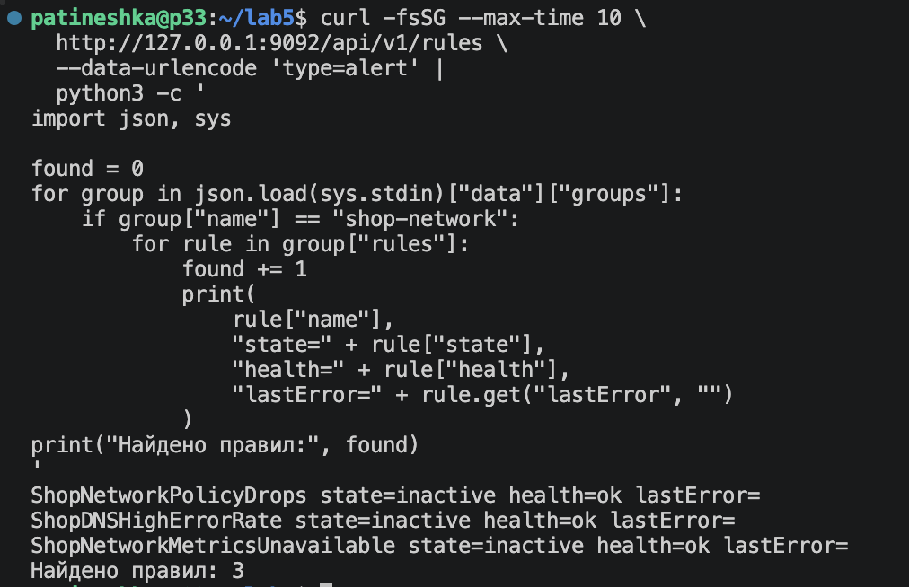

В течение трех минут клиент пытается подключиться к PostgreSQL, а политика блокирует эти соединения

```bash
minikube -p lab2 kubectl -- exec -i \
  -n lab3 shop-client -- python3 -u - \
  < ~/lab5/tests/trigger-network-alert.py
```

В Prometheus появился алерт `ShopNetworkPolicyDrops`. Через Alertmanager уведомление получил `lab2-webhook`. После прекращения запросов пришел `resolved`:

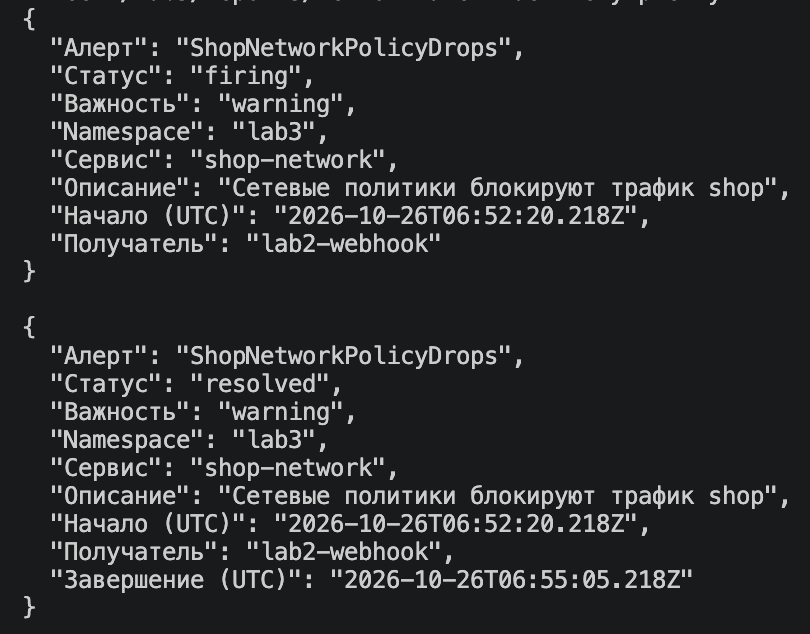

### Метрики и дашборд

Собрала дашборд с такими панельками:

| Панель | Источник | Что показывает |
|---|---|---|
| Блокировки политиками | `hubble_drop_total{reason="POLICY_DENIED"}` | Частоту наблюдаемых отбрасываний с источником или назначением в `lab3` |
| TCP-флаги | `hubble_tcp_flags_total` | Частоту SYN, SYN-ACK, FIN и RST, связанных с `lab3` |
| p95 обработки DNS | `coredns_dns_request_duration_seconds_bucket` | Серверную задержку CoreDNS |
| Ошибки DNS | `coredns_dns_responses_total` | Долю SERVFAIL и REFUSED |
| Доступные цели | `up` | Работает ли сбор метрик Cilium, Hubble и оператора |
| Состояние алерта | `ALERTS` | Находится ли `ShopNetworkPolicyDrops` в firing |

После запуска теста алерта на графиках выросла частота блокировок примерно до одного пакета в секунду, затем алерт перешел из 0 в 1. При этом сбор сетевых метрик оставался доступным, ошибок CoreDNS не наблюдалось:

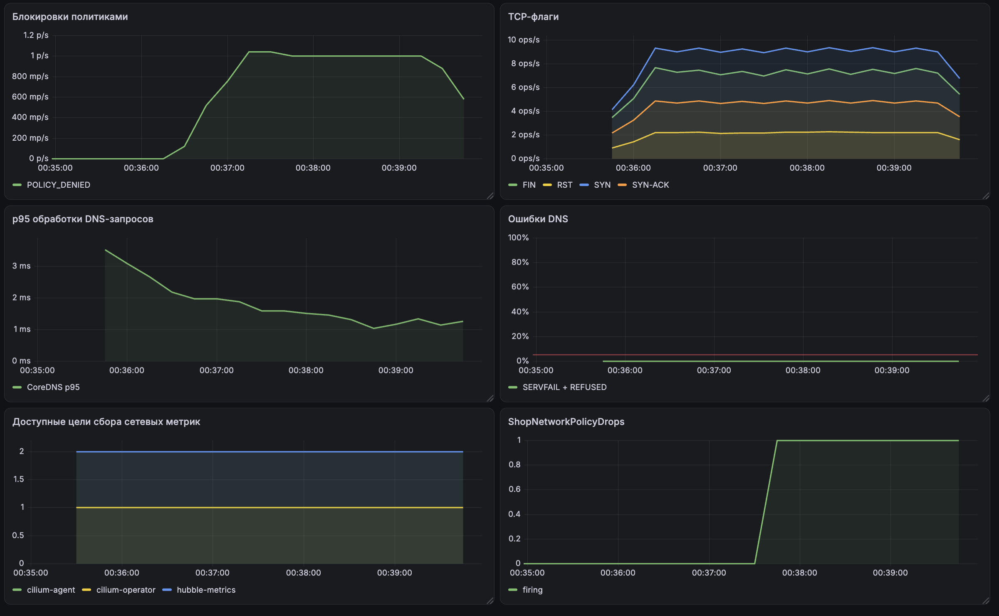

## Что получилось

Сделано много всего. Из интересного: сначала начала делать лабу ничего не было понятно, на середине посмотрела лекцию и все встало на свои места. Больше всего понравилось запрещать и разрешать подключение различный сервисов между собой 

## Топ ошибок

Давно такого не было и вот опять

1. **Считала, что kindnet не применяет политики.** Считала, что политики применяет только Cilium, но в трассировке нашла еще и `kindnet-network-policies`. Перевела правила приложения в CiliumNetworkPolicy, после чего тайм-ауты NodePort исчезли
2. **Сначала default-deny была невалидной.** После преобразования почти все политики были валидными, но у общей default-deny стояло `VALID=False`. Исправила пустые списки `[]` на `[{}]` в CiliumNetworkPolicy и дождалась `VALID=True` у всех 13 правил. Затем повторила разрешенные и запрещенные запросы: предыдущий успешный тест без действующей общей изоляции был недостаточен
3. **Вместе с лишними соединениями запретила health-пробы.** В матрице учла сервисы, но сначала упустила проверки kubelet. Hubble показал блокировки на 8080 и 8000 с адресов `10.244.0.1` и `10.244.1.1`, которые в этой конфигурации определялись как `world`. Это были gateway-адреса сети Pod, а не обращения из интернета. Добавила точные `/32` и нужные порты вместо разрешения для всего world
