# Лаба 7 — Сводка состояния сервисов для дежурного

В этой лабораторной решила собрать помощника для дежурного. За основу взяла предыдущие лабы с магазином `shop`, поэтому взяла знакомые сервисы: API, worker и PostgreSQL 🙂

Придумала команду ShopTeam, которая поддерживает небольшой интернет-магазин. Перед передачей смены дежурный вручную собирает последние проверки сервисов, ищет инструкции и пишет сводку. Автоматизировала эту подготовку: n8n запускает агента, он читает данные через MCP и сохраняет короткий отчет для человека

## Часть 1 — Кейс и стенд

Сводка помогает дежурному по приложению и дежурному по базе данных. В ней нужны состояние сервисов, обнаруженные проблемы, следующие действия и ответственные роли

Выбрала такой процесс:


Ручной запуск в n8n (надо бы это тоже автоматизировать, чтобы запускалось в определенное время, но пока так 🥲)

  → обычный Code-узел выбирает сценарий
  
  → HTTP-запрос к AI-агенту
  
  → агент вызывает инструменты двух MCP-серверов
  
  → локальная модель составляет сводку
  
  → MCP сохраняет Markdown-файл
  
  → результат возвращается в n8n


Все запустила на Mac через Docker Desktop (решила больше не мучать виртуалькой). Модель работает в Ollama, остальные компоненты в Docker Compose

Использовала учебные проверки, а не подключение к настоящему магазину. `outage` означает отказ в тестовых данных, контейнер PostgreSQL для этой проверки не останавливала

| Компонент | Для чего |
|---|---|
| n8n | Запуск workflow и передача сценария агенту |
| Ollama, Qwen3 4B | Локальная модель, которая выбирает инструменты и пишет сводку |
| agent | Цикл model → tool → model и экспортер метрик |
| status-mcp | Проверки трех сервисов в SQLite |
| runbooks-mcp | Инструкции из JSON-файла, ответственные роли и сохранение сводки |
| Prometheus | Сбор метрик и вычисление правил алертов |
| Grafana | Дашборд работы автоматизации |

## Часть 2 — Локальная модель и запуск

Установила Ollama и загрузила модель:

```bash
ollama pull qwen3:4b
```

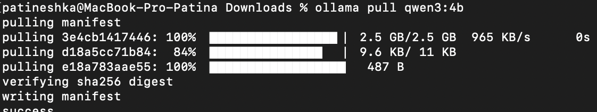

Проверила ответ модели (сколько рассуждений перед выводом одного слова...):

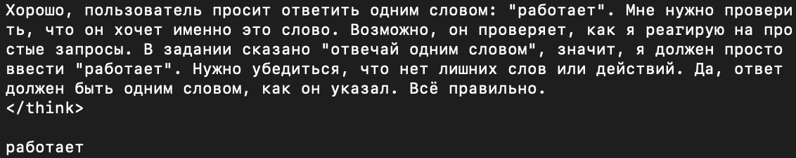

Запуск из папки `lab7`:

```bash
cd ~/Downloads/lab-repo/lab7
python3 tests/prepare-model.py
docker compose up -d --build
```

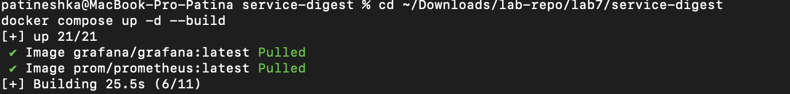

n8n сначала подняла отдельно, затем добавила остальные компоненты в тот же Compose:

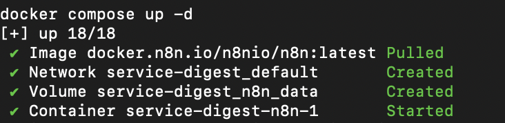

| Интерфейс | Адрес |
|---|---|
| n8n | `http://localhost:5678` |
| Grafana | `http://localhost:3007` |
| Prometheus | `http://localhost:9093` |
| Agent health | `http://localhost:8010/health` |

В n8n создала локальную учетную запись. Для подключения из контейнера к Ollama использовала `http://host.docker.internal:11434`

## Часть 3 — Два MCP-сервера и toolkit

Подняла два отдельных MCP-сервера через Streamable HTTP. Первый отдает проверки из SQLite, второй читает инструкции и сохраняет результат. Это разные контейнеры с отдельными MCP endpoint

| Инструмент | Сервер | Вход | Что делает |
|---|---|---|---|
| `get_service_checks` | status-mcp | `scenario`: healthy, outage или stale | Создает учебный набор, записывает его в SQLite и читает проверки сервисов |
| `get_runbook` | runbooks-mcp | `service` | Читает инструкцию для API, worker или PostgreSQL из `app/runbooks.json` |
| `get_oncall_contacts` | runbooks-mcp | -| Возвращает учебные роли дежурных и правило свежести данных |
| `save_digest` | runbooks-mcp | `filename`, `content` | Сохраняет Markdown в `reports/`, запрещает пути с каталогами |

Получилось четыре инструмента. Их описание агент получает через MCP `list_tools`, затем передает модели. Модель выбирает вызовы, агент выполняет их и возвращает результаты модели

Сам AI-агент реализован отдельным Python-сервисом, а не узлом AI Agent внутри n8n. n8n вызывает его по HTTP. Журнал реальных MCP-вызовов сохраняется в `reports/*-trace.json`

## Часть 4 — Skills и workflow

Правила агента описала в [skills/duty-digest.md](skills/duty-digest.md):

- Получить проверки, контакты и инструкции
- Проверить свежесть: данные старше пяти минут не подтверждают текущее состояние
- Разделять наблюдения и гипотезы, не придумывать причины отказа
- Для исправных сервисов не назначать лишние действия
- При устаревших данных запросить новые проверки
- Сохранить сводку через MCP, самостоятельно ничего не исправлять

В n8n добавила три узла: ручной триггер, Code с выбором сценария и HTTP-вызов агента:

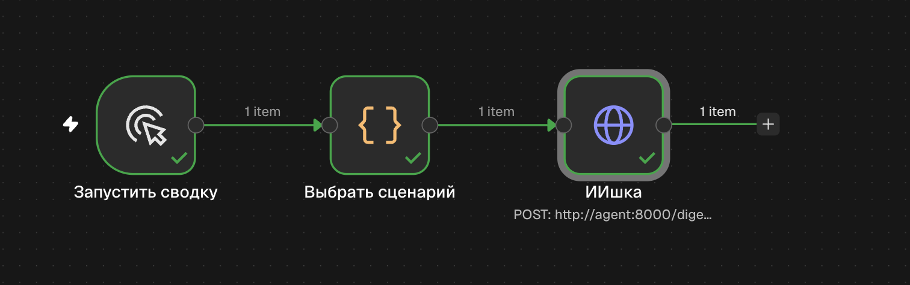

Сценарий меняла в Code-узле:

```javascript
return [{json: {scenario: 'healthy'}}];
```

HTTP-узел отправляет POST на `http://agent:8000/digest`. Ответ содержит имя сохраненного файла, сводку и вызовы инструментов

## Часть 5 — Проверка трех сценариев

### Отказ PostgreSQL

В `outage` проверки API и worker успешны, а PostgreSQL недоступен. Агент указал отказ БД, взял действия из runbook и обозначил возможное влияние на API/worker как гипотезу

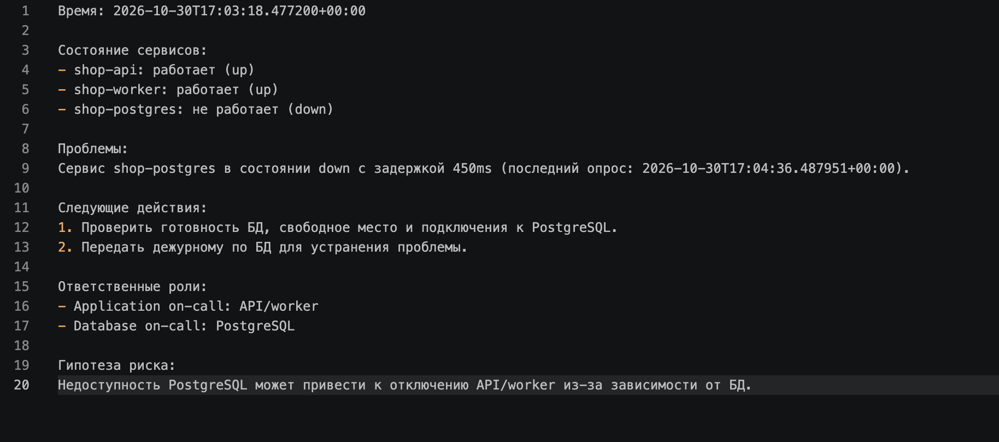

Сценарий завершился успешно: [результат](reports/outage-f396120a36.md)

### Все сервисы доступны

Переключила сценарий на `healthy`:

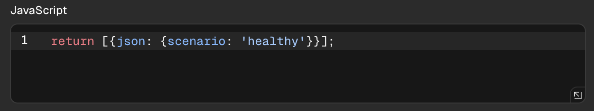

Агент отметил все сервисы доступными:

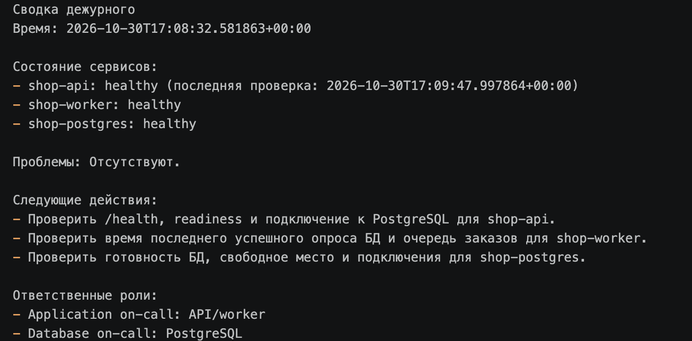

Но в действия перенес все проверки из runbook, хотя наблюдаемой проблемы нет... (лучше перебдеть, чем недобдеть видимо)

Дописала в skills: если все проверки свежие и успешные, вмешательство не требуется, нужно продолжить обычный мониторинг

### Устаревшие проверки

Выбрала сценарий `stale`, в котором источник возвращает проверки примерно тридцатиминутной давности

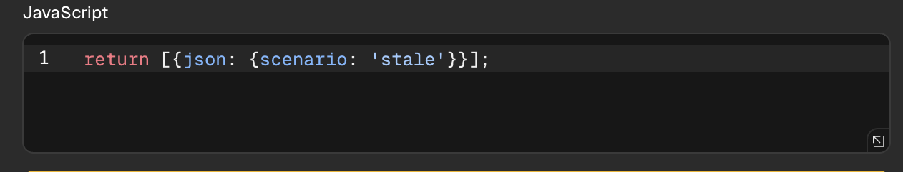

В первом результате агент заметил устаревание, но предложил диагностику PostgreSQL без доказательства его отказа:

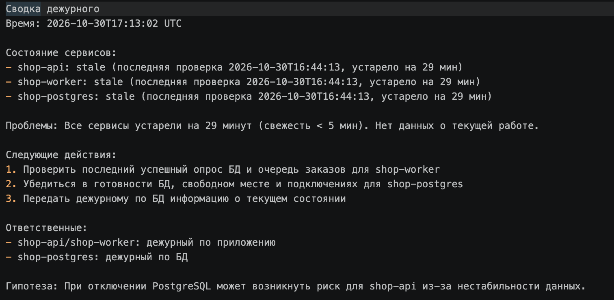

Уточнила в skills, что устарели данные, а не сервисы. Нужно получить свежие проверки и проверить сборщик, а не объявлять отказ базы

После повторного запуска основной вывод и следующие действия стали правильными:

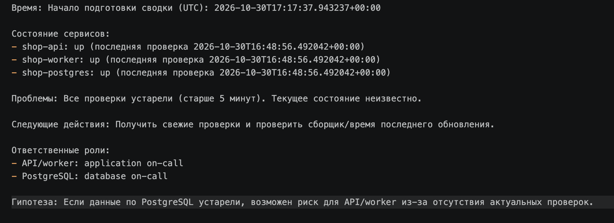

Сохранила [повторную сводку](reports/stale-671e2d0a0a.md) и [журнал вызовов](reports/671e2d0a0a-trace.json)

## Часть 6 — Мониторинг

Добавила на дашборд четыре графика:

| График | Метрика | Зачем |
|---|---|---|
| Обработанные сводки | `digest_runs_total` | Видеть успешные и ошибочные запуски по сценариям |
| p95 времени подготовки | `digest_duration_seconds_bucket` | Следить, сколько дежурный ждет результат |
| Доля технических ошибок | `digest_runs_total{status="error"}` относительно всех завершений | Выявлять поломку автоматизации |
| Вызовы MCP | `digest_tool_calls_total` | Видеть использование инструментов и ошибки вызовов |

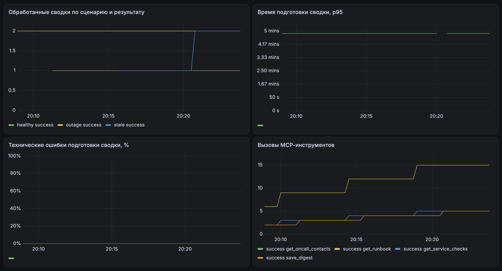

### Алерты

Сформировала такие правила: 

| Алерт | Условие | Обоснование |
|---|---|---|
| `DigestFailures` | Рост счетчика технических ошибок за 10 минут | Сводка не подготовлена: проверить Ollama, MCP и логи агента |
| `DigestSlow` | p95 больше 180 секунд в течение двух минут | Дежурный слишком долго ждет результат: проверить нагрузку и генерацию |
| `DigestAgentUnavailable` | `up=0` больше минуты | Сам агент недоступен, новые сводки не появятся |

Доставку уведомлений не проверила(
Правила находятся в [monitoring/alerts.yml](monitoring/alerts.yml) и подключены к Prometheus
